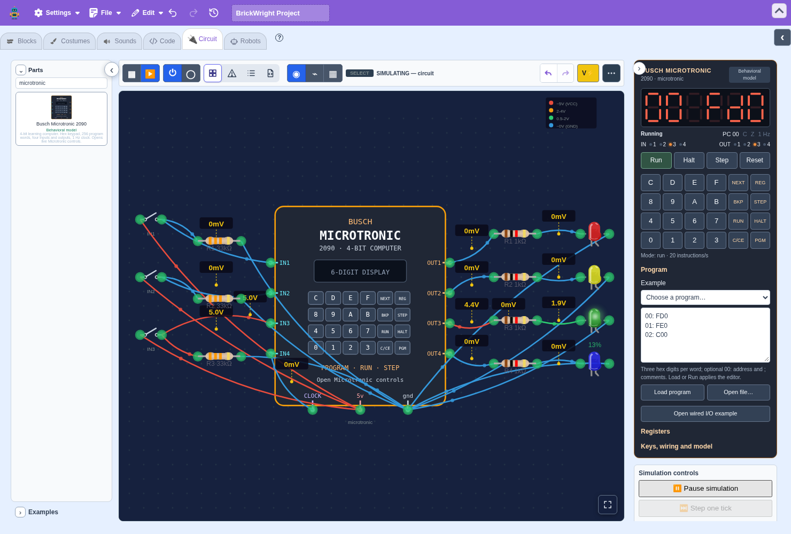

# Microtronic Circuits qualification — 2026-11-25

## Current disposition

The Microtronic learner-instruction model and Circuits panel are implemented,
tested together in the production application, and merged into their owning
engine and UI repositories. Brickwright main adopted those same package pins
in [PR #1845](https://github.com/CrispStrobe/brickwright/pull/1845).

The remaining host acceptance work is in
[PR #1846](https://github.com/CrispStrobe/brickwright/pull/1846). Its release
qualification is blocked: the gallery example needs its canonical upstream
source, and full host CI exposes failures outside the focused Microtronic
checks. The actual working gallery is preserved. No failing gate, historical
seal, reviewed baseline, or vendor-identity rule is waived.

The public sites are not evidence of the new integration. At
2026-11-25 22:33 UTC, both the
[Vercel build manifest](https://brickwright.vercel.app/brickwright-build.json)
and [Pages build manifest](https://crispstrobe.github.io/brickwright/brickwright-build.json)
still identified commit `6e8f065`, built on November 15. This record does not
claim a new public deployment.

## Exact tested identities

| Surface | Identity and evidence |
| --- | --- |
| Engine | `cc18f3c8d84d68e008450e65ddf838b8ec03c7f7`; [Board PR #768](https://github.com/CrispStrobe/bw-board/pull/768), merged. |
| Panel and circuit UI | `0a1b15edb0daecd723c7c07126450d84b86e3e68`; [UI PR #174](https://github.com/CrispStrobe/bw-circuit-ui/pull/174), merged. The merge commit has the identical qualified tree. |
| Production browser run | Local commit `830b2b5fe11c440ed17d780a1c388a503fe99a91`, tree `5679ffc8b971c48bdee9434d4aa1901e474922bc`. Published host commit `ad492c7ac87d2ca393e0da9ceed4d96a3da16563` has that exact tree. |
| Build settings | `NODE_ENV=production`, `BW_ENABLE_CAD=1`, `BW_ENABLE_FPGA=1`; build manifest dated `2026-11-25T21:26:08.770Z`. |

The root and GUI installations were compared with the exact Git/npm-pack
supplier payloads. They resolve one engine. Notices, mirrors, generated
current-pin records and emitted broker proof passed their normal checks.

The review candidate also preserves the newer main branch's CAD SDK update and
adds the small part-profile correction described below. The recorded browser
result applies to the exact tree in this table; it is not represented as a
full-build result for those later changes.

## Observed application behavior

The [machine-readable browser receipt](receipts/busch-microtronic-browser.json)
records **10 passed checks, zero page errors and zero failed requests**.
The verifier uses the real application UI and real circuit solver. It does not
inject a mock designer, directly drive a test-only device API, or manually
advance simulated time.

The run placed the computer from the palette, used its 24-key panel, loaded
learner programs from the editor and a file, and rejected an invalid draft
without losing the accepted program. Physical switches drove the input nets;
the running `DIN`/`DOT` loop supplied current to the external LEDs. An explicit
wire from `CLOCK` to `IN4` changed the observed input/output value between
13 and 5. Opening a switch extinguished its corresponding LED.

Halt, Step and Reset worked with the shared simulation clock. NEXT committed a
keypad-entered word. An unloaded editor draft survived live rerenders. The real
File menu downloaded and reopened the circuit, preserving wiring and accepted
program; the restored halted computer ran again.

The unchanged gallery/CAD browser verifier also passed against that same
CAD-enabled production build: both artwork cards, gallery entry, live I/O,
clock transitions and edited-program persistence.

The screenshot shows the complete application with the wired computer, a lit
external LED, live circuit voltages and the front panel. Its SHA-256 is recorded
in the browser receipt.

## Other completed checks

| Check | Result and scope |
| --- | --- |
| Board supplier CI | [Run 45688117968](https://github.com/CrispStrobe/bw-board/actions/runs/45688117968): test, vectors, corpus and vectors186 all green on the adopted commit. |
| UI supplier CI | [Run 45691768452](https://github.com/CrispStrobe/bw-circuit-ui/actions/runs/45691768452): test, interaction-gate and kicad-oracle green. |
| Focused host integration | 55 checks passed earlier; the three installed-package Microtronic electrical/save-load checks passed again after the part-profile correction. |
| Debugger contracts | 529 local checks passed. Host [debugger workflow 45705080964](https://github.com/CrispStrobe/brickwright/actions/runs/45705080964) is green at `ad492c7`. |
| HDD/history controls | 132 local controls passed, including unchanged historical seals and meaningful negative probes. Host [HDD controls 45705080892](https://github.com/CrispStrobe/brickwright/actions/runs/45705080892) are green at `ad492c7`; historical execution jobs were not selected. |
| Pin-history scan | 46 checks passed on the published `ad492c7` commit; 14,170 files scanned, no stale references or unreadable files. This overlaps the history controls above and is not an additional aggregate count. |
| Production build and corpus | Both jobs passed in [host run 45705080927](https://github.com/CrispStrobe/brickwright/actions/runs/45705080927). Other jobs in that run failed or remained pending. |
| Adjacent hosted checks | [CP1 browser](https://github.com/CrispStrobe/brickwright/actions/runs/45705080898) and [PXT controls](https://github.com/CrispStrobe/brickwright/actions/runs/45705080849) passed at `ad492c7`. |

Five inherited HDD/debugger source-reader failures were repaired in a separately
claimed narrow lane. The fixes preserve workflow policy, runtime behavior,
historical producer/reader bytes and negative assertions. Their details remain
in the host PR and `lanes/2026-11-25-microtronic-host-ci-controls.md`.

## Remaining integration and release blockers

### Gallery source ownership

The incoming main branch added the working example directly to the consumer's
gallery. `sb3-creator` is the canonical source for that tree. The existing
[vendor check](https://github.com/CrispStrobe/brickwright/actions/runs/45705080944)
therefore correctly reports a stale index and three orphan Microtronic files
against the current SB3 pin, `1c29f69fd22c86ecb0051938eedb246921cb3b88`.

The separate [upstream draft PR #237](https://github.com/CrispStrobe/sb3-creator/pull/237)
adds the same three files byte-for-byte,
the required expectations, canonical registration and generated enrollment.
The Microtronic instruction-rate observer uses the public Run control and a
sufficient simulation interval; existing parameter assertions remain intact.
All eight switch combinations and both clock phases passed an independent
electrical check, including LED current, halt, reset and saved-program behavior.
A rate-ignoring mutation fails the retained parameter observation.

The original upstream baseline at `61e9e8cbafb7868c9f1c2e467fceedc866ce7dcb`
already had analog/CP1 observer, metadata and quantitative failures. Its
[baseline run 45669855752](https://github.com/CrispStrobe/sb3-creator/actions/runs/45669855752)
is retained rather than called green. Newer upstream fixes at `b76c34e3` are
preserved in the draft, including its Board test pin
`e744ede765c76ce15b9e5c101aa23f56210eab09`. Only the still older UI test input
moves to the qualified `0a1b15ed` version. The focused new-example checks also
pass with that retained Board input; the host pins stay unchanged.

All 792 incoming EXPECTED pages and 796 existing catalog/enrollment entries
are preserved. Full qualification and corpus provenance remeasurement for the
new UI input remain pending. Publishing a blocked draft permits review; it
does not authorize merging, adopting an unqualified source pin, or hand-restamping
the wider corpus's provenance pages.

### Part capability registry

The full registry gate found fourteen uncatalogued kinds, including the new
Microtronic. The review candidate adds `busch-microtronic` to the existing
`host` category: its learner program runs through the Circuits panel, and it
has no Code-tab compiler target or hardware-emission verb. The generated
profile document and generated package mirror agree with that source.

After this correction, four of the five existing registry checks pass. The
unchanged all-devices coverage assertion still reports the other thirteen
kinds: `bending_ruler`, `cd4046`, `ceramic_filter`, `coil_pendulum`, `dipole`,
`dual_gate_mosfet`, `fm_if`, `humidity_comb`, `induction_loop`, `kosmos-cp1`,
`ptc_sensor`, `sa612`, and `spark_gap`. They were already registered in the
preceding Board pin. They have not been assigned speculative capabilities or
excluded from coverage.

### Wider host qualification

The [host CI snapshot](receipts/busch-microtronic-host-ci-ad492c7.json)
records the exact failing tests, source blob identities and pending jobs at
22:49 UTC. It observed 41 ordinary failed unit tests across shards 1, 2, 4, 6
and 7, plus the gallery and Arcade dependency-witness failures. Three selected
unit jobs were still running, so
this is an explicitly incomplete census, not a final CI verdict.

The remaining findings concern stale extracted CP1/ESP32/Robot/paste fixtures,
File-listener and Board-start source readers, hardcoded translated strings,
already stale corpus/gallery counts, a sealed resonance source mismatch,
broker-copy source matching, and a binary `.pack` classified as text. Further
failures concern CP1 teaching netlist declarations, old UI source/layout
expectations, historical workflow readers and an incomplete CI-workflow census.

The Arcade job stops before browser acceptance because its held hash for the UI
package manifest matches neither the immutable previous supplier nor the new
supplier. The exact held, old and new hashes and unchanged workflow source are
recorded in the snapshot. This is a stale witness finding, not a claim that
Arcade's browser acceptance ran successfully.

The motor schematic mismatch was separately reproduced using both the immutable
previous UI supplier and the Microtronic supplier. Both renders and the normal
installed-package render are byte-identical. Their twenty renderer/model module
blobs are also identical. The golden differs only in four coordinates of one
wire detour; it has not been restamped. The
[comparison receipt](receipts/busch-microtronic-schematic-baseline-comparison.json)
records all source identities, hashes and the complete reproduction command.
The renderer uses its own `AuditBoard`, so the Board runtime pin does not affect
this comparison. This additional check establishes the mismatch as inherited.

The snapshot compares the relevant host inputs at pre-feature commit
`3b85b7524a779bdffcfa743dec491e9aac02a61e`, the earlier feature head and
`ad492c7`. The compared host files are identical. The Microtronic example adds
one circuit to an already failing count, 1946 → 1947 versus the old expectation
of 1650. Source identity establishes the scope of the change; it is not a claim
that an unrun or cancelled baseline CI job passed.

`lanes/PROTOCOL.md` requires selected qualification checks to pass before
landing. These failures therefore keep the remaining host work and upstream
gallery adoption blocked. No unchanged CI run was retried to obtain a better
result, and no historical source hash or screenshot baseline was replaced to
silence a failure.

## Reproduction and next phase

The [usage guide](BUSCH-MICROTRONIC.md) contains the three-word input echo
program and the production build/browser commands. The panel's **Open wired
I/O example** provides a working experiment independent of the pending gallery
source transaction.

This phase is the documented learner-ISA behavior model. Native TMS1600
execution, monitor firmware, display scanning and cassette transfers remain
later work. No original ROM, disassembly, third-party emulator implementation
or copied manual artwork was imported. The hardware-address discrepancy in the
supplied SRAM drawings is recorded in the usage guide for that later phase.
