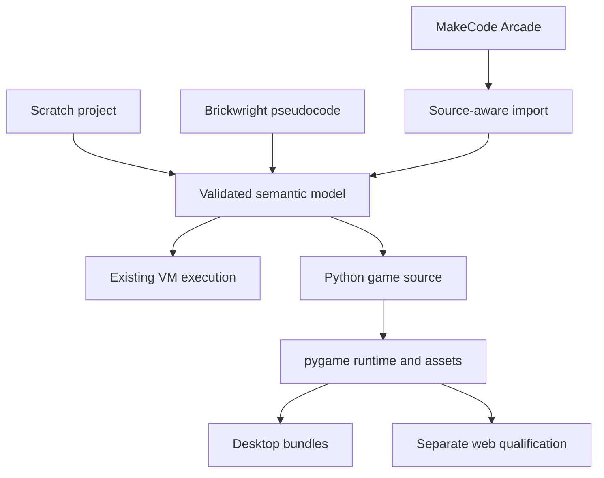

# Code execution and game export (Python and JavaScript)

Status: implementation candidate, with the initial bounded evaluation, console
sessions, scoped JavaScript tasks and authored-document integration recorded.
Section 8.3 records the next milestone and its remaining landing dependencies. Hosted qualification and
supplier adoption remain pending. Recorded 2026-11-27 at the
repository owner's request. This document is an implementation plan, not a
claim that new runtimes or standalone exporters have shipped.

Source baseline: [`14de1c42bd2e2ea84086a2162d1eff1fdbbac20d`](https://github.com/CrispStrobe/brickwright/tree/14de1c42bd2e2ea84086a2162d1eff1fdbbac20d).
At that baseline, the reviewed Code tab files are unchanged from `0aa915915c4f73ad13c851cdb7d7c14b74861433`.
The [evaluation lane](../lanes/2026-11-27-code-runtime-game-export-evaluation.md)
owns documentation and bounded probes only. Follow-on implementation needs its
own claim and the existing upstream ownership rules. The first bounded consumer
implementation is tracked in the [worker ownership lane](../lanes/2026-11-27-code-worker-ownership-and-javascript-plan.md)
and section 8.1 below; section 8.2 records the explicitly claimed task continuation.
Neither closes the complete R1/R2/J1 milestones.

## 1. Decisions to evaluate

1. Make the Code tab preserve authored source and run the exact visible program
   with an explicit language, runtime and target.
2. Compare the existing Skulpt runner with direct MicroPython/WebAssembly and
   Pyodide, using the same programs and execution-service contract. Keep runtime
   selection provisional until compatibility, startup and platform evidence exists.
3. Reuse the useful ideas in Simon Willison's pwasm without assuming that pwasm
   itself is a browser Python loader.
4. Develop a separately qualified export path from supported MakeCode Arcade,
   Scratch and Brickwright pseudocode projects to editable Python + pygame,
   followed by optional standalone packaging.
5. Qualify JavaScript as a common browser/WebView execution and web-game export
   target, with an owned worker lifecycle, shared simulator/game semantics,
   offline web/PWA artifacts and separately built native packages. Reuse the
   existing Tauri architecture; evaluate a second desktop shell only for a
   demonstrated requirement. See [the JavaScript chapter](#9-javascript-execution-and-game-export-across-platforms).

These are related but distinct products. A Python interpreter does not supply
Scratch/Arcade sprite, event, audio or physics semantics. pygame requires its own
CPython-compatible runtime and game adapter. A working Python program also need
not be convertible back to blocks.

This extends [PLAN milestones 4, 5 and 9](../PLAN.md) and the existing
[language/device matrix plan](LANGUAGE-DEVICE-MATRIX-PLAN.md). Preserve their
completed work and the existing Arcade qualification boundaries.

## 2. What exists and what the review found

The primary implementation is
[`pseudocode-importer.jsx`](https://github.com/CrispStrobe/brickwright/blob/14de1c42bd2e2ea84086a2162d1eff1fdbbac20d/overlay/scratch-gui/src/components/tw-pseudocode/pseudocode-importer.jsx).
The file combines editor state, conversion, execution, device routing, examples,
debugging and persistence. Generic Python already runs through Skulpt; adding
Python execution is therefore an improvement to an existing capability.

| Area | Observed behavior at the source baseline | Required change |
| --- | --- | --- |
| Generic Python | Skulpt with Python 3 mode; ordinary programs use a new worker with a four-second timeout | Expose the actual runtime and its compatibility; retain an owned execution session |
| Interactive Python | A regular expression detecting `input(` switches to main-thread execution | Keep execution in a worker; route input requests and replies through a documented protocol |
| Target routing | `currentDevice()` reads a `DEVICE` directive from the pseudocode buffer, while `setActiveCode()` clears other language buffers | Persist target independently from a disposable projection; test editing Python before Run |
| Pico execution | `runPicoSim()` regenerates MicroPython from pseudocode | Pass the selected source explicitly; distinguish executing authored Python from generated firmware code |
| Other Python routes | micro:bit/Calliope firmware and SPIKE/block/VM paths have specialized semantics | Describe each route accurately; do not label every path CPython or native Python |
| Tab switching | `deriveBuffer()` extracts generated text without retaining conversion diagnostics | Retain the report and source mapping; do not silently promote an approximate projection to source |
| Persistence | Autosave stores the active language and text; switching/editing can clear other buffers | Version the authored-source model and generated revisions, and preserve source on failed conversion |
| Worker ownership | Generic worker handles are local; completion/error/timeout terminate them, but global Stop/unmount lacks a common owned session | Add Stop/Reset, teardown, stale-message rejection, output streaming and cleanup |
| JavaScript | Worker sends completion after invoking `new Function`; generated async IIFEs are not awaited | Define an async execution contract and completion semantics, with an actual completion handle |
| Editor responsiveness | CodeMirror sends complete text on changes; `fromBlocks()` eagerly generates multiple languages | Measure before changing; derive the requested language first and cache by project revision/options |
| Generated game behavior | Generic Python/JS shims print `say`/`think` and stub other operations | Supply a real target runtime before claiming game execution or export fidelity |

Existing protections must remain: compile request/source ownership checks,
failed-conversion source retention, save-time editor flushing, lazy CodeMirror
loading and the existing conversion ownership tests. This plan does not replace
those controls with a new editor or duplicate the simulator.

### 2.1 Semantic defects that precede a new runtime

The current
[`sb3-creator-python.js`](https://github.com/CrispStrobe/brickwright/blob/14de1c42bd2e2ea84086a2162d1eff1fdbbac20d/overlay/scratch-gui/src/lib/sb3-creator-python.js)
reader was exercised with programs in its supported entry-point form. Observed
results include:

| Python input | Current emitted pseudocode | Consequence |
| --- | --- | --- |
| `x = 7 // 2` | `set x to (7 / 2)` | Floor division changes into ordinary division |
| `x = 3` then `x *= 2` on a new line | Set to 3, then change by 2 | Multiplication assignment changes into addition |
| `x = 8` then `x /= 2` on a new line | Set to 8, then change by 2 | Division assignment changes into addition |
| `break` / `continue` | Statements omitted | Loop control changes |

These cases returned no warnings in the review probes. Enabling a strict flag
alone cannot repair a construct that is silently accepted. Implement the exact
semantics where representable, otherwise refuse with a source span and a concrete
explanation. Add differential behavior fixtures, not tests that merely reproduce
the current text output. Cover negative operands, nested loops and side effects.

The shared reader/emitter belongs to `sb3-creator`. Repair it upstream and adopt
the exact reviewed pin; keep `overlay/` and generated `packages/` mirrors identical
under [the vendoring regime](VENDORING-REGIME.md). Do not introduce a private
compiler fork to accelerate this roadmap.

### 2.2 Further reproduced execution risks

- Editing Python after a pseudocode `DEVICE pico` declaration can erase the
  buffer used to identify the target and select generic execution instead.
- A string containing `input(` can select the main-thread route, while calling
  an alias of `input` can remain in the worker route with its empty input stub.
- A JavaScript program that schedules output after an `await` can lose that
  output because the worker reports completion and is terminated first.

Acceptance requires running these behavioral fixtures through the real revised
entry points. Do not infer that a source-pattern check alone qualifies the fix.

## 3. Runtime alternatives and pwasm

| Candidate | What it provides | Main reason to evaluate | Boundary |
| --- | --- | --- | --- |
| Existing Skulpt | Python implementation in JavaScript already used by the Code tab | Migration baseline and existing browser integration | Python 3 mode does not imply full current CPython/library compatibility |
| Direct MicroPython/WASM | A small Python implementation compiled to WebAssembly, called directly from JS | Lightweight learning/robotics execution and explicit MicroPython dialect | Different language/library behavior from CPython; board modules require adapters |
| Pyodide | CPython compiled for the browser, with supported WASM packages | Broader Python compatibility and optional scientific packages | Larger runtime; desktop native wheels and OS APIs do not automatically work |
| pwasm host | A Python-hosted WebAssembly interpreter/compiler with bundled guests | Reference for capability registration, resource accounting and optional host tools | Requires an outer Python interpreter; not the direct browser bootstrap |

### 3.1 Why pwasm is not the default browser execution layer

At reviewed pwasm commit
[`3398e812b0fffe4db8dbf1eb2df2d7b60ec7dad7`](https://github.com/simonw/pwasm/tree/3398e812b0fffe4db8dbf1eb2df2d7b60ec7dad7)
(0.2a0), the host is Python 3.10+ and the bundled MicroPython guest is a custom
WASI embed build. Running the entire package in a browser would first need an
outer Python implementation, then pwasm, then the guest. Direct MicroPython/WASM
or Pyodide avoids that additional interpreter layer.

Useful ideas to reuse are named host functions, JSON-shaped arguments/results,
an explicit capability list, resource limits, and discarding a failed guest.
The reviewed MicroPython guest is 286,631 bytes raw; that is one custom binary,
not the download size of a complete browser integration. Its host imports and
WASI/Emscripten exception plumbing are not interchangeable with the official
MicroPython browser loader.

pwasm's fuel and deadline checks live in its host engine. Instantiating its guest
directly in a browser does not preserve those checks. Its registered host calls
are synchronous; async input, device communication and UI dispatch still need a
designed bridge. WASM linear-memory limits do not bound all browser/host memory,
and a long host callback is not preempted by a guest deadline. Treat the project
as experimental, and qualify any use separately. See
[pwasm](https://github.com/simonw/pwasm) and its
[MicroPython host implementation](https://github.com/simonw/pwasm/blob/3398e812b0fffe4db8dbf1eb2df2d7b60ec7dad7/src/pwasm/guests/micropython.py).

### 3.2 Platform and compatibility policy

Use the released, non-JSPI MicroPython build as the initial portability baseline.
The released v1.29.0
[WebAssembly port](https://github.com/micropython/micropython/blob/v1.29.0/ports/webassembly/README.md)
has JS module registration and async execution APIs. Newer development browser
builds using JSPI are separate candidates, not proof of support on older WebViews.

Pyodide supports
[workers](https://pyodide.org/en/stable/usage/webworker.html), but worker placement
does not make synchronous Python `input()` automatically asynchronous. Evaluate
explicit async input and, where available, shared-memory or JSPI integration.
Graceful interruption can require `SharedArrayBuffer` and cross-origin isolation;
worker termination must remain the fallback. Pin runtime assets and their lock
metadata; do not ship a production dependency on a floating CDN `latest` URL.

| Host | Intended baseline | Evidence required before a support claim |
| --- | --- | --- |
| Desktop browsers | Worker-based Skulpt/MicroPython/Pyodide candidates | Supported Chromium, Firefox and Safari versions; CSP, caching, offline and input/Stop |
| Windows native shell | Same worker service in WebView2; optional future native CPython adapter | Installed app on the supported Windows/WebView2 floor |
| Linux native shell | Same worker service in WebKitGTK; optional future native CPython adapter | Supported distro/WebKitGTK floor and packaged asset loading |
| macOS native shell | Same worker service in WKWebView | Supported macOS/WKWebView floor, native packaging and lifecycle |
| Android | Browser/system WebView path first | Representative low-memory device, background/resume and actual WebView version |
| iOS/iPadOS | WKWebView/browser path, feature-detected | Oldest supported device/OS, memory pressure, lifecycle and current runtime requirements |

The application currently declares an iOS 15 / macOS 12 minimum in its native
configuration. Upstream Pyodide's browser baseline and new JSPI variants must be
reconciled with those floors. A passing current Chromium test does not qualify
these platforms. Do not silently increase the app's OS minimum to install a new
runtime. Native desktop CPython is a possible advanced adapter, not a universal
mobile sidecar; native mobile embedding is a separate build/distribution project.

Workers provide responsiveness and a termination boundary, not a complete
security sandbox. Define the project's trust model, allowed imports, network and
filesystem access, JS FFI and native-command exposure. Keep native/device actions
behind explicitly registered capabilities and validated messages. A restricted
bridge must not be advertised as a restriction on arbitrary Python JS access if
the selected runtime still exposes that access.

## 4. Code tab architecture and user experience

### 4.1 Authored source and projections

Persist a versioned record containing authored text/language, runtime/dialect,
target, source revision, dependency manifest and conversion options. Keep that
source distinct from generated projections and the selected visible tab. Retain
each projection's originating revision and diagnostics; recompute only when its
inputs change. If multiple authored documents are allowed, preserve them as
documents rather than pretending they are always equivalent translations.

Conversion results need `exact`, `changed`, and `unsupported` outcomes with spans,
source maps and explanations. Existing `preserved`/success reporting is not an
equivalence proof. Show why a conversion cannot be applied, retain the source,
and provide an explicit preview/apply flow for lossy conversion. Python that runs
successfully can remain intentionally nonconvertible to blocks.

Preserve editor selection, scroll and undo history appropriately. Display the
runtime and Run target, diagnostics at the relevant lines, and useful completion
for the supported Brickwright APIs. Give changed source an honest generated-view
indicator. Keep implementation/package details out of normal learner flows.

### 4.2 One execution service

A run request must carry `{source, language, runtime, target, sourceRevision}`.
No adapter may infer the selected program or target from an unrelated emptied
language buffer. Separate editor/session state, conversion, execution and target
adapters out of the large component incrementally.

The service owns a run ID, worker/runtime handle, lifecycle, budgets and cleanup.
Its protocol supports ready/run/output/error/input-request/input-reply/complete/
stop/reset events. Reject stale replies after Stop or a newer run. Stream output
in bounded batches, cap excessive output, and retain useful source-line errors.
Stop must terminate a CPU-bound program, cancel outstanding input and device
requests, and leave a clean next run. Unmount and target changes follow the same
cleanup rules. Graceful interrupt is optional; forced termination is the fallback.

Define whether runs are fresh or use a persistent REPL. A warm runtime may be
reused, but leaked globals/imports from one run must not silently alter another.
Record dependency installation and reset behavior. Do not destroy the worker
until awaited user tasks and the chosen event-program lifetime actually finish.

### 4.3 Shared stage, circuit and device bridge

Define a narrow, versioned command/event API for motors, sensors, sprites and
timing. Use the existing simulation world and clock. Do not create a second copy
of the circuit or robot state inside Python. Batch high-frequency operations;
make long operations asynchronous and cancellation-aware. Host callbacks must
not block the UI. Give each capability an explicit availability/error contract.

Qualify the same motor/sensor scenario from blocks and each Python adapter against
the same simulator, including Stop, reset, disconnect and stale callbacks. Device
firmware execution remains a separate adapter with its own build/deploy/runtime
semantics. The language/device matrix must add runtime, host-platform and
convertibility axes rather than equating them.

### 4.4 Performance work

- Preserve lazy loading of the Code tab, CodeMirror grammars and optional engines.
  Load a new Python runtime on demand and cache approved assets for offline use.
- Generate the requested representation first; cache by project revision,
  language, target and options. Move sufficiently costly pure conversion work
  into a worker after measuring it.
- Profile representative small, medium and large programs before changing full
  text synchronization, debounce behavior or editor state ownership.
- Measure first-open latency, typing responsiveness, conversion time, cold/warm
  runtime readiness, run time, transfer bytes and memory with defined workloads.
  Do not claim a performance gain from switching language implementations alone.

## 5. Runtime evaluation protocol

The plan and roadmap land before measurements. Use an isolated probe, no default
runtime switch and no dependency/pin changes in the application. Record exact
versions and asset hashes, source baseline, OS/CPU/browser, commands, network/cache
conditions and raw outputs. All timing rows must state the measured scope and
sample count. Separate engine initialization from script execution and from
network transfer. Report unsupported fixtures explicitly, never as zero time.

| Fixture | Required observation |
| --- | --- |
| Arithmetic, strings, lists, dictionaries, functions and classes | Output and exception behavior against declared dialect expectations |
| Floor division, augmented assignment, break/continue | Runtime results and separately the converter's preserved/refused behavior |
| Current generated Python and representative examples | Imports, API calls, errors and game/device host requirements |
| Input followed by repeated runs | Prompt/reply correctness, UI responsiveness, cancellation and state isolation |
| Infinite loop | Stop latency, clean restart and no stale output |
| Large output | Batching, output cap and responsive controls |
| Same motor/sensor program | Same host state/clock and cancellation behavior |
| Error and reset | Source lines, exception propagation, memory/session recovery |
| Startup and steady state | Cold bytes, cache behavior, time to ready, warm execution, memory and repeated-run stability |

First compare all three engines in the same browser/worker harness where the
environment permits. Host-only or source-analysis results get separate labels.
Use an uninstrumented run for timing when instrumentation changes behavior. Do
not equate raw WASM size, gzip size, package tarball size and actual transfer bytes.
JS heap, WASM linear memory and whole-process memory are also different metrics.

Then qualify the oldest supported iPad, Android and each supported desktop
WebView/browser. Include offline startup, background/resume, storage pressure,
repeated interruption, optional dependencies, and feature detection without JSPI
or shared memory. Unsupported physical-device cells remain pending.

Decision gates:

1. Correctness and reliable Stop/input/restart before comparative speed.
2. Direct MicroPython is a candidate for an explicit lightweight MicroPython
   mode, conditional on the generated-program and bridge corpus.
3. Pyodide is a candidate for broader CPython mode, loaded only when requested.
4. Keep Skulpt as the measured migration baseline until a replacement is qualified.
   A runtime change must never silently change the project's declared dialect.
5. pwasm remains a design reference or optional host experiment unless a concrete
   deployment need justifies its additional layer.

## 6. MakeCode Arcade / Scratch / pseudocode to Python + pygame

### 6.1 Feasible end state and the right compiler boundary

Offer an editable export directory containing Python source, a small versioned
Brickwright game runtime, assets, an asset/source manifest, pinned dependency
requirements, notices and reproducible run/build instructions. A learner can run
the exported project with CPython + pygame and later package it for a supported
desktop OS. The exported source is independently editable; arbitrary subsequent
Python edits do not acquire a promise of conversion back to Scratch or MakeCode.

Reuse the existing MakeCode source extraction, importer, assets and supported
Scratch/pseudocode model, but do not force every export through pretty-printed
text. Use a validated semantic intermediate representation that preserves the
source dialect and the game metadata needed by each backend. The current SB3
graph with Arcade extensions and semantic metadata is the first model to reuse;
measure and extend its fidelity before inventing a parallel compiler model.
Add explicit source spans and provenance. Export the current edited graph and
current assets, not stale original MakeCode files retained for reference. Reuse
the existing original-source current/stale/unsettled/none tracking contract.

Conceptual route:



If an Arcade feature cannot survive the import/model, either extend the model or
report the refusal before export. Generating Python after an already lossy import
cannot recover the missing behavior. A direct Arcade-aware backend may be needed
for constructs outside the common Scratch subset; keep that choice explicit.

### 6.2 The runtime is the substantial work

Map blocks/IR to operations against a documented game API. pygame provides
rendering/input/audio building blocks; the exporter must implement source
semantics for:

- Stage and sprite coordinates, scale, rotation, costumes, visibility, layers,
  cloning, effects and asset decoding.
- Event hats, green flag/start, controller input, broadcast and broadcast-and-wait,
  concurrent scripts, waits, procedure calls, cancellation and restart.
- Lists, variables, string/number coercion, indexing, random numbers and timers.
- Collision/overlap policies, sprite kinds, physics, camera, tilemaps and source
  frame/update ordering where supported.
- Sound, pen/text rendering, score/life/countdown and other explicitly admitted
  Scratch/Arcade APIs.

Do not copy Scratch and Arcade into one assumed scheduler. Preserve source
profiles, coordinate conventions, scheduling, collision and frame-order rules.
The existing [Arcade frame scheduler contract](ARCADE-FRAME-SCHEDULER.md) includes
zero-delta first frame, continuation eligibility, controller/physics/update/render
ordering, independent overlap fibers and scene/run cancellation. Those become
backend parity requirements. Long-running scripts must yield cooperatively so
input/rendering continue; a literal `while True` translation is insufficient.

The current generic Python generator's no-op Scratch shim is not this runtime.
Unknown reporters can become `None`, unknown commands can become comments, and
flag handlers run sequentially. The game exporter must reject such unsupported
operations explicitly and supply the event scheduler. Adding pygame imports to
the existing output will not turn it into a playable game.

### 6.3 Start with a declared subset

First vertical slice: one sprite, one backdrop, keyboard/controller motion,
variables, a repeated update, a collision, score, one sound, and clean restart.
Export one Scratch fixture and one imported Arcade fixture through the same
capability report. Then expand to clones, broadcasts, concurrent scripts,
tilemaps/camera and richer assets in measured increments.

For every operation, say exact, approximate or unsupported for the selected
backend/profile. Block export on silent loss. Keep original sources/assets in
the export manifest, with hashes and converter/runtime versions. Compare input
traces, state at fixed frames, event ordering, collision results and selected
rendered frames against the original source runtime. Add audio/controller checks
where the feature is admitted. Seed randomness and use deterministic time where
the source contract permits it.

Include press/hold/repeat/release input, image/array aliasing, pause/frame ordering,
tile transparency/camera transforms, clone-local state, broadcast-and-wait and
game-over/restart in the corpus as those features are admitted. Exercise import
→ edit Code/Blocks/artwork → save/reopen → export → independent execution, not
just an unchanged original project. Private compatibility inputs remain private;
public fixtures are original minimal authored examples.

Reuse existing original-PXT/ScratchVM differential fixtures. The current
[Arcade conversion journey](ARCADE-CONVERSION-JOURNEY.md) explicitly distinguishes
its headless evidence from rendered pixels, audio, controller and whole-game
equivalence. Preserve that distinction in pygame acceptance.

### 6.4 Standalone does not mean one binary for every platform

| Deliverable | Proposed route | Qualification boundary |
| --- | --- | --- |
| Editable desktop project | CPython + pygame/pygame-ce, source + assets + locked requirements | Establish runtime parity and a reproducible clean install first |
| Windows application | PyInstaller or equivalent native packaging | Build/test on the target OS/architecture; include assets and required native libraries |
| macOS application | Native application bundle with CPython/pygame runtime | Build/test architecture targets, signing/notarization and launch without a developer Python install |
| Linux application | Native packaged output for a defined distro/ABI floor | Native dependencies and minimum supported environment; no universal Linux binary claim |
| Browser game | Separate pygame-ce/WASM route such as pygbag, or an experimental Pyodide SDL preview | Async-compatible frame loop, supported modules/assets, audio/autoplay, offline and browser testing |
| Android/iOS application | Separate SDL/Python embedding or other mobile packaging project | Touch/input/audio/lifecycle, native dependencies, signing and distribution qualification |

[PyInstaller](https://pyinstaller.org/en/stable/) bundles the interpreter and
dependencies but is not a cross-compiler. Build artifacts per supported target
and architecture; test on a clean target without Python installed. A source ZIP
is not a standalone executable. A packaged web game is not a native mobile app.
Evaluate [pygbag](https://github.com/pygame-web/pygbag) independently from Pyodide.
Pyodide 314.0.8 lists pygame-ce 2.5.7, but its
[SDL integration](https://pyodide.org/en/314.0.8/usage/sdl.html) is experimental,
requires canvas integration and an opt-in flag, and has async/stack-unwinding
constraints. A console worker cannot be assumed to render it unchanged. A game
preview is a separate spike from the generic Python console runner. Pygbag's
ordinary CDN runtime also needs explicit asset inclusion and offline testing
before describing the resulting web package as self-contained.

pygame-ce uses LGPL-2.1-or-later, as recorded in its
[2.5.8 license](https://github.com/pygame-community/pygame-ce/blob/2.5.8/docs/LGPL.txt).
The repository currently describes a
permissive shipped dependency graph, so adding either to a shipped bundle needs
an explicit dependency-policy decision and a license/notice/source inventory.
Keep the initial exporter dependency optional and unbundled until that decision.
PyInstaller's bootloader exception is distinct from the licenses of everything
inside an exported application. Track fonts, sounds and imported game assets as
well as runtime libraries. This evaluation does not change the project's policy.

## 7. Ordered delivery and acceptance

| Phase | Deliverable | Exit criterion |
| --- | --- | --- |
| R0 — record and evaluate | This plan, linked roadmap, reproducible runtime report | Plan lands first; every result names its environment/version and unmeasured cells |
| R1 — source and conversion integrity | Versioned source/projections, explicit target/run request; upstream reader repairs | Source survives tabs/save/reopen; demonstrated wrong translations are exact or refused with diagnostics |
| R2 — execution service | Owned worker sessions, streaming output, input, Stop/Reset and error mapping | Infinite-loop and async/input/restart fixtures pass without UI blocking or stale effects |
| R3 — runtime adapters | Qualified MicroPython and/or Pyodide mode behind explicit selection | Same declared corpus passes; budgets and platform floors recorded; no silent dialect change |
| R4 — simulator bridge | Shared stage/circuit/device API and one simulation clock | Blocks/Python parity on admitted scenarios, including cancellation and device lifecycle |
| G0 — export contract | Source profiles, semantic IR, capability report and asset manifest | Unsupported import/model/export features are detected before generation |
| G1 — playable Python export | Minimal game runtime and generated source for one Scratch and one Arcade fixture | Clean CPython install runs the games; deterministic state/frame checks agree within declared bounds |
| G2 — game coverage | Scheduler, assets and admitted Scratch/Arcade features | Differential corpus covers supported behavior; approximations remain visible |
| G3 — desktop standalone | Reproducible per-platform packages | Clean-machine launch, assets/audio/input, restart, licenses and supported OS/architecture matrix pass |
| G4 — web/mobile expansion | Independently scoped browser and mobile targets | Runtime and packaging qualification on actual target environments; no inheritance of desktop acceptance |
| J0 — JS contract | Explicit script/module/game lifetimes; source/export capability catalog | Current worker, input, generator and source-download boundaries are recorded; unsupported operations are named |
| J1 — JS execution | Owned worker async completion, input, Stop/Reset and errors through the R2 service | Await/rejection/input/CPU-loop/rerun fixtures pass with responsive UI and no stale effects; generated async programs expose a completion handle |
| J2 — JS simulator bridge | Shared stage/circuit/device state, clock and capability API | Admitted blocks/JS scenarios agree; Stop/disconnect cancel host resources and stale commands |
| J3 — playable JS web export | Semantic model to editable JS game source/runtime/assets; separately labeled VM player if offered | One Scratch and one Arcade fixture pass source/runtime state/event/frame checks; exact/approximate/unsupported report precedes export |
| J4 — offline web/PWA | Complete local asset/dependency graph, serving contract, optional installable PWA and cache/update policy | Qualified browser floors pass offline restart, update consistency, input/audio and CSP/module/worker loading |
| J5 — JS desktop bundles | Per-target Tauri player packages; optional Electron assessment only if justified | Clean-target/offline launch, native dependencies, assets, signing/permissions and declared OS/architecture support |
| J6 — JS mobile bundles | Separately built Android/iOS player applications | Actual supported device/WebView, touch/audio/background lifecycle, native capabilities, signing and distribution qualification |

R1/R2 are valuable with any interpreter. R3 is a measured choice, not a required
wholesale replacement. Game export can share the conversion/model work but has
its own runtime and packaging gates. Do not bundle a complete compiler rewrite,
new interpreter, game engine and mobile distribution into one release.

JavaScript J1/J2 share R2/R4 rather than creating another execution service or
simulation world. J3 shares G0's source-aware graph and asset contract; JS and
pygame backends retain independent behavior gates. J4–J6 qualify delivery
targets separately. A JS engine being present on a host does not close its
renderer, hardware, offline or packaged-app gates.

## 8. Evidence and follow-up

The initial planning commit landed before the probes. The
[2026-11-27 evaluation report](CODE-RUNTIME-EVALUATION-2026-11-27.md) now records
Node and real headless Chromium observations for the three runtimes, a separate
pwasm host probe, eight reader semantic witnesses, and a Linux pygame packaging
smoke. It preserves initial failures, corrected probe revisions and remaining
device/application gaps. A successful probe does not close R1 through R4 or G0
through G4.

Primary runtime references: [Skulpt](https://github.com/skulpt/skulpt),
[MicroPython WebAssembly](https://github.com/micropython/micropython/tree/v1.29.0/ports/webassembly),
[Pyodide compatibility](https://pyodide.org/en/stable/usage/wasm-constraints.html),
[Pyodide interruption](https://pyodide.org/en/stable/usage/keyboard-interrupts.html),
[pwasm](https://github.com/simonw/pwasm),
[pygame-ce](https://github.com/pygame-community/pygame-ce), and
[PyInstaller usage](https://pyinstaller.org/en/stable/usage.html).

### 8.1 First implementation candidate: editor ownership and console sessions

The initial candidate at `18113510b7f1ac9f78d4bc8b744406b42136427f`
extends the existing consumer component without changing runtime
dependencies, upstream reader/emitter sources, vendor pins or device adapters.
It is held for hosted qualification; the JavaScript plan itself was published
on `main` at [`d787866d`](https://github.com/CrispStrobe/brickwright/commit/d787866d8662bb6aab07253643ea7a6edb56fcce).

- `switchTab` and `setGenOpt` retain request, VM, language and immutable buffer
  ownership. Success and error publication recheck ownership inside the React
  state updater, including edit/revert and competing derivation cases.
- Generic Run captures the clicked source before loading a runtime. An owned
  disposable worker session handles streamed output, input, Stop, global/project
  Stop, rerun, VM replacement and unmount. Stop during lazy loading prevents a
  late load from creating a worker. There is no generic main-thread fallback
  when worker creation is unavailable.
- Python keeps the existing Skulpt runtime and uses Promise-backed input in the
  worker, including aliased `input`. JavaScript supports explicit top-level
  `await`, returned promises and `await input(question)`. A fresh run uses a
  fresh worker. This is a console contract, not an event-driven game scheduler.
- Input is an inline, cancellable form. Replies belong to the rendered request
  and the current session. The four-second execution budget pauses for human
  input and resumes with its remaining time. Output is batched in the worker
  and parent and capped at 65,536 UTF-16 code units per run, including replayed
  output; oversized output ends with a named limit result.

Compatibility boundaries remain explicit. Synchronous JavaScript `prompt()`
uses replay with cached answers and `Math.random()` values. It does not roll back
global mutations, time, cryptographic randomness, network requests or persistent
side effects. Prefer `await input(...)` for authored asynchronous source. The
existing simulator-driver + `prompt` route still uses its legacy main-thread
board adapter and displays that worker Stop is unavailable. Pico and other
specialized device routes retain their existing behavior. Dormant main-thread
Python helper methods remain for the existing native-dialog regression corpus;
generic Run no longer calls them.

Generated detached async IIFEs are still not owned completion handles. The
candidate does not implement generated game lifetimes, the shared simulator
bridge, full authored-document persistence, explicit target routing, upstream
semantic repairs, a new Python runtime, or any game exporter/package.

**Bounded qualification:** 112 focused source tests passed (9 session, 49
derivation/run ownership, 3 failed-conversion, 27 existing conversion ownership,
4 existing Run-via-blocks and 20 existing SPIKE caller controls). The actual
methods are exercised with controlled asynchronous boundaries; these are not
rendered whole-app tests. Before the derivation fix, 4 normal controls passed
and 29 stale-publication counterexamples failed. The old empty-target fixture
needed only its missing `leaveCp1`/VM setup; its assertions were retained.

The [production-worker browser probe](../scripts/probes/code-runtime/session-browser-probe.mjs)
and [raw results](../scripts/probes/code-runtime/session-browser-results.json)
record 19/19 passing cases and zero page errors in Chromium 158.0.8127.0 with
actual Skulpt 1.2.0, without cross-origin isolation or SharedArrayBuffer. They
cover normal/error execution, live output, waiting longer than the execution
budget for input, Stop during input and infinite loops, bounded output, fresh
restart, JS prompt replay/randoms, explicit awaited completion and loading
cancellation. Recorded source hashes match the candidate's session/builders.
The probe uses a localhost harness and the container's `--no-sandbox` launch
requirement; it does not establish production CSP, React UI, hostile-code
isolation or desktop/mobile WebView qualification. Reproduction instructions are
in the [probe README](../scripts/probes/code-runtime/README.md#production-console-session-probe).

**Landing gate:** the existing
[vendor-freshness run](https://github.com/CrispStrobe/brickwright/actions/runs/45950936687)
fails on the examples index and three orphaned Microtronic lesson files; its
converter identity and transpiler checks pass. Those gallery paths are already
owned by the [Microtronic integration lane](../lanes/2026-11-25-microtronic-gallery-source.md)
and [consumer PR #1846](https://github.com/CrispStrobe/brickwright/pull/1846).
This candidate does not remove the lesson, relax the gate or advance its pin.
Hosted candidate qualification and the broader platform/UI matrix remain open.

### 8.2 Owned JavaScript console tasks and input watchdog continuation

This continuation implements the bounded console portion of J1 in the owned
worker and a separate canonical `sb3-creator` generator candidate. The
[cross-repository claim](../lanes/2026-11-27-javascript-owned-console-tasks.md)
was published on main at `93c991254e51f5457ccfc0f85fa96381f6b896c9` before
implementation. The consumer's SB3 pin and vendored generator remain unchanged;
the Code tab does not yet select the new generation mode. Supplier qualification
and normal coordinated adoption remain necessary before that UI path changes.

The worker supplies version 1 of `codeRun`. Its global API belongs to the entry
program. `spawn(thunk)` registers concurrent work and supplies a distinct API to
that task:

```js
codeRun.spawn(async task => {
    await task.sleep(100);
    const name = await task.input('Name?');
    console.log(name);
});
```

The entry and every registered descendant must complete before the worker reports
done. Each task owns its input and delays; a rejection ends the run and disposes
its worker. A completed task's API cannot acquire later work. `spawn` deliberately
returns `undefined`: sequential work awaits a local async function using the same
task API. The implementation does not guess arbitrary promise dependency graphs.
Unregistered native timers/promises remain outside this ownership contract.

Outstanding input or sleeps at an owner's completion are errors, even when other
tasks remain. A task waiting for input cannot start more owned work until that
input finishes; its existing sleeps must finish before it requests input.
Concurrent asks are explicitly refused. Owned tasks cannot mix with synchronous
`prompt()` replay. The existing replay path remains available to legacy console
programs, with its previously documented side-effect limits.

**Input protection now has two parts.** The normal execution budget continues
while another registered scope is active. Once the actual input owner is the
sole active scope, human waiting pauses only the remaining budget. Independently,
the parent probes worker responsiveness during input: a challenge every 250 ms
must receive an owned reply within 1,000 ms. Stop, reply, completion and all error
paths clear these resources. This repairs the reproducible old failure in which
`input('Question?'); while (true) {}` disabled the only execution timer. It also
rejects abandoned input and responsive owned work that would otherwise continue
under an input exemption. This is lifecycle protection, not hostile-code isolation.

Task registration is bounded to 256 simultaneous tasks and 10,000 registrations
per run; pending sleeps are bounded to 256. The existing four-second console
execution budget and 65,536-code-unit output limit remain in place. An event/game
program needs its own lifetime and resource policy.

**Canonical generation.** The supplier candidate on
`CrispStrobe/sb3-creator:codex/javascript-owned-console-2026-11-27` adds
`generateJavaScript(project, {async: true, execution: 'owned-console-v1'})`.
The emitted classic script checks the API version before starting, registers
flag functions, and passes each flag's scoped `codeRun` through every awaited
procedure call. Ask uses awaited input; finite waits convert seconds to owned
milliseconds. An explicit block allowlist admits console output, input, counted
loops, conditions, procedures and selected data/expressions. Events, game/device
operations, unsupported shadows/math variants, warp procedures and other
unadmitted blocks fail by target/block/opcode instead of becoming silent stubs.

Default generation is unchanged. This opt-in source is not admitted by the
existing JS reverse reader, and its existing numeric/list/initial-state lowering
does not establish full Scratch semantic equivalence. No shared simulator bridge,
renderer, game export, new Python runtime or native package is introduced.

**Original task-checkpoint evidence:** 139/139 consumer controls pass, no skips, including 18 session
tests and 18 actual-production-worker task cases plus the existing editor,
conversion and device-caller controls. The upstream generator, codegen and
roundtrip suite passes 193/193, no skips; 240 existing generated outputs across
40 examples and six existing options are byte-identical to upstream baseline
`682e462914a22947b196858e5687800521b368e8`. A scoped-procedure negative control
rejects when only the forwarded owner argument is removed. Removing the input
watchdog's termination call or the worker's wait for registered tasks likewise
fails the corresponding behavioral control.

The [original task-browser receipt](../scripts/probes/code-runtime/session-task-browser-results.json)
passes **38/38 cases with zero page errors**. It uses actual production workers,
Skulpt 1.2.0 and real Chromium 158 without COI/SAB. Three cases execute source
from the actual canonical generator: concurrent flags/procedure completion,
long input and Stop during a generated wait. Other new cases cover nested tasks,
rejection, scoped orphan input, active sibling budgets, a busy input worker,
late scope use, output limits and restart. The original 19-case receipt is
retained as evidence for the initial candidate, not relabeled for these sources.
Neither receipt qualifies the rendered app, production CSP or native WebViews.

**Landing:** both implementation candidates require hosted qualification. The
consumer cannot adopt this generator until the supplier revision is qualified
and the separately owned gallery adoption is coordinated. The local evidence
does not authorize bypassing either repository's landing gates.

The earlier `18113510` head of [PR #1855](https://github.com/CrispStrobe/brickwright/pull/1855)
had two confirmed inherited blockers:
[gallery freshness](https://github.com/CrispStrobe/brickwright/actions/runs/45956026910)
(one stale index and three Microtronic orphans) and
[HDD workflow controls](https://github.com/CrispStrobe/brickwright/actions/runs/45956027049)
(three repository-identity reader failures). Those source/adoption and test
paths are already owned by PR #1846 and its gallery/controls claims. Its repairs
are not duplicated here. The initial Build qualification was incomplete at the
inspection snapshot; it cannot qualify the successor checkpoint below.

#### 8.2.1 Boolean values and default-worker loading qualification

The original candidates were published as [Brickwright draft #1855](https://github.com/CrispStrobe/brickwright/pull/1855)
at `b875bc6b824b11eb82a6e2dd852f934bda2224a3` and
[supplier draft #246](https://github.com/CrispStrobe/sb3-creator/pull/246)
at `c7584fd0f4cbb26e0742d45bfc10a04c47f77ebd`. Their complete Git trees matched
the locally tested candidates. The counts and receipts above describe that
checkpoint and remain preserved with their original hashes.

Review found an admitted-graph defect: comparison and Boolean reporters placed
in ordinary value sockets became `undefined`. Supplier
[`cbdf1791`](https://github.com/CrispStrobe/sb3-creator/commit/cbdf179160a3f3054872d045503659967bd1b72e)
routes those six opcodes through the existing condition lowering only in owned
mode. Eight new executable controls fail against the previous emitter and pass
after correction. The focused suite now passes **201/201**, no skips, including
44 owned-console cases. The existing **240/240** corpus outputs remain identical
to the original baseline; **84/84** additional outputs from 14 Boolean graphs
under six legacy options match `c7584fd0`, including reused generator instances.

The [39-case successor receipt](CODE-CONSOLE-VALUES-WORKER-RECEIPT-2026-11-27.md)
executes the published supplier and passes with zero page errors. Its fourth
canonical generated program places an actual SB3 comparison reporter in a say
value socket and requires `true`, preserving the graph, transform description,
generated source and source hash. Consumer production sources remain unchanged;
all **139/139** focused controls pass on the restored checkpoint.

The [CSP probe](../scripts/probes/code-runtime/session-csp-browser-probe.mjs) adds
coverage of the production default Blob-worker factory. Its external harness
module loads under actual HTTP response policies; instrumentation calls through
to the real Worker and URL methods. No replacement worker factory or modified
production source is supplied. Its [receipt](../scripts/probes/code-runtime/session-csp-browser-results.json)
passes **16/16** cases and **2/2** enforced-policy negative controls with zero
page errors: permitted JavaScript/Skulpt execution, long input, Stop, bounded
output, cleanup and fresh state; denied worker loading and dynamic compilation;
and recovery in the same browser after navigation to a permitted policy.
Violation events and HTTP reports establish that denial was enforced. Every
constructed worker and Blob URL is released once. A 120 ms quiet window observes
no late worker messages; it is not a termination-completion measurement.

The no-CSP baseline and permissive test policy do not establish deployed headers
or native-host acceptance. The Tauri configuration is read and hashed only as
configuration evidence. Under Chromium's worker-src denial the worker error
event is empty, so the session reports generic `Worker error`; detailed policy
evidence is in the probe. Rendered React UI, hosted production CSP, app protocols,
offline delivery, other engines and native/mobile WebViews remain unqualified.

**Hosted blockers remain.** Runtime `b875bc6b` failed
[gallery freshness](https://github.com/CrispStrobe/brickwright/actions/runs/45965021137)
and [HDD controls](https://github.com/CrispStrobe/brickwright/actions/runs/45965021191)
with the same PR #1846-owned defects. Supplier `c7584fd0` passed its original
36 owned-console controls in [shard 4/4](https://github.com/CrispStrobe/sb3-creator/actions/runs/45965165478/job/140391997862),
but the RF mixer test measured 1170.569 Hz instead of 5830 ±600 Hz, identical to
[baseline main's failure](https://github.com/CrispStrobe/sb3-creator/actions/runs/45836555459/job/139966847463).
Supplier PR #244 records that RF repair's separate owner. The successor commits
need their own hosted qualification. Pins, vendored source, Code-tab generator
selection, separately owned repairs and workflow gates do not change here.

### 8.3 Authored documents and actual Code-tab integration

The next candidate is implemented on the existing worker-ownership branch under
the [integration claim](../lanes/2026-11-27-owned-console-code-tab-integration.md)
and [Pico ownership companion](../lanes/2026-11-27-code-document-pico-ownership.md).
The [integration report](CODE-DOCUMENT-INTEGRATION-2026-11-27.md) records source
identity, behavior controls, actual-editor reproduction and the landing blockers.
The [rendered receipt](OWNED-CONSOLE-CODE-TAB-RECEIPT-2026-11-27.md) passes 12/12
checks against the exact production-source checkpoint and an isolated official
supplier sync; its full hashes and experimental classification are preserved.

The Code tab now separates one authored document from revision-bound generated
views. The existing autosave and SB3 sidecar retain the exact source, selected
view, target, runtime, generation options and diagnostics. Edits invalidate
derived views; selecting a view does not replace its author. An explicit
file/example import establishes a new authored program. Save refuses when the
live document cannot be persisted rather than attaching an older cached source.

JavaScript has an explicit **Console program** generation choice. Its bounded
owned-task contract is retained when the generated text becomes authored or its
header is deleted. Reverse conversion is refused before a reader or VM mutation;
the original authored source remains available while generated views are merely
being inspected. From blocks generates from the actual current SB3 graph.

The existing Pico route receives the clicked Python text and has cancellation
ownership through asynchronous startup. It does not infer the program from an
emptied Pseudo view or allow old teardown to unpublish a newer run's board.
Generic Python remains Skulpt; no interpreter replacement is part of this step.

Supplier PR #246 adds source-located refusals for the demonstrated lossy generic
Python conversions. The consumer retains individual codes and spans in its
conversion report. The supplier's pre-existing RF failure still prevents normal
upstream landing and shipping-pin adoption. Candidate browser integration uses
an isolated, explicitly experimental official sync; it is not a shipping pin
or platform qualification. The full R1/R2/J1 milestones retain their broader
preview/apply, source-map, compatibility and platform acceptance work.

## 9. JavaScript execution and game export across platforms

Status: planned. This chapter extends the Python evaluation with a JavaScript
execution and export track. It does not qualify a new runner, renderer, exporter,
PWA or native game package.

JavaScript is the first common web-game target to develop: the browser or native
shell already supplies its JavaScript engine, and Brickwright already has a JS
generator and JS-based simulation/rendering components. This avoids adding a
second language runtime to a basic web export. The remaining work is execution
ownership, source semantics, a real game runtime, assets and target packaging.
Keep Python + pygame as a separately qualified editable-source target sharing
the same semantic model and fixtures.

The intended scope includes Windows, macOS, Linux, Android and iOS/iPadOS. A
program can use the same browser-compatible JS source across these hosts, but
syntax support, available APIs, native permissions and packaged-app behavior
must be qualified separately. Tauri uses WebView2 on Windows, Android System
WebView on Android, WKWebView on Apple platforms and WebKitGTK on Linux; it does
not replace those engines with one identical implementation. See the official
[Tauri architecture](https://github.com/tauri-apps/tauri/blob/dev/README.md) and
[WebView reference](https://v2.tauri.app/reference/webview-versions/).

### 9.1 Existing JavaScript boundaries

The following are source observations at the document's pinned baseline, not new
measurements. They describe the generic Code tab route; dedicated device and
MakeCode routes retain their own contracts.

| Area | Current boundary | Required outcome |
| --- | --- | --- |
| JS console worker | `JS_WORKER` invokes `new Function` and immediately sends `done`; `runViaWorker` then terminates it | Completion must follow the declared program lifetime, including awaited work and errors |
| Generated async code | Flag calls can be emitted as detached async IIFEs; the enclosing function does not return their promises | Emit or register an owned completion handle; merely adding `await fn()` in the runner is insufficient |
| Input | A source-pattern check for `prompt(` selects the main thread; `runWithReplayedInput` reruns a synchronous program with accumulated answers | Worker input requests/replies, cancellation and declared async input semantics; no replay of device or persistent-state effects |
| Stage operations | The generated `scratch` proxy prints `say`/`think`; other methods are no-ops returning zero | A qualified renderer/runtime adapter and explicit capability report |
| Events and unsupported blocks | Ordinary nonflag hats become function definitions with a comment to call them; optional extension-event registration is separate. Fallbacks can emit comments, `undefined` or `false` | Preserve admitted event/scheduler semantics; refuse unsupported operations before export |
| Download | `saveCodeFile()` saves the visible source as a `.js` file | Distinguish a source download from a playable export containing its runtime, entry point and assets |

Evidence: the baseline
[Code tab](https://github.com/CrispStrobe/brickwright/blob/14de1c42bd2e2ea84086a2162d1eff1fdbbac20d/overlay/scratch-gui/src/components/tw-pseudocode/pseudocode-importer.jsx),
[replayed-input helper](https://github.com/CrispStrobe/brickwright/blob/14de1c42bd2e2ea84086a2162d1eff1fdbbac20d/overlay/scratch-gui/src/lib/replay-input.js),
and [`generateJavaScript` / `scratchShimJs`](https://github.com/CrispStrobe/brickwright/blob/14de1c42bd2e2ea84086a2162d1eff1fdbbac20d/overlay/scratch-gui/src/lib/sb3-creator.js).
Existing conversion diagnostics and source-ownership rules apply to JS as well
as Python. Arbitrary executable JS need not be convertible back to blocks.

### 9.2 One execution service, explicit JavaScript program kinds

Use the owned execution service in section 4.2 for JS and Python. A run carries
the exact source, revision, target, runtime and capabilities. Preserve three
distinct program contracts:

- **Synchronous script:** finishes when its entry point returns. Retain an
  explicitly supported compatibility route for existing simple console source.
- **Async module/program:** provides an entry point whose promise represents its
  lifetime. Define input, sleeps, spawned tasks and cancellation through the
  versioned host API; propagate rejections with source locations.
- **Event/game program:** remains active while its scheduler owns handlers,
  fibers and resources. Finishing initialization does not end the game. Stop,
  game-over and restart have explicit lifecycle rules.

For example, an eventual module contract could expose
`export async function main(api)` with `await api.input(...)` and
`await api.sleep(...)`. This is a proposed API, not current export syntax.
Generated code must return/register its tasks rather than launch unobserved
async IIFEs. Arbitrary detached timers/promises cannot be treated as an
automatically discoverable completion signal. Define their supported ownership
policy instead of guessing that the worker is idle.

Use a dedicated worker so CPU-bound user JS can be stopped without waiting for
that JS to yield. The HTML standard defines worker termination as discarding
queued work and aborting the running script; cleanup of host-owned device,
audio, rendering and input resources must therefore happen outside that worker.
Run IDs, bounded output, stale-message rejection, error propagation, reset and
unmount cleanup are shared R2/J1 requirements. A four-second console budget
must not become the lifetime of every event-driven game. See
[HTML workers and termination](https://html.spec.whatwg.org/multipage/workers.html).

Choose and document classic-script versus module loading. `new Function` is not
an ES-module loader, and a module worker cannot use `importScripts`. Package a
closed dependency graph with supported relative imports; do not imply that
Node's `require`, filesystem APIs or arbitrary npm packages exist in a browser
worker. Module workers are an appropriate candidate, subject to the actual
supported WebViews and app-protocol loading tests.

### 9.3 Platform and capability matrix

Every row below is an intended route requiring qualification. No JS game export
or target-specific package is newly accepted by this chapter.

| Host | JS execution route | Game and export route | Separate qualification |
| --- | --- | --- | --- |
| Desktop browsers | Native engine and dedicated worker; declared syntax/module baseline | Static web player or JS project; optional installed PWA | Chromium, Firefox and Safari floors, asset loading, input/audio, offline and Stop |
| Windows app | Worker in WebView2 | Reuse a minimal Tauri player shell and bundled web assets | Supported Windows/architecture, WebView2 version/install mode, native permissions and offline first launch |
| macOS app | Worker in WKWebView | Tauri app bundle using the same web-game artifact | Declared macOS 12 floor, graphics/input/audio, signing/notarization and lifecycle |
| Linux app | Worker in WebKitGTK | Tauri package for a declared distro/ABI floor | Actual WebKitGTK/native dependencies, graphics/audio and package installation |
| Android | Browser or selected system WebView engine | Web/PWA, or separately built Tauri APK/AAB | WebView version/provider, touch, low memory, background/resume, permissions and native device adapter |
| iOS/iPadOS | Browser/WKWebView engine | Home Screen web app, or separately built Tauri iOS app | Declared iOS 15 floor, touch/audio/lifecycle, native capabilities, signing and distribution |

The repository's
[native configuration](https://github.com/CrispStrobe/brickwright/blob/14de1c42bd2e2ea84086a2162d1eff1fdbbac20d/apps/tauri/src-tauri/tauri.conf.json)
declares the Apple OS floors above. WebKit shipped module workers with
[Safari 15](https://webkit.org/blog/11989/new-webkit-features-in-safari-15/), but
OffscreenCanvas 2D arrived in
[Safari 16.4](https://webkit.org/blog/13966/webkit-features-in-safari-16-4/).
Therefore keep a renderer on the UI thread, driven by bounded worker
commands/state updates, as the baseline architecture. Feature-detect and test
worker rendering as an optional optimization; do not silently raise the OS
minimum or equate worker support with OffscreenCanvas support.

Transpiling newer syntax can widen syntax compatibility. It does not supply
missing Bluetooth, serial, USB, filesystem, rendering or native APIs. Device
access needs a capability-specific adapter and the host's permission/user-action
flow. For example, Chrome documents different transport/platform availability
for [Web Serial](https://developer.chrome.com/docs/capabilities/serial) and
[Web Bluetooth](https://developer.chrome.com/docs/capabilities/bluetooth).
Test each admitted device/transport on each host; a JS-language support badge
must not imply universal hardware connectivity.

### 9.4 Reuse the semantic graph, renderer and simulation world

Share section 6's source-aware graph, import diagnostics, assets, provenance and
capability analysis between JS and Python backends. Preserve Scratch and Arcade
profiles: event ordering, clocks, numerical/string coercions, list indexing,
coordinates, random behavior, sprite/image identity and cancellation do not
become equivalent merely because the implementation language is JavaScript.
Reuse the existing [Arcade scheduler contract](ARCADE-FRAME-SCHEDULER.md) and
[conversion-journey boundaries](ARCADE-CONVERSION-JOURNEY.md).

Qualify two clearly named artifacts if both are offered:

1. **Web player:** a current project graph and current assets packaged with the
   required existing VM/extensions/renderer. This can reuse established project
   execution, but still needs an inventory of standalone dependencies and tests
   for every admitted extension.
2. **Editable JavaScript project:** generated JS modules calling a versioned
   game API, with its scheduler, renderer adapters and assets. This is a compiler
   backend with differential behavior gates, not simply the current `.js`
   download embedded in an HTML page.

Within Brickwright, both JS and Python adapters must operate on the existing
stage/circuit/device state and simulation clock. A standalone game has its own
owned game state by design, initialized from its exported manifest; do not
silently duplicate the live editor's world during preview. Keep renderer and
host-service adapters separate from game logic so the same generated game can
use the in-app preview or an exported player without a second semantic model.

Start the editable-JS slice with one sprite/backdrop, keyboard or touch control,
an update loop, collision, score, one admitted sound and clean restart. Use one
original Scratch fixture and one imported Arcade fixture. Export from the
current edited graph/assets, honor original-source current/stale tracking, and
report exact/approximate/unsupported features before generation. Independently
edited JS remains editable source with declared conversion limits.

### 9.5 Export deliverables and packaging choices

| Deliverable | Proposed contents or route | What still needs qualification |
| --- | --- | --- |
| JS source download | Visible source with the existing save action | Its runtime/API assumptions must be clear; this alone does not include a game player |
| Editable web-game ZIP | HTML entry point, JS modules/runtime, current assets, source maps, capability/source manifest, notices and run instructions | Independent launch under the documented HTTP(S)/app-protocol environment; source/runtime parity and asset completeness |
| Installable/offline PWA | The same qualified web game plus manifest/icons and versioned service-worker caching | Actual installation UX, first-load/cache readiness, offline restart, update consistency and storage eviction on each browser |
| Native desktop game | Web-game artifact in a minimal player profile using the existing Tauri tooling | Per-target native bundle, dependencies, signing where applicable, clean-machine/offline launch and native bridge capabilities |
| Native mobile game | Web-game artifact in an explicitly configured Tauri mobile player | Android APK/AAB or iOS build, touch/audio/background behavior, permissions, platform toolchain and distribution |
| Optional Electron desktop package | Same web-game artifact with bundled Chromium/Node | Separate dependency/update/size decision and isolated renderer; no mobile qualification inherited |

Prefer reusing Tauri's player/build conventions before adding a second desktop
shell. [Tauri distribution](https://v2.tauri.app/distribute/) provides distinct
desktop and mobile build/package paths;
[its CLI](https://v2.tauri.app/reference/cli/) documents Android APK/AAB and iOS
IPA generation, with iOS commands requiring a macOS host. A shared frontend does
not create one executable for every OS. Exporting source from any host is also
different from building/signing all native targets on that host.

On Windows, decide whether an offline package must also carry its WebView2
installation dependency; Tauri documents
[bootstrapper, offline-installer and fixed-runtime options](https://v2.tauri.app/distribute/windows-installer/#webview2-installation-options).
On Linux, record the supported distribution/native-library floor. On mobile,
record lifecycle, input, audio and device behavior on actual supported devices.

[Electron](https://www.electronjs.org/docs/latest/) is a desktop alternative
that bundles Chromium and Node for Windows/macOS/Linux. It can reduce variation
in the supplied browser engine, at the cost of a separate engine distribution
and update responsibility. Measure its package/startup costs before selecting
it. User game code must not receive Node or unrestricted native privileges;
follow the documented [renderer isolation and IPC guidance](https://www.electronjs.org/docs/latest/tutorial/security).
Electron is not an Android/iOS export strategy in this plan.

PWA installation remains a browser/OS-specific delivery mechanism. WebKit's
[Home Screen web-app documentation](https://webkit.org/blog/13878/web-push-for-web-apps-on-ios-and-ipados/)
and [macOS web-app documentation](https://webkit.org/blog/14445/) describe
platform experiences; they do not imply that installing a PWA grants native
device APIs. A ZIP opened through `file://` is not the baseline for module,
service-worker and origin-sensitive behavior. Provide the serving instructions
and separately qualify any promised double-click/single-file export.

### 9.6 Offline assets, CSP and the host boundary

Build exports from pinned local runtime dependencies and the current asset
manifest. Include fonts, images, sounds, extension code and workers; remove
accidental CDN/dev-server dependencies. Record source/runtime versions, hashes,
licenses and the admitted feature profile. Browser exports need a secure origin
for service workers, and offline behavior depends on their cache/lifecycle:
see the [Service Worker standard](https://w3c.github.io/ServiceWorker/#secure-context)
and [service-worker lifecycle guidance](https://web.dev/learn/pwa/service-workers).
Keep service-worker caching separate from game-worker execution. Native packaged
assets should also start without a network connection; do not assume the web
PWA cache supplies native offline behavior.

Design and test the code-loading/CSP policy with the runner. CSP's
[`worker-src`](https://w3c.github.io/webappsec-csp/#directive-worker-src) governs
worker URLs, while dynamic `Function` compilation is an eval-controlled sink.
The current Tauri configuration has `csp: null`; that is an existing condition,
not an export policy. Prefer packaged module files for generated exports.
Editable execution may require a distinct, deliberately scoped loading policy;
do not disable CSP throughout the app as an incidental implementation shortcut.
Tauri documents its [CSP integration](https://v2.tauri.app/security/csp/).

A worker provides a responsiveness and termination boundary, not complete
isolation from the origin's network/storage capabilities. Keep raw Tauri invoke,
Node, shell and unrestricted filesystem interfaces outside user programs.
Expose only validated, versioned host requests with per-run capabilities,
resource ownership and cancellation. Connection/permission UI remains owned by
the host; a worker message does not substitute for a required user gesture.
Tauri's [capability system](https://v2.tauri.app/security/capabilities/) has
platform-specific permissions, and registered custom app commands require their
own deliberate restrictions. Do not assume that merely creating a capability
file confines every native command or makes an iframe a portable privilege
boundary. Stronger hostile-code isolation requires a separately scoped design.

### 9.7 Acceptance and sequencing

J0–J6 in section 7 are planned gates. J1 shares execution work with R2; J2 shares
the simulator contract with R4; J3 shares semantic-model/asset work with G0.
JavaScript web export can be qualified before Python game export or native
packaging is complete. No existing Python/pygame measurement closes a JS gate.

The JS corpus must include output before/after `await`, promise rejection,
repeated input and cancellation, detached-task policy, infinite CPU loop Stop,
large output, rapid rerun and stale replies. Include generated async/event
programs and module-load failures under the production CSP/app protocol.
Simulator fixtures cover state/clock parity, disconnect and Stop without stale
actuator commands. Game fixtures compare scripted inputs, state at fixed frames,
event order, collision outcomes, asset hashes and selected rendered frames to
the appropriate source runtime; add real audio/controller checks for admitted
features.

For each packaging target, add install/launch, first offline start, update,
background/resume, viewport/touch and dependency/notice checks. Test the oldest
supported WebViews as well as current engines. Record exactly which source,
renderer, runtime, assets, platform and package passed. Keep untested host/device
cells pending and retain the existing upstream ownership rules for changes to
the shared reader/emitter.
