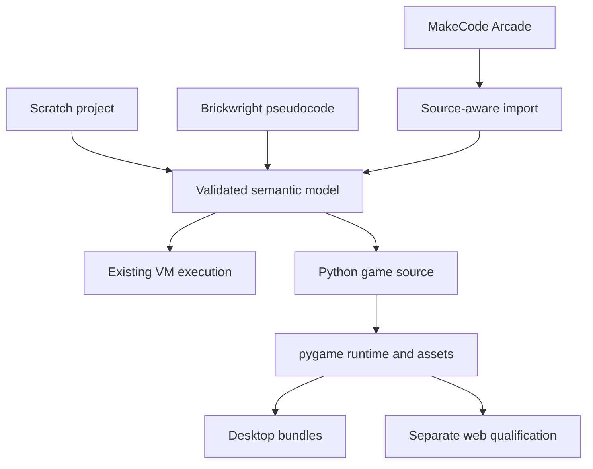

# Code execution and Python game export

Status: planned, with the initial bounded evaluation recorded. Recorded 2026-11-27 at the
repository owner's request. This document is an implementation plan, not a
claim that new runtimes or standalone exporters have shipped.

Source baseline: [`14de1c42bd2e2ea84086a2162d1eff1fdbbac20d`](https://github.com/CrispStrobe/brickwright/tree/14de1c42bd2e2ea84086a2162d1eff1fdbbac20d).
The reviewed Code tab files are unchanged from `0aa915915c4f73ad13c851cdb7d7c14b74861433`.
The [evaluation lane](../lanes/2026-11-27-code-runtime-game-export-evaluation.md)
owns documentation and bounded probes only. Follow-on implementation needs its
own claim and the existing upstream ownership rules.

## 1. Decisions to evaluate

1. Make the Code tab preserve authored source and run the exact visible program
   with an explicit language, runtime and target.
2. Compare the existing Skulpt runner with direct MicroPython/WebAssembly and
   Pyodide, using the same programs and execution-service contract. Keep runtime
   selection provisional until compatibility, startup and platform evidence exists.
3. Reuse the useful ideas in Simon Willison's pwasm without assuming that pwasm
   itself is a browser Python loader.
4. Develop a separately qualified export path from supported MakeCode Arcade,
   Scratch and Brickwright pseudocode projects to editable Python + pygame,
   followed by optional standalone packaging.

These are related but distinct products. A Python interpreter does not supply
Scratch/Arcade sprite, event, audio or physics semantics. pygame requires its own
CPython-compatible runtime and game adapter. A working Python program also need
not be convertible back to blocks.

This extends [PLAN milestones 4, 5 and 9](../PLAN.md) and the existing
[language/device matrix plan](LANGUAGE-DEVICE-MATRIX-PLAN.md). Preserve their
completed work and the existing Arcade qualification boundaries.

## 2. What exists and what the review found

The primary implementation is
[`pseudocode-importer.jsx`](https://github.com/CrispStrobe/brickwright/blob/14de1c42bd2e2ea84086a2162d1eff1fdbbac20d/overlay/scratch-gui/src/components/tw-pseudocode/pseudocode-importer.jsx).
The file combines editor state, conversion, execution, device routing, examples,
debugging and persistence. Generic Python already runs through Skulpt; adding
Python execution is therefore an improvement to an existing capability.

| Area | Observed behavior at the source baseline | Required change |
| --- | --- | --- |
| Generic Python | Skulpt with Python 3 mode; ordinary programs use a new worker with a four-second timeout | Expose the actual runtime and its compatibility; retain an owned execution session |
| Interactive Python | A regular expression detecting `input(` switches to main-thread execution | Keep execution in a worker; route input requests and replies through a documented protocol |
| Target routing | `currentDevice()` reads a `DEVICE` directive from the pseudocode buffer, while `setActiveCode()` clears other language buffers | Persist target independently from a disposable projection; test editing Python before Run |
| Pico execution | `runPicoSim()` regenerates MicroPython from pseudocode | Pass the selected source explicitly; distinguish executing authored Python from generated firmware code |
| Other Python routes | micro:bit/Calliope firmware and SPIKE/block/VM paths have specialized semantics | Describe each route accurately; do not label every path CPython or native Python |
| Tab switching | `deriveBuffer()` extracts generated text without retaining conversion diagnostics | Retain the report and source mapping; do not silently promote an approximate projection to source |
| Persistence | Autosave stores the active language and text; switching/editing can clear other buffers | Version the authored-source model and generated revisions, and preserve source on failed conversion |
| Worker ownership | Generic worker handles are local; completion/error/timeout terminate them, but global Stop/unmount lacks a common owned session | Add Stop/Reset, teardown, stale-message rejection, output streaming and cleanup |
| JavaScript | Worker sends completion after invoking `new Function`; generated async IIFEs are not awaited | Define an async execution contract and completion semantics, with an actual completion handle |
| Editor responsiveness | CodeMirror sends complete text on changes; `fromBlocks()` eagerly generates multiple languages | Measure before changing; derive the requested language first and cache by project revision/options |
| Generated game behavior | Generic Python/JS shims print `say`/`think` and stub other operations | Supply a real target runtime before claiming game execution or export fidelity |

Existing protections must remain: compile request/source ownership checks,
failed-conversion source retention, save-time editor flushing, lazy CodeMirror
loading and the existing conversion ownership tests. This plan does not replace
those controls with a new editor or duplicate the simulator.

### 2.1 Semantic defects that precede a new runtime

The current
[`sb3-creator-python.js`](https://github.com/CrispStrobe/brickwright/blob/14de1c42bd2e2ea84086a2162d1eff1fdbbac20d/overlay/scratch-gui/src/lib/sb3-creator-python.js)
reader was exercised with programs in its supported entry-point form. Observed
results include:

| Python input | Current emitted pseudocode | Consequence |
| --- | --- | --- |
| `x = 7 // 2` | `set x to (7 / 2)` | Floor division changes into ordinary division |
| `x = 3` then `x *= 2` on a new line | Set to 3, then change by 2 | Multiplication assignment changes into addition |
| `x = 8` then `x /= 2` on a new line | Set to 8, then change by 2 | Division assignment changes into addition |
| `break` / `continue` | Statements omitted | Loop control changes |

These cases returned no warnings in the review probes. Enabling a strict flag
alone cannot repair a construct that is silently accepted. Implement the exact
semantics where representable, otherwise refuse with a source span and a concrete
explanation. Add differential behavior fixtures, not tests that merely reproduce
the current text output. Cover negative operands, nested loops and side effects.

The shared reader/emitter belongs to `sb3-creator`. Repair it upstream and adopt
the exact reviewed pin; keep `overlay/` and generated `packages/` mirrors identical
under [the vendoring regime](VENDORING-REGIME.md). Do not introduce a private
compiler fork to accelerate this roadmap.

### 2.2 Further reproduced execution risks

- Editing Python after a pseudocode `DEVICE pico` declaration can erase the
  buffer used to identify the target and select generic execution instead.
- A string containing `input(` can select the main-thread route, while calling
  an alias of `input` can remain in the worker route with its empty input stub.
- A JavaScript program that schedules output after an `await` can lose that
  output because the worker reports completion and is terminated first.

Acceptance requires running these behavioral fixtures through the real revised
entry points. Do not infer that a source-pattern check alone qualifies the fix.

## 3. Runtime alternatives and pwasm

| Candidate | What it provides | Main reason to evaluate | Boundary |
| --- | --- | --- | --- |
| Existing Skulpt | Python implementation in JavaScript already used by the Code tab | Migration baseline and existing browser integration | Python 3 mode does not imply full current CPython/library compatibility |
| Direct MicroPython/WASM | A small Python implementation compiled to WebAssembly, called directly from JS | Lightweight learning/robotics execution and explicit MicroPython dialect | Different language/library behavior from CPython; board modules require adapters |
| Pyodide | CPython compiled for the browser, with supported WASM packages | Broader Python compatibility and optional scientific packages | Larger runtime; desktop native wheels and OS APIs do not automatically work |
| pwasm host | A Python-hosted WebAssembly interpreter/compiler with bundled guests | Reference for capability registration, resource accounting and optional host tools | Requires an outer Python interpreter; not the direct browser bootstrap |

### 3.1 Why pwasm is not the default browser execution layer

At reviewed pwasm commit
[`3398e812b0fffe4db8dbf1eb2df2d7b60ec7dad7`](https://github.com/simonw/pwasm/tree/3398e812b0fffe4db8dbf1eb2df2d7b60ec7dad7)
(0.2a0), the host is Python 3.10+ and the bundled MicroPython guest is a custom
WASI embed build. Running the entire package in a browser would first need an
outer Python implementation, then pwasm, then the guest. Direct MicroPython/WASM
or Pyodide avoids that additional interpreter layer.

Useful ideas to reuse are named host functions, JSON-shaped arguments/results,
an explicit capability list, resource limits, and discarding a failed guest.
The reviewed MicroPython guest is 286,631 bytes raw; that is one custom binary,
not the download size of a complete browser integration. Its host imports and
WASI/Emscripten exception plumbing are not interchangeable with the official
MicroPython browser loader.

pwasm's fuel and deadline checks live in its host engine. Instantiating its guest
directly in a browser does not preserve those checks. Its registered host calls
are synchronous; async input, device communication and UI dispatch still need a
designed bridge. WASM linear-memory limits do not bound all browser/host memory,
and a long host callback is not preempted by a guest deadline. Treat the project
as experimental, and qualify any use separately. See
[pwasm](https://github.com/simonw/pwasm) and its
[MicroPython host implementation](https://github.com/simonw/pwasm/blob/3398e812b0fffe4db8dbf1eb2df2d7b60ec7dad7/src/pwasm/guests/micropython.py).

### 3.2 Platform and compatibility policy

Use the released, non-JSPI MicroPython build as the initial portability baseline.
The released v1.29.0
[WebAssembly port](https://github.com/micropython/micropython/blob/v1.29.0/ports/webassembly/README.md)
has JS module registration and async execution APIs. Newer development browser
builds using JSPI are separate candidates, not proof of support on older WebViews.

Pyodide supports
[workers](https://pyodide.org/en/stable/usage/webworker.html), but worker placement
does not make synchronous Python `input()` automatically asynchronous. Evaluate
explicit async input and, where available, shared-memory or JSPI integration.
Graceful interruption can require `SharedArrayBuffer` and cross-origin isolation;
worker termination must remain the fallback. Pin runtime assets and their lock
metadata; do not ship a production dependency on a floating CDN `latest` URL.

| Host | Intended baseline | Evidence required before a support claim |
| --- | --- | --- |
| Desktop browsers | Worker-based Skulpt/MicroPython/Pyodide candidates | Supported Chromium, Firefox and Safari versions; CSP, caching, offline and input/Stop |
| Windows native shell | Same worker service in WebView2; optional future native CPython adapter | Installed app on the supported Windows/WebView2 floor |
| Linux native shell | Same worker service in WebKitGTK; optional future native CPython adapter | Supported distro/WebKitGTK floor and packaged asset loading |
| macOS native shell | Same worker service in WKWebView | Supported macOS/WKWebView floor, native packaging and lifecycle |
| Android | Browser/system WebView path first | Representative low-memory device, background/resume and actual WebView version |
| iOS/iPadOS | WKWebView/browser path, feature-detected | Oldest supported device/OS, memory pressure, lifecycle and current runtime requirements |

The application currently declares an iOS 15 / macOS 12 minimum in its native
configuration. Upstream Pyodide's browser baseline and new JSPI variants must be
reconciled with those floors. A passing current Chromium test does not qualify
these platforms. Do not silently increase the app's OS minimum to install a new
runtime. Native desktop CPython is a possible advanced adapter, not a universal
mobile sidecar; native mobile embedding is a separate build/distribution project.

Workers provide responsiveness and a termination boundary, not a complete
security sandbox. Define the project's trust model, allowed imports, network and
filesystem access, JS FFI and native-command exposure. Keep native/device actions
behind explicitly registered capabilities and validated messages. A restricted
bridge must not be advertised as a restriction on arbitrary Python JS access if
the selected runtime still exposes that access.

## 4. Code tab architecture and user experience

### 4.1 Authored source and projections

Persist a versioned record containing authored text/language, runtime/dialect,
target, source revision, dependency manifest and conversion options. Keep that
source distinct from generated projections and the selected visible tab. Retain
each projection's originating revision and diagnostics; recompute only when its
inputs change. If multiple authored documents are allowed, preserve them as
documents rather than pretending they are always equivalent translations.

Conversion results need `exact`, `changed`, and `unsupported` outcomes with spans,
source maps and explanations. Existing `preserved`/success reporting is not an
equivalence proof. Show why a conversion cannot be applied, retain the source,
and provide an explicit preview/apply flow for lossy conversion. Python that runs
successfully can remain intentionally nonconvertible to blocks.

Preserve editor selection, scroll and undo history appropriately. Display the
runtime and Run target, diagnostics at the relevant lines, and useful completion
for the supported Brickwright APIs. Give changed source an honest generated-view
indicator. Keep implementation/package details out of normal learner flows.

### 4.2 One execution service

A run request must carry `{source, language, runtime, target, sourceRevision}`.
No adapter may infer the selected program or target from an unrelated emptied
language buffer. Separate editor/session state, conversion, execution and target
adapters out of the large component incrementally.

The service owns a run ID, worker/runtime handle, lifecycle, budgets and cleanup.
Its protocol supports ready/run/output/error/input-request/input-reply/complete/
stop/reset events. Reject stale replies after Stop or a newer run. Stream output
in bounded batches, cap excessive output, and retain useful source-line errors.
Stop must terminate a CPU-bound program, cancel outstanding input and device
requests, and leave a clean next run. Unmount and target changes follow the same
cleanup rules. Graceful interrupt is optional; forced termination is the fallback.

Define whether runs are fresh or use a persistent REPL. A warm runtime may be
reused, but leaked globals/imports from one run must not silently alter another.
Record dependency installation and reset behavior. Do not destroy the worker
until awaited user tasks and the chosen event-program lifetime actually finish.

### 4.3 Shared stage, circuit and device bridge

Define a narrow, versioned command/event API for motors, sensors, sprites and
timing. Use the existing simulation world and clock. Do not create a second copy
of the circuit or robot state inside Python. Batch high-frequency operations;
make long operations asynchronous and cancellation-aware. Host callbacks must
not block the UI. Give each capability an explicit availability/error contract.

Qualify the same motor/sensor scenario from blocks and each Python adapter against
the same simulator, including Stop, reset, disconnect and stale callbacks. Device
firmware execution remains a separate adapter with its own build/deploy/runtime
semantics. The language/device matrix must add runtime, host-platform and
convertibility axes rather than equating them.

### 4.4 Performance work

- Preserve lazy loading of the Code tab, CodeMirror grammars and optional engines.
  Load a new Python runtime on demand and cache approved assets for offline use.
- Generate the requested representation first; cache by project revision,
  language, target and options. Move sufficiently costly pure conversion work
  into a worker after measuring it.
- Profile representative small, medium and large programs before changing full
  text synchronization, debounce behavior or editor state ownership.
- Measure first-open latency, typing responsiveness, conversion time, cold/warm
  runtime readiness, run time, transfer bytes and memory with defined workloads.
  Do not claim a performance gain from switching language implementations alone.

## 5. Runtime evaluation protocol

The plan and roadmap land before measurements. Use an isolated probe, no default
runtime switch and no dependency/pin changes in the application. Record exact
versions and asset hashes, source baseline, OS/CPU/browser, commands, network/cache
conditions and raw outputs. All timing rows must state the measured scope and
sample count. Separate engine initialization from script execution and from
network transfer. Report unsupported fixtures explicitly, never as zero time.

| Fixture | Required observation |
| --- | --- |
| Arithmetic, strings, lists, dictionaries, functions and classes | Output and exception behavior against declared dialect expectations |
| Floor division, augmented assignment, break/continue | Runtime results and separately the converter's preserved/refused behavior |
| Current generated Python and representative examples | Imports, API calls, errors and game/device host requirements |
| Input followed by repeated runs | Prompt/reply correctness, UI responsiveness, cancellation and state isolation |
| Infinite loop | Stop latency, clean restart and no stale output |
| Large output | Batching, output cap and responsive controls |
| Same motor/sensor program | Same host state/clock and cancellation behavior |
| Error and reset | Source lines, exception propagation, memory/session recovery |
| Startup and steady state | Cold bytes, cache behavior, time to ready, warm execution, memory and repeated-run stability |

First compare all three engines in the same browser/worker harness where the
environment permits. Host-only or source-analysis results get separate labels.
Use an uninstrumented run for timing when instrumentation changes behavior. Do
not equate raw WASM size, gzip size, package tarball size and actual transfer bytes.
JS heap, WASM linear memory and whole-process memory are also different metrics.

Then qualify the oldest supported iPad, Android and each supported desktop
WebView/browser. Include offline startup, background/resume, storage pressure,
repeated interruption, optional dependencies, and feature detection without JSPI
or shared memory. Unsupported physical-device cells remain pending.

Decision gates:

1. Correctness and reliable Stop/input/restart before comparative speed.
2. Direct MicroPython is a candidate for an explicit lightweight MicroPython
   mode, conditional on the generated-program and bridge corpus.
3. Pyodide is a candidate for broader CPython mode, loaded only when requested.
4. Keep Skulpt as the measured migration baseline until a replacement is qualified.
   A runtime change must never silently change the project's declared dialect.
5. pwasm remains a design reference or optional host experiment unless a concrete
   deployment need justifies its additional layer.

## 6. MakeCode Arcade / Scratch / pseudocode to Python + pygame

### 6.1 Feasible end state and the right compiler boundary

Offer an editable export directory containing Python source, a small versioned
Brickwright game runtime, assets, an asset/source manifest, pinned dependency
requirements, notices and reproducible run/build instructions. A learner can run
the exported project with CPython + pygame and later package it for a supported
desktop OS. The exported source is independently editable; arbitrary subsequent
Python edits do not acquire a promise of conversion back to Scratch or MakeCode.

Reuse the existing MakeCode source extraction, importer, assets and supported
Scratch/pseudocode model, but do not force every export through pretty-printed
text. Use a validated semantic intermediate representation that preserves the
source dialect and the game metadata needed by each backend. The current SB3
graph with Arcade extensions and semantic metadata is the first model to reuse;
measure and extend its fidelity before inventing a parallel compiler model.
Add explicit source spans and provenance. Export the current edited graph and
current assets, not stale original MakeCode files retained for reference. Reuse
the existing original-source current/stale/unsettled/none tracking contract.

Conceptual route:

If an Arcade feature cannot survive the import/model, either extend the model or
report the refusal before export. Generating Python after an already lossy import
cannot recover the missing behavior. A direct Arcade-aware backend may be needed
for constructs outside the common Scratch subset; keep that choice explicit.

### 6.2 The runtime is the substantial work

Map blocks/IR to operations against a documented game API. pygame provides
rendering/input/audio building blocks; the exporter must implement source
semantics for:

- Stage and sprite coordinates, scale, rotation, costumes, visibility, layers,
  cloning, effects and asset decoding.
- Event hats, green flag/start, controller input, broadcast and broadcast-and-wait,
  concurrent scripts, waits, procedure calls, cancellation and restart.
- Lists, variables, string/number coercion, indexing, random numbers and timers.
- Collision/overlap policies, sprite kinds, physics, camera, tilemaps and source
  frame/update ordering where supported.
- Sound, pen/text rendering, score/life/countdown and other explicitly admitted
  Scratch/Arcade APIs.

Do not copy Scratch and Arcade into one assumed scheduler. Preserve source
profiles, coordinate conventions, scheduling, collision and frame-order rules.
The existing [Arcade frame scheduler contract](ARCADE-FRAME-SCHEDULER.md) includes
zero-delta first frame, continuation eligibility, controller/physics/update/render
ordering, independent overlap fibers and scene/run cancellation. Those become
backend parity requirements. Long-running scripts must yield cooperatively so
input/rendering continue; a literal `while True` translation is insufficient.

The current generic Python generator's no-op Scratch shim is not this runtime.
Unknown reporters can become `None`, unknown commands can become comments, and
flag handlers run sequentially. The game exporter must reject such unsupported
operations explicitly and supply the event scheduler. Adding pygame imports to
the existing output will not turn it into a playable game.

### 6.3 Start with a declared subset

First vertical slice: one sprite, one backdrop, keyboard/controller motion,
variables, a repeated update, a collision, score, one sound, and clean restart.
Export one Scratch fixture and one imported Arcade fixture through the same
capability report. Then expand to clones, broadcasts, concurrent scripts,
tilemaps/camera and richer assets in measured increments.

For every operation, say exact, approximate or unsupported for the selected
backend/profile. Block export on silent loss. Keep original sources/assets in
the export manifest, with hashes and converter/runtime versions. Compare input
traces, state at fixed frames, event ordering, collision results and selected
rendered frames against the original source runtime. Add audio/controller checks
where the feature is admitted. Seed randomness and use deterministic time where
the source contract permits it.

Include press/hold/repeat/release input, image/array aliasing, pause/frame ordering,
tile transparency/camera transforms, clone-local state, broadcast-and-wait and
game-over/restart in the corpus as those features are admitted. Exercise import
→ edit Code/Blocks/artwork → save/reopen → export → independent execution, not
just an unchanged original project. Private compatibility inputs remain private;
public fixtures are original minimal authored examples.

Reuse existing original-PXT/ScratchVM differential fixtures. The current
[Arcade conversion journey](ARCADE-CONVERSION-JOURNEY.md) explicitly distinguishes
its headless evidence from rendered pixels, audio, controller and whole-game
equivalence. Preserve that distinction in pygame acceptance.

### 6.4 Standalone does not mean one binary for every platform

| Deliverable | Proposed route | Qualification boundary |
| --- | --- | --- |
| Editable desktop project | CPython + pygame/pygame-ce, source + assets + locked requirements | Establish runtime parity and a reproducible clean install first |
| Windows application | PyInstaller or equivalent native packaging | Build/test on the target OS/architecture; include assets and required native libraries |
| macOS application | Native application bundle with CPython/pygame runtime | Build/test architecture targets, signing/notarization and launch without a developer Python install |
| Linux application | Native packaged output for a defined distro/ABI floor | Native dependencies and minimum supported environment; no universal Linux binary claim |
| Browser game | Separate pygame-ce/WASM route such as pygbag, or an experimental Pyodide SDL preview | Async-compatible frame loop, supported modules/assets, audio/autoplay, offline and browser testing |
| Android/iOS application | Separate SDL/Python embedding or other mobile packaging project | Touch/input/audio/lifecycle, native dependencies, signing and distribution qualification |

[PyInstaller](https://pyinstaller.org/en/stable/) bundles the interpreter and
dependencies but is not a cross-compiler. Build artifacts per supported target
and architecture; test on a clean target without Python installed. A source ZIP
is not a standalone executable. A packaged web game is not a native mobile app.
Evaluate [pygbag](https://github.com/pygame-web/pygbag) independently from Pyodide.
Pyodide 314.0.8 lists pygame-ce 2.5.7, but its
[SDL integration](https://pyodide.org/en/314.0.8/usage/sdl.html) is experimental,
requires canvas integration and an opt-in flag, and has async/stack-unwinding
constraints. A console worker cannot be assumed to render it unchanged. A game
preview is a separate spike from the generic Python console runner. Pygbag's
ordinary CDN runtime also needs explicit asset inclusion and offline testing
before describing the resulting web package as self-contained.

pygame-ce uses LGPL-2.1-or-later, as recorded in its
[2.5.8 license](https://github.com/pygame-community/pygame-ce/blob/2.5.8/docs/LGPL.txt).
The repository currently describes a
permissive shipped dependency graph, so adding either to a shipped bundle needs
an explicit dependency-policy decision and a license/notice/source inventory.
Keep the initial exporter dependency optional and unbundled until that decision.
PyInstaller's bootloader exception is distinct from the licenses of everything
inside an exported application. Track fonts, sounds and imported game assets as
well as runtime libraries. This evaluation does not change the project's policy.

## 7. Ordered delivery and acceptance

| Phase | Deliverable | Exit criterion |
| --- | --- | --- |
| R0 — record and evaluate | This plan, linked roadmap, reproducible runtime report | Plan lands first; every result names its environment/version and unmeasured cells |
| R1 — source and conversion integrity | Versioned source/projections, explicit target/run request; upstream reader repairs | Source survives tabs/save/reopen; demonstrated wrong translations are exact or refused with diagnostics |
| R2 — execution service | Owned worker sessions, streaming output, input, Stop/Reset and error mapping | Infinite-loop and async/input/restart fixtures pass without UI blocking or stale effects |
| R3 — runtime adapters | Qualified MicroPython and/or Pyodide mode behind explicit selection | Same declared corpus passes; budgets and platform floors recorded; no silent dialect change |
| R4 — simulator bridge | Shared stage/circuit/device API and one simulation clock | Blocks/Python parity on admitted scenarios, including cancellation and device lifecycle |
| G0 — export contract | Source profiles, semantic IR, capability report and asset manifest | Unsupported import/model/export features are detected before generation |
| G1 — playable Python export | Minimal game runtime and generated source for one Scratch and one Arcade fixture | Clean CPython install runs the games; deterministic state/frame checks agree within declared bounds |
| G2 — game coverage | Scheduler, assets and admitted Scratch/Arcade features | Differential corpus covers supported behavior; approximations remain visible |
| G3 — desktop standalone | Reproducible per-platform packages | Clean-machine launch, assets/audio/input, restart, licenses and supported OS/architecture matrix pass |
| G4 — web/mobile expansion | Independently scoped browser and mobile targets | Runtime and packaging qualification on actual target environments; no inheritance of desktop acceptance |

R1/R2 are valuable with any interpreter. R3 is a measured choice, not a required
wholesale replacement. Game export can share the conversion/model work but has
its own runtime and packaging gates. Do not bundle a complete compiler rewrite,
new interpreter, game engine and mobile distribution into one release.

## 8. Evidence and follow-up

The initial planning commit landed before the probes. The
[2026-11-27 evaluation report](CODE-RUNTIME-EVALUATION-2026-11-27.md) now records
Node and real headless Chromium observations for the three runtimes, a separate
pwasm host probe, eight reader semantic witnesses, and a Linux pygame packaging
smoke. It preserves initial failures, corrected probe revisions and remaining
device/application gaps. A successful probe does not close R1 through R4 or G0
through G4.

Primary runtime references: [Skulpt](https://github.com/skulpt/skulpt),
[MicroPython WebAssembly](https://github.com/micropython/micropython/tree/v1.29.0/ports/webassembly),
[Pyodide compatibility](https://pyodide.org/en/stable/usage/wasm-constraints.html),
[Pyodide interruption](https://pyodide.org/en/stable/usage/keyboard-interrupts.html),
[pwasm](https://github.com/simonw/pwasm),
[pygame-ce](https://github.com/pygame-community/pygame-ce), and
[PyInstaller usage](https://pyinstaller.org/en/stable/usage.html).
