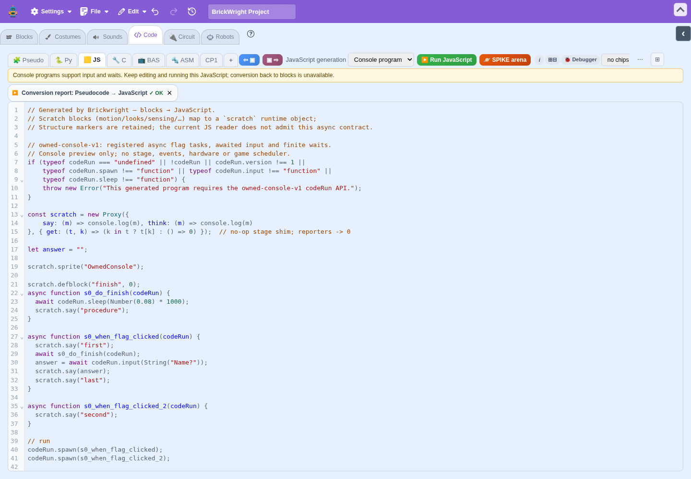

# Owned-console Code-tab acceptance receipt — 2026-11-27

## Outcome and exact scope

**Passed 12 of 12 acceptance checks** between `2026-11-27T10:21:04.639Z` and `2026-11-27T10:21:21.803Z`. The test drove the real built Brickwright editor, CodeMirror, production JavaScript/Python workers, the live VM observed read-only, and the visible project File Save/Open controls. It used no replacement worker, mock component, direct component setter, or direct VM project loading. A fresh context set the existing starter-tour-completion preference; all source entry and project changes used the user interface.

The tested application was **consumer checkpoint `71d6854cb3c4411072deeaee448281d2fc9d13c1` plus an experimental, official synchronization of supplier candidate `4994e2c77143c7bee9eb8b76706ffae3321743a0`** in an isolated detached worktree. Its committed consumer tree is `675d636247173d550ecea087e27e7116705892c5`. The shipping consumer pin remains `1c29f69fd22c86ecb0051938eedb246921cb3b88`. This is local integration evidence with `shippingEvidence: false`; it does not qualify that candidate for shipping, close the supplier RF release gate, or represent a build of a later documentation/fixture-only successor commit.

This run covers desktop headless Chromium console behavior and source persistence. It does not qualify device execution, the simulator, stage scheduling, other browsers/platforms, or browser security settings. The complete source/build manifest is preserved in [manifest.md](owned-console-code-tab-2026-11-27/manifest.md); the complete run receipt follows below without omitted fields.

## Source, build and browser identity

| Item | Recorded value |
| --- | --- |
| Consumer repository | [CrispStrobe/brickwright](https://github.com/CrispStrobe/brickwright/commit/71d6854cb3c4411072deeaee448281d2fc9d13c1) |
| Supplier candidate | [CrispStrobe/sb3-creator](https://github.com/CrispStrobe/sb3-creator/commit/4994e2c77143c7bee9eb8b76706ffae3321743a0) |
| Committed shipping supplier pin | `1c29f69fd22c86ecb0051938eedb246921cb3b88` |
| Exact tracked experimental patch SHA-256 | `cd31ad0c3c25dec88f76322163841c3cbd0db04e48cd679967d95e64afd8833c` |
| Manifest created | `2026-11-27T10:21:00.847Z` |
| Raw manifest SHA-256 | `85f75bbf7a5e0e48096fdbc0cf7201c933cebbdb12bf04580747874c3f05c301` |
| Raw results SHA-256 | `4824b9c6bcde8de7570b8e64615938a52afb45c90d0bfee58557fc26b14a9e9b` |
| Entry document SHA-256 | `f090c56c2a8c3010009adaa2c888b05894bc7d4370ecf6a61640c4bb7cdc9c38` |
| Harness SHA-256 | `bf1baf67be74b073a418e54a01229734943911546e3f7c59665524ce6a23bafa` |
| Boolean fixture SHA-256 | `47e921b27fa002d9a13d963c0aa84c87d4ddfc59e7f5c143dfcba162e816cde6` |
| Node / Playwright | `v24.22.3` / `1.62.1` |
| Browser distribution / version | `@sparticuz/chromium@158.0.0` / `158.0.8127.0` |
| Viewport | 1440 × 1000 pixels |
| Page capabilities | `crossOriginIsolated: false`, `sharedArrayBuffer: false` |
| App URL | `http://127.0.0.1:8617/` |
| Build command | `NODE_ENV=production NODE_OPTIONS=--max-old-space-size=2560 npm run build:gui` |

The environment could not download Playwright's bundled browser (HTTP 403), so the pinned Chromium distribution was installed in a separate scratch runtime. The harness removed the distribution's `--disable-web-security` and forced `SharedArrayBuffer` arguments. It retained the distribution's other arguments, including sandbox/site-isolation-related overrides. **Every supplied flag and the actual launched command line obtained from CDP are retained in `environment` in the complete receipt.** This records the actual environment and is not a claim of default-browser security equivalence.

The candidate was integrated using `scripts/sync-sb3creator.mjs --dir … --pin` and `scripts/sync-examples.mjs --dir … --pin`, then the official integration/dependency workflow. The first compiler sync correctly stopped for a stale gallery; the gallery was synchronized and the unchanged compiler command then succeeded. Neither `--force` nor `--allow-stale` was used. The SPIKE round-trip fixture's duplicate pin literal was updated only in this detached experimental checkout, and all unchanged executable artifact assertions were run. No shipping-worktree pin, workflow, release threshold, or scanner exemption was changed for this experiment.

The final identity run passed **6/6 tests with zero skips**, including canonical upstream identity for all 21 mapped compiler files, mirrors and the SPIKE executable round trip. The normal `npm run build:gui` command passed its load and native-broker checks and webpack completed in 20,295 ms with three warnings: a Microtronic CSS `start`/`flex-start` compatibility warning, asset-size guidance and entrypoint-size guidance.

### Selected source hashes

These hashes identify the executed importer, ownership/document helpers, supplier generator and proof code. The complete manifest includes their corresponding package copies and all remaining recorded files.

| Source | SHA-256 |
| --- | --- |
| `overlay/scratch-gui/src/components/tw-pseudocode/pseudocode-importer.jsx` | `55fc372a0ef0533e651636d3d2b22f5480719263f6432895aa4122cae9b866d3` |
| `overlay/scratch-gui/src/lib/code-source-document.js` | `e98bee02f2027e9013fc6c71aa53870730a7aebe26ca933033caa65cef7656cf` |
| `overlay/scratch-gui/src/lib/code-execution-session.js` | `eaa2f153bb51dda2bb025d09441772b0e7a612f9a7a5f5cb5e7fee4538a84cf6` |
| `overlay/scratch-gui/src/lib/code-execution-workers.js` | `8bb9b3d93c2752f7ecc1c94b7bd228c262797355df0df845c7224dfb8dc66325` |
| `overlay/scratch-gui/src/lib/bw-conversion-error.js` | `70314ae7071652fad44df50773d9f31ab7df160c25e3e3e528843d4e1f6a8c2f` |
| `overlay/scratch-gui/src/lib/pico-sim-run.js` | `d74cc614ae8b2971b0d021d2f07c3bb00823ef8908282057154bb5d2295ce313` |
| `overlay/scratch-gui/src/lib/sb3-creator-javascript.js` | `25b66e91de30fbcef655db2e6355ef1d9ccf8b3e932c61f945386688ba193c55` |
| `scripts/verify-owned-console-code-tab.mjs` | `bf1baf67be74b073a418e54a01229734943911546e3f7c59665524ce6a23bafa` |
| `scripts/write-owned-console-qualification-manifest.mjs` | `e4489f53a2850bedfd599745bae8d1338ceb8aa9eb26c5177ac4d7c54f49fe6e` |

## Accepted behavior

The first eleven checks exercise the rendered editor. Check 12 waits for all observed emitted-script reads, rejects any read/hash error, verifies that manifest-bound scripts actually loaded, and requires no uncaught page errors. Its raw step label is “the complete rendered journey has no uncaught page errors”; the identity assertions are part of that same step.

| # | Acceptance check | Result | Duration (ms) |
| --- | --- | --- | ---: |
| 1 | built editor opens its real Code tab | Pass | 3,242 |
| 2 | visible Console program target generates owned JavaScript and preserves its authored source | Pass | 1,336 |
| 3 | multiple flags, awaited procedure, finite wait and long human input complete in the actual worker | Pass | 4,918 |
| 4 | real File Open and From blocks preserve a Boolean in an ordinary value socket | Pass | 1,311 |
| 5 | Stop closes a generated delayed task before its later effect | Pass | 472 |
| 6 | editing generated JavaScript keeps its contract and a fresh run succeeds after Stop | Pass | 175 |
| 7 | owned source explicitly refuses unsupported reverse conversion without changing source or VM | Pass | 243 |
| 8 | actual File Save persists authored bytes and owned execution metadata | Pass | 278 |
| 9 | real project replacement and File Open restore source, target and executable behavior | Pass | 1,634 |
| 10 | page reload restores the same authored source and target from real autosave | Pass | 1,888 |
| 11 | fresh authored Python refuses lossy block conversion by line and still runs in Skulpt | Pass | 694 |
| 12 | the complete rendered journey has no uncaught page errors (also awaits and validates every emitted-script hash) | Pass | 0 |

The human-input prompt remained pending for **4,502 ms**, longer than the four-second execution budget, while the real Run control stayed disabled and Stop remained available. The generated two-flag program produced `first`, `second`, `procedure`, then the entered answer `Ada` and `last`, in that order. The Boolean SB3 fixture used `operator_gt` directly in a normal `looks_say` value socket and produced `true`.

Stop closed the generated task before its delayed `late` output. A subsequent edit deliberately removed the generated ownership header and still retained the `owned-console-v1` execution contract. The edited source, including the Unicode `Ω` comment, survived actual SB3 Save/Open and a real autosave reload byte for byte. The saved Code document has `version: 1`, authored JavaScript, `selectedLang: javascript`, `execution: owned-console-v1`, and no JavaScript projection replacing the authored text.

Owned JavaScript refused unsupported conversion to blocks and Python without changing the source or VM graph. A fresh authored Python file containing `print(7 // 2)` separately refused lossy conversion with an explicit **Line 2** diagnostic, then ran through the actual Skulpt worker and produced `3`. Its source and the VM graph remained unchanged.

### Worker and output evidence

All seven Code-tab runs created production Blob workers and each closed on settlement or Stop. All nine workers observed during the journey, including two other application workers across the reload, have recorded closure timestamps in the full receipt. Worker indices below are zero-based indices into that receipt's `workers` array.

| Run | Exact output (escaped newlines) | Worker index | Lifecycle |
| --- | --- | --- | --- |
| generated-concurrent-procedure-input | `first\nsecond\nprocedure\nAda\nlast\n` | 1 | Closed |
| generated-boolean-value | `true\n` | 2 | Closed |
| generated-stop | `ready\n\nStopped.` | 3 | Closed |
| edited-fresh-run-after-stop | `saved-before\nsaved-after\n` | 4 | Closed |
| reopened-saved-project | `saved-before\nsaved-after\n` | 5 | Closed |
| autosave-reopened-page | `saved-before\nsaved-after\n` | 7 | Closed |
| authored-python-floor-division | `3\n` | 8 | Closed |

### Build binding and retained diagnostics

The manifest inventories 565 emitted entries: the HTML entry document and 564 JS/MJS files. The browser requested **53 same-origin HTTP script responses covering 29 unique files; all 53 matched their recorded build SHA-256**. The actual entry document also matched the manifest. This is evidence for loaded scripts, not execution coverage of every emitted chunk.

Dynamic `blob:` URLs do not name emitted files and are outside the HTTP build inventory. The receipt records all nine such script responses in `nonEmittedScriptResponses`; their actual worker creation and closure are recorded separately. The observer continues to fail on unreadable or mismatched bytes for any same-origin emitted HTTP(S) script. This scope avoids treating an intentionally terminated worker's transient Blob URL as a missing emitted build file.

There were **zero uncaught page errors**. Four console resource-error messages were retained. The static server log identifies them as a HEAD and GET for `/static/labwired/labwired_wasm_bg.wasm` on initial page load and again after reload. No emitted JavaScript asset failed or mismatched. The server log uses its process-local timestamp; the receipt above uses UTC ISO timestamps.

```text
127.0.0.1 - - [27/Nov/2026 11:21:08] code 404, message File not found
127.0.0.1 - - [27/Nov/2026 11:21:08] "HEAD /static/labwired/labwired_wasm_bg.wasm HTTP/1.1" 404 -
127.0.0.1 - - [27/Nov/2026 11:21:08] code 404, message File not found
127.0.0.1 - - [27/Nov/2026 11:21:08] "GET /static/labwired/labwired_wasm_bg.wasm HTTP/1.1" 404 -
127.0.0.1 - - [27/Nov/2026 11:21:19] code 404, message File not found
127.0.0.1 - - [27/Nov/2026 11:21:19] "HEAD /static/labwired/labwired_wasm_bg.wasm HTTP/1.1" 404 -
127.0.0.1 - - [27/Nov/2026 11:21:19] code 404, message File not found
127.0.0.1 - - [27/Nov/2026 11:21:19] "GET /static/labwired/labwired_wasm_bg.wasm HTTP/1.1" 404 -
```

## Visual review

The final screenshots were taken at 1440 × 1000. Review of [01-generated-console.png](owned-console-code-tab-2026-11-27/01-generated-console.png) and [05-explicit-conversion-limit.png](owned-console-code-tab-2026-11-27/05-explicit-conversion-limit.png) confirms that the **Run JavaScript button is directly visible and the complete conversion-limit notice is readable without horizontal scrolling**. The limitation is below the toolbar and the generation selector clearly says “Console program”.



## Preserved artifacts

All nine final screenshots, the five generated/authored source files and both SB3 archives are retained byte for byte. The earlier failed-run screenshot is not part of this final archive. The tracked [Boolean graph fixture](../scripts/probes/code-runtime/owned-code-tab/boolean-value.fixture.json) and [acceptance harness](../scripts/verify-owned-console-code-tab.mjs) are also available in this repository.

| Artifact | Bytes | SHA-256 |
| --- | ---: | --- |
| [01-generated-console.png](owned-console-code-tab-2026-11-27/01-generated-console.png) | 175,762 | `93538b19dcd44ff59db56427f2bc6833adf748b7043db7a52e85270c2b44d57f` |
| [02-awaiting-human-input.png](owned-console-code-tab-2026-11-27/02-awaiting-human-input.png) | 168,085 | `a733154c21b317baffb4b9e799e00dabc9b0a15f8887c3f72bddd08b6cc728f5` |
| [03-boolean-output.png](owned-console-code-tab-2026-11-27/03-boolean-output.png) | 135,410 | `9d2f328de0aafd7248b1f1344c8387e63a693d35fae258294c9d8db32e99a22c` |
| [04-stopped.png](owned-console-code-tab-2026-11-27/04-stopped.png) | 143,407 | `b64f0b980bd3a870751bf7406ce3bc324349a71f08d7a612160573c9b6d641c2` |
| [05-explicit-conversion-limit.png](owned-console-code-tab-2026-11-27/05-explicit-conversion-limit.png) | 82,097 | `e8eda692824c5d84f8399b1da4ef1f79f1f9def997e25728b61386e191d19896` |
| [06-reopened-project.png](owned-console-code-tab-2026-11-27/06-reopened-project.png) | 78,165 | `3b07afe5e350820dc5ffcc830f7b39c7634e05b6cbfa8f58bad0c6a5dd560261` |
| [07-reloaded-autosave.png](owned-console-code-tab-2026-11-27/07-reloaded-autosave.png) | 71,537 | `9d51bf3852007b6e89ed152c0847a47f1403e507b9bf8adcaf82405f0a6ed849` |
| [08-python-conversion-refusal.png](owned-console-code-tab-2026-11-27/08-python-conversion-refusal.png) | 59,967 | `400f5e0cc25cf32cd0dd5b3153a5daeefc4fae876e678f4a229080b96569198d` |
| [09-python-runs.png](owned-console-code-tab-2026-11-27/09-python-runs.png) | 56,643 | `70fb5bdf51dc1fd5bbbfe1e6f35094e4d7acf346a0056ce48e1f3827ad95c441` |
| [concurrent-generated.js](owned-console-code-tab-2026-11-27/concurrent-generated.js) | 1,408 | `0522adee3a2fb79646af91c4b017129990dac198d7b13ad7fd10e126fb5f3f78` |
| [boolean-generated.js](owned-console-code-tab-2026-11-27/boolean-generated.js) | 1,005 | `10a156883fc467fa1eb36752c047d70149c6317db4d4af89ad1e8cd09887b9b9` |
| [stop-generated.js](owned-console-code-tab-2026-11-27/stop-generated.js) | 1,068 | `d40f1b918aeaa5aaee17ea1141c11a4691833f1f860577ac1c5db06917b9d3eb` |
| [authored-javascript.js](owned-console-code-tab-2026-11-27/authored-javascript.js) | 203 | `af81c740e0a7f64f8d4fabfdeada814e4498c8d90d93b2766876cce7b7906ea2` |
| [authored-floor-division.py](owned-console-code-tab-2026-11-27/authored-floor-division.py) | 59 | `4b342555801280f46d7cf91edb7c161282820a6b3e76a82371d98a0c41c85449` |
| [authored-owned-console.sb3](owned-console-code-tab-2026-11-27/authored-owned-console.sb3) | 2,666 | `c0f34403fc8220ed8dfd4b28fc4fa5a1f7b19b9c5f83413eea490063e7a25da9` |
| [boolean-value.fixture.sb3](owned-console-code-tab-2026-11-27/boolean-value.fixture.sb3) | 1,453 | `a35f7313d059ca4c351972b3b83bf58ef7d0c7190e62f925c00f8e68315adaab` |

## Reproduction outline

Use detached checkouts at the exact consumer and supplier commits above. Keep the candidate synchronization isolated from the shipping worktree. Run the two official sync scripts with the supplier checkout and `--pin`, finish the repository's normal dependency/integration workflow, and run its vendor identity/mirror/SPIKE gates. The manifest records the exact resulting tracked patch and changed paths.

After the normal build, generate the binding manifest with the committed writer:

```sh
node scripts/write-owned-console-qualification-manifest.mjs \
  --supplier "$SUPPLIER_CHECKOUT" \
  --expect-supplier 4994e2c77143c7bee9eb8b76706ffae3321743a0 \
  --build-command 'NODE_ENV=production NODE_OPTIONS=--max-old-space-size=2560 npm run build:gui'
```

Serve `packages/scratch-gui/build` over HTTP, then invoke the committed harness against that server from the same detached consumer worktree:

```sh
PROOF_URL=http://127.0.0.1:8617/ \
BW_CHROMIUM_RUNTIME_ROOT="$CHROMIUM_RUNTIME" \
node scripts/verify-owned-console-code-tab.mjs \
  --qualification-manifest scripts/probes/code-runtime/owned-code-tab/experimental-bundle.json
```

The local execution environment used a writable scratch `TMPDIR`, an existing official worktree dependency store, and a scratch npm cache. It launched the static server and harness as sibling processes because separate executor invocations did not share the loopback network namespace. The server served the normal build output unchanged. `BW_CHROMIUM_RUNTIME_ROOT` names the pinned scratch browser distribution; the harness supports a normal Playwright-managed browser or `BW_BROWSER` as alternatives for a future independently recorded run.

## Final run and identity logs

These are complete final browser and vendor-identity logs, with the same workspace-prefix normalization described below.

```text
ok   built editor opens its real Code tab
ok   visible Console program target generates owned JavaScript and preserves its authored source
ok   multiple flags, awaited procedure, finite wait and long human input complete in the actual worker
ok   real File Open and From blocks preserve a Boolean in an ordinary value socket
ok   Stop closes a generated delayed task before its later effect
ok   editing generated JavaScript keeps its contract and a fresh run succeeds after Stop
ok   owned source explicitly refuses unsupported reverse conversion without changing source or VM
ok   actual File Save persists authored bytes and owned execution metadata
ok   real project replacement and File Open restore source, target and executable behavior
ok   page reload restores the same authored source and target from real autosave
ok   fresh authored Python refuses lossy block conversion by line and still runs in Skulpt
ok   the complete rendered journey has no uncaught page errors
PASSED 12/12 checks; $WORKSPACE/brickwright-owned-console-qualification/scripts/probes/code-runtime/owned-code-tab/results.json
```

```text
(node:12) [MODULE_TYPELESS_PACKAGE_JSON] Warning: Module type of file://$WORKSPACE/brickwright-owned-console-qualification/overlay/scratch-gui/src/lib/sb3-creator.js is not specified and it doesn't parse as CommonJS.
Reparsing as ES module because module syntax was detected. This incurs a performance overhead.
To eliminate this warning, add "type": "module" to $WORKSPACE/brickwright-owned-console-qualification/package.json.
(Use `node --trace-warnings ...` to show where the warning was created)
✔ vendored SPIKE compiler emits a canonical executable round-trip artifact (78.345814ms)
✔ overlay/packages dual-tracked pairs are identical at HEAD (133.376578ms)
✔ the file map is populated, and every vendored copy is on disk (2.350463ms)
✔ every vendored sb3-creator file equals upstream at the pin (118.518983ms)
ℹ sb3-creator at 4994e2c77: 21 file(s) identical after the sync's rewrite
✔ the rewrite is load-bearing — without it the comparison would be wrong (0.48156ms)
✔ no upstream file imports a rename the sync does NOT handle (27.074563ms)
ℹ tests 6
ℹ suites 0
ℹ pass 6
ℹ fail 0
ℹ cancelled 0
ℹ skipped 0
ℹ todo 0
ℹ duration_ms 512.496328
```

## Complete receipt and serialization

The original `results.json` is 121,787 bytes, SHA-256 `4824b9c6bcde8de7570b8e64615938a52afb45c90d0bfee58557fc26b14a9e9b`. For the fenced receipt below, the single transient absolute scratch-workspace prefix was replaced by the literal token `$WORKSPACE` in **three path occurrences**: the browser executable, its command-line executable and its temporary user-data directory. No fields, array entries, timestamps, flags, URLs, observed outputs, hashes or recorded source identities were removed or reserialized. The normalized UTF-8 JSON is 121,724 bytes, SHA-256 `c95b9f74e68f8e6ffedcc733715985aa32b5749742bcbf75a66866e68257390e`. Each fenced JSON payload includes its original final newline.

The nested `qualification` object contains the complete manifest as observed by the harness. The separately preserved [manifest.md](owned-console-code-tab-2026-11-27/manifest.md) contains the byte-identical original manifest and its raw hash. These fenced historical records deliberately remain documentation; they are not current shipping pin authorities.

```json
{
  "schema": "bw.owned-console-code-tab-acceptance.v1",
  "status": "passed",
  "startedAt": "2026-11-27T10:21:04.639Z",
  "url": "http://127.0.0.1:8617/",
  "scope": "Actual built editor, CodeMirror edits, visible generation target, production console worker, read-only VM observations, and actual SB3 File Save/Open. Desktop Chromium only; no device, simulator, stage scheduler or other browser/platform qualification.",
  "fixtureSha256": "47e921b27fa002d9a13d963c0aa84c87d4ddfc59e7f5c143dfcba162e816cde6",
  "harnessSha256": "bf1baf67be74b073a418e54a01229734943911546e3f7c59665524ce6a23bafa",
  "qualification": {
    "schema": "bw.owned-console-experimental-bundle.v1",
    "classification": "experimental-candidate-bundle",
    "shippingEvidence": false,
    "createdAt": "2026-11-27T10:21:00.847Z",
    "consumer": {
      "repository": "CrispStrobe/brickwright",
      "commit": "71d6854cb3c4411072deeaee448281d2fc9d13c1"
    },
    "supplier": {
      "repository": "CrispStrobe/sb3-creator",
      "shippingPin": "1c29f69fd22c86ecb0051938eedb246921cb3b88",
      "candidateCommit": "4994e2c77143c7bee9eb8b76706ffae3321743a0",
      "qualification": "Candidate integration only; supplier RF release gate remains independent."
    },
    "sync": {
      "method": "Official sync-sb3creator.mjs and sync-examples.mjs --dir with explicit --pin, followed by integrate.mjs",
      "force": false,
      "allowStale": false,
      "compilerByteIdentity": true,
      "compilerMirrorsIdentical": true
    },
    "npmPins": {
      "bw-board": "cc18f3c8d84d68e008450e65ddf838b8ec03c7f7",
      "bw-circuit-ui": "0a1b15edb0daecd723c7c07126450d84b86e3e68"
    },
    "trackedPatchSha256": "cd31ad0c3c25dec88f76322163841c3cbd0db04e48cd679967d95e64afd8833c",
    "changedPaths": [
      "docs/generated/ARCADE-AUTHORING-VOCABULARY.md",
      "overlay/scratch-gui/examples/index.json",
      "overlay/scratch-gui/examples/lab-555-amp-beats/EXPECTED.md",
      "overlay/scratch-gui/examples/lab-555-direction-tester/EXPECTED.md",
      "overlay/scratch-gui/examples/lab-555-fibre-darlington/EXPECTED.md",
      "overlay/scratch-gui/examples/lab-555-humidity-switch/EXPECTED.md",
      "overlay/scratch-gui/examples/lab-555-hysteresis-feedback/EXPECTED.md",
      "overlay/scratch-gui/examples/lab-555-mic-fm/EXPECTED.md",
      "overlay/scratch-gui/examples/lab-555-morse-touch/EXPECTED.md",
      "overlay/scratch-gui/examples/lab-555-sound-switch/EXPECTED.md",
      "overlay/scratch-gui/examples/lab-555-touch-timer/EXPECTED.md",
      "overlay/scratch-gui/examples/lab-555-touch-toggle/EXPECTED.md",
      "overlay/scratch-gui/examples/lab-555-trip-latch/EXPECTED.md",
      "overlay/scratch-gui/examples/lab-555-twilight/EXPECTED.md",
      "overlay/scratch-gui/examples/lab-555-wail/EXPECTED.md",
      "overlay/scratch-gui/examples/lab-abs-alarm/EXPECTED.md",
      "overlay/scratch-gui/examples/lab-ac-voltmeter/EXPECTED.md",
      "overlay/scratch-gui/examples/lab-am-detector/EXPECTED.md",
      "overlay/scratch-gui/examples/lab-am-music/EXPECTED.md",
      "overlay/scratch-gui/examples/lab-am-transmitter/EXPECTED.md",
      "overlay/scratch-gui/examples/lab-am-voice-dual-gate/EXPECTED.md",
      "overlay/scratch-gui/examples/lab-ammeter-overload/EXPECTED.md",
      "overlay/scratch-gui/examples/lab-amp-audiometer/EXPECTED.md",
      "overlay/scratch-gui/examples/lab-amp-baby-monitor/EXPECTED.md",
      "overlay/scratch-gui/examples/lab-amp-blinker/EXPECTED.md",
      "overlay/scratch-gui/examples/lab-amp-classes/EXPECTED.md",
      "overlay/scratch-gui/examples/lab-amp-configurations/EXPECTED.md",
      "overlay/scratch-gui/examples/lab-amp-dc-gain/EXPECTED.md",
      "overlay/scratch-gui/examples/lab-amp-ic-applause/EXPECTED.md",
      "overlay/scratch-gui/examples/lab-amp-ic-baby-monitor/EXPECTED.md",
      "overlay/scratch-gui/examples/lab-amp-ic-balance/EXPECTED.md",
      "overlay/scratch-gui/examples/lab-amp-ic-beeps/EXPECTED.md",
      "overlay/scratch-gui/examples/lab-amp-ic-blinker/EXPECTED.md",
      "overlay/scratch-gui/examples/lab-amp-ic-chirp/EXPECTED.md",
      "overlay/scratch-gui/examples/lab-amp-ic-clap-latch/EXPECTED.md",
      "overlay/scratch-gui/examples/lab-amp-ic-coin-toss/EXPECTED.md",
      "overlay/scratch-gui/examples/lab-amp-ic-colour-pitch/EXPECTED.md",
      "overlay/scratch-gui/examples/lab-amp-ic-dimmer/EXPECTED.md",
      "overlay/scratch-gui/examples/lab-amp-ic-exposure/EXPECTED.md",
      "overlay/scratch-gui/examples/lab-amp-ic-light-organ/EXPECTED.md",
      "overlay/scratch-gui/examples/lab-amp-ic-light-tone/EXPECTED.md",
      "overlay/scratch-gui/examples/lab-amp-ic-pedestrian/EXPECTED.md",
      "overlay/scratch-gui/examples/lab-amp-ic-pot-piano/EXPECTED.md",
      "overlay/scratch-gui/examples/lab-amp-ic-siren/EXPECTED.md",
      "overlay/scratch-gui/examples/lab-amp-ic-spokes/EXPECTED.md",
      "overlay/scratch-gui/examples/lab-amp-ic-ticker/EXPECTED.md",
      "overlay/scratch-gui/examples/lab-amp-light-organ/EXPECTED.md",
      "overlay/scratch-gui/examples/lab-amp-metronome/EXPECTED.md",
      "overlay/scratch-gui/examples/lab-amp-midpoint/EXPECTED.md",
      "overlay/scratch-gui/examples/lab-amp-probe-harp/EXPECTED.md",
      "overlay/scratch-gui/examples/lab-amp-schmitt-sweep/EXPECTED.md",
      "overlay/scratch-gui/examples/lab-amp-struck-note/EXPECTED.md",
      "overlay/scratch-gui/examples/lab-amp-supply-decoupling/EXPECTED.md",
      "overlay/scratch-gui/examples/lab-amp-touch-latch/EXPECTED.md",
      "overlay/scratch-gui/examples/lab-applause-meter/EXPECTED.md",
      "overlay/scratch-gui/examples/lab-auto-dip-beam/EXPECTED.md",
      "overlay/scratch-gui/examples/lab-barcode-pen/EXPECTED.md",
      "overlay/scratch-gui/examples/lab-beats/EXPECTED.md",
      "overlay/scratch-gui/examples/lab-beeper-diode-check/EXPECTED.md",
      "overlay/scratch-gui/examples/lab-beeper-transistor-check/EXPECTED.md",
      "overlay/scratch-gui/examples/lab-bias-drift/EXPECTED.md",
      "overlay/scratch-gui/examples/lab-bicolor-polarity/EXPECTED.md",
      "overlay/scratch-gui/examples/lab-bird-chirps/EXPECTED.md",
      "overlay/scratch-gui/examples/lab-body-hum/EXPECTED.md",
      "overlay/scratch-gui/examples/lab-bounce-counter/EXPECTED.md",
      "overlay/scratch-gui/examples/lab-brake-light-check/EXPECTED.md",
      "overlay/scratch-gui/examples/lab-break-loop-alarm/EXPECTED.md",
      "overlay/scratch-gui/examples/lab-broadcast-pickup/EXPECTED.md",
      "overlay/scratch-gui/examples/lab-buffered-voltmeter/EXPECTED.md",
      "overlay/scratch-gui/examples/lab-buffered-voltmeter/intro.de.md",
      "overlay/scratch-gui/examples/lab-buffered-voltmeter/intro.md",
      "overlay/scratch-gui/examples/lab-button-volume/EXPECTED.md",
      "overlay/scratch-gui/examples/lab-cable-tracer/EXPECTED.md",
      "overlay/scratch-gui/examples/lab-capacitive-level/EXPECTED.md",
      "overlay/scratch-gui/examples/lab-cb-button/EXPECTED.md",
      "overlay/scratch-gui/examples/lab-ce-audio-bias/EXPECTED.md",
      "overlay/scratch-gui/examples/lab-charge-pump/EXPECTED.md",
      "overlay/scratch-gui/examples/lab-chopped-spark/EXPECTED.md",
      "overlay/scratch-gui/examples/lab-clap-toggle-relay/EXPECTED.md",
      "overlay/scratch-gui/examples/lab-coil-compass/EXPECTED.md",
      "overlay/scratch-gui/examples/lab-coin-toss/EXPECTED.md",
      "overlay/scratch-gui/examples/lab-colour-amp-comparator/EXPECTED.md",
      "overlay/scratch-gui/examples/lab-comb-jet-spark/EXPECTED.md",
      "overlay/scratch-gui/examples/lab-common-base/EXPECTED.md",
      "overlay/scratch-gui/examples/lab-counter-timer/EXPECTED.md",
      "overlay/scratch-gui/examples/lab-counter-traffic-lights/EXPECTED.md",
      "overlay/scratch-gui/examples/lab-crossing-latch/EXPECTED.md",
      "overlay/scratch-gui/examples/lab-crystal-set/EXPECTED.md",
      "overlay/scratch-gui/examples/lab-dawn-mosfet/EXPECTED.md",
      "overlay/scratch-gui/examples/lab-dawn-radio/EXPECTED.md",
      "overlay/scratch-gui/examples/lab-diff-pair-amp/EXPECTED.md",
      "overlay/scratch-gui/examples/lab-diff-pair-charging/EXPECTED.md",
      "overlay/scratch-gui/examples/lab-diff-pair/EXPECTED.md",
      "overlay/scratch-gui/examples/lab-dipole-turn/EXPECTED.md",
      "overlay/scratch-gui/examples/lab-direction-finder/EXPECTED.md",
      "overlay/scratch-gui/examples/lab-door-chime/EXPECTED.md",
      "overlay/scratch-gui/examples/lab-draught-alarm/EXPECTED.md",
      "overlay/scratch-gui/examples/lab-dusk-parking-light/EXPECTED.md",
      "overlay/scratch-gui/examples/lab-earphone-click/EXPECTED.md",
      "overlay/scratch-gui/examples/lab-electronic-fuse/EXPECTED.md",
      "overlay/scratch-gui/examples/lab-electroscope/EXPECTED.md",
      "overlay/scratch-gui/examples/lab-eq-preamp/EXPECTED.md",
      "overlay/scratch-gui/examples/lab-feedback-howl/EXPECTED.md",
      "overlay/scratch-gui/examples/lab-fibre-loss-receivers/EXPECTED.md",
      "overlay/scratch-gui/examples/lab-fibre-morse-music/EXPECTED.md",
      "overlay/scratch-gui/examples/lab-fibre-proximity/EXPECTED.md",
      "overlay/scratch-gui/examples/lab-flame-ir-latch/EXPECTED.md",
      "overlay/scratch-gui/examples/lab-fm-slope/EXPECTED.md",
      "overlay/scratch-gui/examples/lab-freezer-diode-alarm/EXPECTED.md",
      "overlay/scratch-gui/examples/lab-fusion-divider/EXPECTED.md",
      "overlay/scratch-gui/examples/lab-gate-pump/EXPECTED.md",
      "overlay/scratch-gui/examples/lab-hall-changeover-pitch/EXPECTED.md",
      "overlay/scratch-gui/examples/lab-hall-door-tone/EXPECTED.md",
      "overlay/scratch-gui/examples/lab-hall-tacho/EXPECTED.md",
      "overlay/scratch-gui/examples/lab-hartley-oscillator/EXPECTED.md",
      "overlay/scratch-gui/examples/lab-heat-watchdog/EXPECTED.md",
      "overlay/scratch-gui/examples/lab-hum-finder/EXPECTED.md",
      "overlay/scratch-gui/examples/lab-hygrometer/EXPECTED.md",
      "overlay/scratch-gui/examples/lab-ir-barrier-alarm/EXPECTED.md",
      "overlay/scratch-gui/examples/lab-ir-flash-toggle/EXPECTED.md",
      "overlay/scratch-gui/examples/lab-ir-light-meter/EXPECTED.md",
      "overlay/scratch-gui/examples/lab-ir-light-meter/intro.de.md",
      "overlay/scratch-gui/examples/lab-ir-light-meter/intro.md",
      "overlay/scratch-gui/examples/lab-ir-music-link/EXPECTED.md",
      "overlay/scratch-gui/examples/lab-ir-pulse-dimmer/EXPECTED.md",
      "overlay/scratch-gui/examples/lab-ir-reflect-alarm/EXPECTED.md",
      "overlay/scratch-gui/examples/lab-ir-tone-link/EXPECTED.md",
      "overlay/scratch-gui/examples/lab-lamp-hum/EXPECTED.md",
      "overlay/scratch-gui/examples/lab-led-colour-blind/EXPECTED.md",
      "overlay/scratch-gui/examples/lab-led-colour-blind/intro.de.md",
      "overlay/scratch-gui/examples/lab-led-colour-blind/intro.md",
      "overlay/scratch-gui/examples/lab-led-light-sensor/EXPECTED.md",
      "overlay/scratch-gui/examples/lab-led-power-curve/EXPECTED.md",
      "overlay/scratch-gui/examples/lab-led-sensor-colours/EXPECTED.md",
      "overlay/scratch-gui/examples/lab-led-sensor-colours/intro.de.md",
      "overlay/scratch-gui/examples/lab-led-sensor-colours/intro.md",
      "overlay/scratch-gui/examples/lab-led-tester/EXPECTED.md",
      "overlay/scratch-gui/examples/lab-lens-beam-link/EXPECTED.md",
      "overlay/scratch-gui/examples/lab-light-remote/EXPECTED.md",
      "overlay/scratch-gui/examples/lab-light-thyristor/EXPECTED.md",
      "overlay/scratch-gui/examples/lab-light-volume-am/EXPECTED.md",
      "overlay/scratch-gui/examples/lab-log-roots/EXPECTED.md",
      "overlay/scratch-gui/examples/lab-lux-meter-pnp/EXPECTED.md",
      "overlay/scratch-gui/examples/lab-magnet-code-lock/EXPECTED.md",
      "overlay/scratch-gui/examples/lab-magnet-drop/EXPECTED.md",
      "overlay/scratch-gui/examples/lab-meissner-squegg/EXPECTED.md",
      "overlay/scratch-gui/examples/lab-meissner-squegg/circuit.json",
      "overlay/scratch-gui/examples/lab-meissner-squegg/intro.de.md",
      "overlay/scratch-gui/examples/lab-meissner-squegg/intro.md",
      "overlay/scratch-gui/examples/lab-metal-detector/EXPECTED.md",
      "overlay/scratch-gui/examples/lab-mirror-thermo-alarm/EXPECTED.md",
      "overlay/scratch-gui/examples/lab-mirror-thermometer/EXPECTED.md",
      "overlay/scratch-gui/examples/lab-mixer-beat-rx/EXPECTED.md",
      "overlay/scratch-gui/examples/lab-mixer-diff-amp/EXPECTED.md",
      "overlay/scratch-gui/examples/lab-mixer-direct-conversion/EXPECTED.md",
      "overlay/scratch-gui/examples/lab-mixer-metal-detector/EXPECTED.md",
      "overlay/scratch-gui/examples/lab-mixer-points/EXPECTED.md",
      "overlay/scratch-gui/examples/lab-mixer-strobe/EXPECTED.md",
      "overlay/scratch-gui/examples/lab-moisture-beeper/EXPECTED.md",
      "overlay/scratch-gui/examples/lab-morse-power-amp/EXPECTED.md",
      "overlay/scratch-gui/examples/lab-mosfet-field/EXPECTED.md",
      "overlay/scratch-gui/examples/lab-mosfet-regen/EXPECTED.md",
      "overlay/scratch-gui/examples/lab-mosfet-tone-key/EXPECTED.md",
      "overlay/scratch-gui/examples/lab-motor-stall-cutout/EXPECTED.md",
      "overlay/scratch-gui/examples/lab-motor-throttle/EXPECTED.md",
      "overlay/scratch-gui/examples/lab-motorboat/EXPECTED.md",
      "overlay/scratch-gui/examples/lab-noise-drum/EXPECTED.md",
      "overlay/scratch-gui/examples/lab-noise-hiss/EXPECTED.md",
      "overlay/scratch-gui/examples/lab-noise-level-meter/EXPECTED.md",
      "overlay/scratch-gui/examples/lab-npn-and-gate/EXPECTED.md",
      "overlay/scratch-gui/examples/lab-npn-astable-states/EXPECTED.md",
      "overlay/scratch-gui/examples/lab-npn-diode-horn/EXPECTED.md",
      "overlay/scratch-gui/examples/lab-npn-fade/EXPECTED.md",
      "overlay/scratch-gui/examples/lab-npn-four-tone-keys/EXPECTED.md",
      "overlay/scratch-gui/examples/lab-npn-heat-alarm/EXPECTED.md",
      "overlay/scratch-gui/examples/lab-npn-horn-follower/EXPECTED.md",
      "overlay/scratch-gui/examples/lab-npn-police-siren/EXPECTED.md",
      "overlay/scratch-gui/examples/lab-npn-probe-tone/EXPECTED.md",
      "overlay/scratch-gui/examples/lab-npn-shunt-pair/EXPECTED.md",
      "overlay/scratch-gui/examples/lab-npn-swell-siren/EXPECTED.md",
      "overlay/scratch-gui/examples/lab-npn-two-tone-bell/EXPECTED.md",
      "overlay/scratch-gui/examples/lab-one-transistor-radio/EXPECTED.md",
      "overlay/scratch-gui/examples/lab-opamp-add-subtract/EXPECTED.md",
      "overlay/scratch-gui/examples/lab-opamp-adder-subtractor/EXPECTED.md",
      "overlay/scratch-gui/examples/lab-opamp-baby-monitor/EXPECTED.md",
      "overlay/scratch-gui/examples/lab-opamp-beats/EXPECTED.md",
      "overlay/scratch-gui/examples/lab-opamp-binary-counter/EXPECTED.md",
      "overlay/scratch-gui/examples/lab-opamp-click-whistle/EXPECTED.md",
      "overlay/scratch-gui/examples/lab-opamp-crossing/EXPECTED.md",
      "overlay/scratch-gui/examples/lab-opamp-doubler/EXPECTED.md",
      "overlay/scratch-gui/examples/lab-opamp-flash-adc/EXPECTED.md",
      "overlay/scratch-gui/examples/lab-opamp-gated-tones/EXPECTED.md",
      "overlay/scratch-gui/examples/lab-opamp-gates/EXPECTED.md",
      "overlay/scratch-gui/examples/lab-opamp-hand-astable/EXPECTED.md",
      "overlay/scratch-gui/examples/lab-opamp-hearing-limit/EXPECTED.md",
      "overlay/scratch-gui/examples/lab-opamp-hysteresis/EXPECTED.md",
      "overlay/scratch-gui/examples/lab-opamp-key-finder/EXPECTED.md",
      "overlay/scratch-gui/examples/lab-opamp-led-pitch/EXPECTED.md",
      "overlay/scratch-gui/examples/lab-opamp-meter-stages/EXPECTED.md",
      "overlay/scratch-gui/examples/lab-opamp-meter-stages/circuit.json",
      "overlay/scratch-gui/examples/lab-opamp-meter-stages/intro.de.md",
      "overlay/scratch-gui/examples/lab-opamp-meter-stages/intro.md",
      "overlay/scratch-gui/examples/lab-opamp-monoflop/EXPECTED.md",
      "overlay/scratch-gui/examples/lab-opamp-plus-minus/EXPECTED.md",
      "overlay/scratch-gui/examples/lab-opamp-relay-timer/EXPECTED.md",
      "overlay/scratch-gui/examples/lab-opamp-relay-timer/intro.de.md",
      "overlay/scratch-gui/examples/lab-opamp-relay-timer/intro.md",
      "overlay/scratch-gui/examples/lab-opamp-sawtooth/EXPECTED.md",
      "overlay/scratch-gui/examples/lab-opamp-schmitt/EXPECTED.md",
      "overlay/scratch-gui/examples/lab-opamp-shift-register/EXPECTED.md",
      "overlay/scratch-gui/examples/lab-opamp-sound-relay/EXPECTED.md",
      "overlay/scratch-gui/examples/lab-opamp-staircase/EXPECTED.md",
      "overlay/scratch-gui/examples/lab-opamp-toggle/EXPECTED.md",
      "overlay/scratch-gui/examples/lab-opamp-touch-latch/EXPECTED.md",
      "overlay/scratch-gui/examples/lab-optical-astable/EXPECTED.md",
      "overlay/scratch-gui/examples/lab-pendulum-kick/EXPECTED.md",
      "overlay/scratch-gui/examples/lab-pll-beats/EXPECTED.md",
      "overlay/scratch-gui/examples/lab-pll-fsk/EXPECTED.md",
      "overlay/scratch-gui/examples/lab-pll-hygrometer/EXPECTED.md",
      "overlay/scratch-gui/examples/lab-pll-light-gate/EXPECTED.md",
      "overlay/scratch-gui/examples/lab-pll-light-tone/EXPECTED.md",
      "overlay/scratch-gui/examples/lab-pll-lock/EXPECTED.md",
      "overlay/scratch-gui/examples/lab-pll-sound-machine/EXPECTED.md",
      "overlay/scratch-gui/examples/lab-pll-vco/EXPECTED.md",
      "overlay/scratch-gui/examples/lab-potato-x10/EXPECTED.md",
      "overlay/scratch-gui/examples/lab-ptc-alarm/EXPECTED.md",
      "overlay/scratch-gui/examples/lab-ptc-bridge/EXPECTED.md",
      "overlay/scratch-gui/examples/lab-ptc-fibre-alarm/EXPECTED.md",
      "overlay/scratch-gui/examples/lab-ptc-thermometer/EXPECTED.md",
      "overlay/scratch-gui/examples/lab-ptc-tone-bridge/EXPECTED.md",
      "overlay/scratch-gui/examples/lab-radio-loudspeaker/EXPECTED.md",
      "overlay/scratch-gui/examples/lab-radio-preamp/EXPECTED.md",
      "overlay/scratch-gui/examples/lab-radio-whistle/EXPECTED.md",
      "overlay/scratch-gui/examples/lab-ramp-timer/EXPECTED.md",
      "overlay/scratch-gui/examples/lab-reflex-radio/EXPECTED.md",
      "overlay/scratch-gui/examples/lab-regen-receiver/EXPECTED.md",
      "overlay/scratch-gui/examples/lab-resistor-heat/EXPECTED.md",
      "overlay/scratch-gui/examples/lab-resistor-heating/EXPECTED.md",
      "overlay/scratch-gui/examples/lab-rf-remote/EXPECTED.md",
      "overlay/scratch-gui/examples/lab-ring-relay/EXPECTED.md",
      "overlay/scratch-gui/examples/lab-ruler-scale/EXPECTED.md",
      "overlay/scratch-gui/examples/lab-schmitt-clap/EXPECTED.md",
      "overlay/scratch-gui/examples/lab-schmitt-supply-watch/EXPECTED.md",
      "overlay/scratch-gui/examples/lab-scr-dimmer/EXPECTED.md",
      "overlay/scratch-gui/examples/lab-scr-flash/EXPECTED.md",
      "overlay/scratch-gui/examples/lab-shortwave-regen/EXPECTED.md",
      "overlay/scratch-gui/examples/lab-siren-canary/EXPECTED.md",
      "overlay/scratch-gui/examples/lab-sliding-winding/EXPECTED.md",
      "overlay/scratch-gui/examples/lab-solar-tone-switch/EXPECTED.md",
      "overlay/scratch-gui/examples/lab-spark-transmitter/EXPECTED.md",
      "overlay/scratch-gui/examples/lab-static-detector/EXPECTED.md",
      "overlay/scratch-gui/examples/lab-steam-train/EXPECTED.md",
      "overlay/scratch-gui/examples/lab-steered-toggle-toss/EXPECTED.md",
      "overlay/scratch-gui/examples/lab-superhet/EXPECTED.md",
      "overlay/scratch-gui/examples/lab-superregen-fm/EXPECTED.md",
      "overlay/scratch-gui/examples/lab-sync-detector/EXPECTED.md",
      "overlay/scratch-gui/examples/lab-tail-light-fibre/EXPECTED.md",
      "overlay/scratch-gui/examples/lab-thermocouple-millivolts/EXPECTED.md",
      "overlay/scratch-gui/examples/lab-thermocouple/EXPECTED.md",
      "overlay/scratch-gui/examples/lab-tilt-comparator/EXPECTED.md",
      "overlay/scratch-gui/examples/lab-tilt-comparator/intro.de.md",
      "overlay/scratch-gui/examples/lab-tilt-comparator/intro.md",
      "overlay/scratch-gui/examples/lab-tone-control/EXPECTED.md",
      "overlay/scratch-gui/examples/lab-tone-mux/EXPECTED.md",
      "overlay/scratch-gui/examples/lab-tongue-battery/EXPECTED.md",
      "overlay/scratch-gui/examples/lab-touch-darlington/EXPECTED.md",
      "overlay/scratch-gui/examples/lab-touch-morse/EXPECTED.md",
      "overlay/scratch-gui/examples/lab-touch-off/EXPECTED.md",
      "overlay/scratch-gui/examples/lab-touch-paper/EXPECTED.md",
      "overlay/scratch-gui/examples/lab-transistor-phase-shift/EXPECTED.md",
      "overlay/scratch-gui/examples/lab-transistor-thermometer/EXPECTED.md",
      "overlay/scratch-gui/examples/lab-transistor-thermometer/circuit.json",
      "overlay/scratch-gui/examples/lab-transistor-v-to-f/EXPECTED.md",
      "overlay/scratch-gui/examples/lab-trf-mosfet/EXPECTED.md",
      "overlay/scratch-gui/examples/lab-trip-wire-siren/EXPECTED.md",
      "overlay/scratch-gui/examples/lab-two-tone-horn/EXPECTED.md",
      "overlay/scratch-gui/examples/lab-ultrasonic-sweep/EXPECTED.md",
      "overlay/scratch-gui/examples/lab-voice-canceller/EXPECTED.md",
      "overlay/scratch-gui/examples/lab-voice-fm/EXPECTED.md",
      "overlay/scratch-gui/examples/lab-warm-stops-blinker/EXPECTED.md",
      "overlay/scratch-gui/examples/lab-wet-dry-probe/EXPECTED.md",
      "overlay/scratch-gui/examples/lab-whistle-fm/EXPECTED.md",
      "overlay/scratch-gui/examples/lab-wien-mosfet/EXPECTED.md",
      "overlay/scratch-gui/examples/lab-wireless-click/EXPECTED.md",
      "overlay/scratch-gui/examples/lab-wobble-astable/EXPECTED.md",
      "overlay/scratch-gui/examples/lab-xor-reflect/EXPECTED.md",
      "overlay/scratch-gui/examples/pc07-pot-dimmer/EXPECTED.md",
      "overlay/scratch-gui/examples/pc13-direct-diode/EXPECTED.md",
      "overlay/scratch-gui/examples/pc14-mini-led/EXPECTED.md",
      "overlay/scratch-gui/examples/pc15-mini-npn/EXPECTED.md",
      "overlay/scratch-gui/examples/pc16-mini-rc/EXPECTED.md",
      "overlay/scratch-gui/examples/pc17-current-compare/EXPECTED.md",
      "overlay/scratch-gui/examples/pc18-zener-clamp/EXPECTED.md",
      "overlay/scratch-gui/examples/pc19-buzzer-direct/EXPECTED.md",
      "overlay/scratch-gui/examples/pc20-rgb-mix/EXPECTED.md",
      "overlay/scratch-gui/examples/pc21-rc-smoothing/EXPECTED.md",
      "overlay/scratch-gui/examples/pc22-diode-selector/EXPECTED.md",
      "overlay/scratch-gui/examples/pc23-transistor-switch/EXPECTED.md",
      "overlay/scratch-gui/examples/pc24-light-gate/EXPECTED.md",
      "overlay/scratch-gui/examples/pc25-relay-isolator/EXPECTED.md",
      "overlay/scratch-gui/examples/pc27-timer-pulse/EXPECTED.md",
      "overlay/scratch-gui/examples/pc28-logic-interlock/EXPECTED.md",
      "overlay/scratch-gui/examples/pc29-capacitor-discharge/EXPECTED.md",
      "overlay/scratch-gui/examples/pc30-resistor-ladder/EXPECTED.md",
      "overlay/scratch-gui/examples/pc31-bridge-rectifier/EXPECTED.md",
      "overlay/scratch-gui/examples/pc32-pnp-high-side/EXPECTED.md",
      "overlay/scratch-gui/examples/pc33-thermistor-divider/EXPECTED.md",
      "overlay/scratch-gui/examples/pc34-polarity-protector/EXPECTED.md",
      "overlay/scratch-gui/examples/pc35-capacitor-bypass/EXPECTED.md",
      "overlay/scratch-gui/examples/pc36-series-interlock/EXPECTED.md",
      "overlay/scratch-gui/examples/pc37-selectable-reference/EXPECTED.md",
      "overlay/scratch-gui/examples/pc38-relay-changeover/EXPECTED.md",
      "overlay/scratch-gui/examples/pc39-nmos-switch/EXPECTED.md",
      "overlay/scratch-gui/examples/pc77-klemmenspannung/EXPECTED.md",
      "overlay/scratch-gui/examples/pc78-belastete-quelle/EXPECTED.md",
      "overlay/scratch-gui/examples/pc79-indirekte-strommessung/EXPECTED.md",
      "overlay/scratch-gui/examples/pc80-quellen-vergleich/EXPECTED.md",
      "overlay/scratch-gui/src/lib/sb3-creator-python.js",
      "overlay/scratch-gui/src/lib/sb3-creator.js",
      "packages/scratch-gui/src/lib/sb3-creator-python.js",
      "packages/scratch-gui/src/lib/sb3-creator.js",
      "test/lego-spike-roundtrip.test.mjs",
      "vendor-pins.json"
    ],
    "sourceFiles": {
      "overlay/scratch-gui/src/lib/sb3-creator.js": "c36326d6db5bc44fb9eb8bd2074df91cc697dfcf181e6882deeb9d5bdf9e3fca",
      "packages/scratch-gui/src/lib/sb3-creator.js": "c36326d6db5bc44fb9eb8bd2074df91cc697dfcf181e6882deeb9d5bdf9e3fca",
      "overlay/scratch-gui/src/lib/procedureParameterConstraints.js": "dfa2c40b9b054a0bb3c4a5165110b2f94b25a5b877e7a2e7b8980f9d5475070a",
      "packages/scratch-gui/src/lib/procedureParameterConstraints.js": "dfa2c40b9b054a0bb3c4a5165110b2f94b25a5b877e7a2e7b8980f9d5475070a",
      "overlay/scratch-gui/src/lib/trace-oracle.js": "6ce92bf7dec774d3858422f330eb510f367d8de1df240a8abee5d535af7dc73f",
      "packages/scratch-gui/src/lib/trace-oracle.js": "6ce92bf7dec774d3858422f330eb510f367d8de1df240a8abee5d535af7dc73f",
      "overlay/scratch-gui/src/lib/sb3-creator-examples.js": "b722e7f05b47cb605a424f0819b1ae90123155d608641edbc91e5fced3871823",
      "packages/scratch-gui/src/lib/sb3-creator-examples.js": "b722e7f05b47cb605a424f0819b1ae90123155d608641edbc91e5fced3871823",
      "overlay/scratch-gui/src/lib/sb3-creator-python.js": "3d035d82e741c17ed49c5456ebfbc4d01b1d4297d89108810dc956b416308bcf",
      "packages/scratch-gui/src/lib/sb3-creator-python.js": "3d035d82e741c17ed49c5456ebfbc4d01b1d4297d89108810dc956b416308bcf",
      "overlay/scratch-gui/src/lib/sb3-creator-micropython.js": "5f9ddbde3a1b9673f41f7fbadc85f48aee5cc3cf3f5b8d2159b57cc0360aa66f",
      "packages/scratch-gui/src/lib/sb3-creator-micropython.js": "5f9ddbde3a1b9673f41f7fbadc85f48aee5cc3cf3f5b8d2159b57cc0360aa66f",
      "overlay/scratch-gui/src/lib/sb3-creator-spike3.js": "9ddb50eae74a9947a7a8dfaa2f031f08111760e5e8e2a1e3d7f27d6488247cff",
      "packages/scratch-gui/src/lib/sb3-creator-spike3.js": "9ddb50eae74a9947a7a8dfaa2f031f08111760e5e8e2a1e3d7f27d6488247cff",
      "overlay/scratch-gui/src/lib/pico-repl.js": "bce5776c9b15177a9798ce02f6e56ee58084a7331efe87f80232784d2330a5d5",
      "packages/scratch-gui/src/lib/pico-repl.js": "bce5776c9b15177a9798ce02f6e56ee58084a7331efe87f80232784d2330a5d5",
      "overlay/scratch-gui/src/lib/sb3-creator-javascript.js": "25b66e91de30fbcef655db2e6355ef1d9ccf8b3e932c61f945386688ba193c55",
      "packages/scratch-gui/src/lib/sb3-creator-javascript.js": "25b66e91de30fbcef655db2e6355ef1d9ccf8b3e932c61f945386688ba193c55",
      "overlay/scratch-gui/src/lib/sb3-creator-c.js": "4d1595803a6d93fa3cf5bd97e9af55b9f71cfa105b7cbb02a9d470f2ed54378f",
      "packages/scratch-gui/src/lib/sb3-creator-c.js": "4d1595803a6d93fa3cf5bd97e9af55b9f71cfa105b7cbb02a9d470f2ed54378f",
      "overlay/scratch-gui/src/lib/sb3-creator-runtime.js": "b01f1890b8adb62075f98268346d4dd5950d681c6679ec92c5d62536dd4ead1d",
      "packages/scratch-gui/src/lib/sb3-creator-runtime.js": "b01f1890b8adb62075f98268346d4dd5950d681c6679ec92c5d62536dd4ead1d",
      "overlay/scratch-gui/src/lib/sb3-creator-scratchruntime.js": "92b1ae396029c47bcf0f71376c31477fd768986cd0019c2740bfbc8d14f59f2c",
      "packages/scratch-gui/src/lib/sb3-creator-scratchruntime.js": "92b1ae396029c47bcf0f71376c31477fd768986cd0019c2740bfbc8d14f59f2c",
      "overlay/scratch-gui/src/lib/sb3-creator-chostruntime.js": "7e333a55a166fd38e9205a6437c0aef84cf3d1424161336bfaf293f3199876fc",
      "packages/scratch-gui/src/lib/sb3-creator-chostruntime.js": "7e333a55a166fd38e9205a6437c0aef84cf3d1424161336bfaf293f3199876fc",
      "overlay/scratch-gui/src/lib/sb3-creator-chost.js": "68c6b4d62eebf13c317c4af0c9531e0a63d62319224759e864048cbdc6cc72bb",
      "packages/scratch-gui/src/lib/sb3-creator-chost.js": "68c6b4d62eebf13c317c4af0c9531e0a63d62319224759e864048cbdc6cc72bb",
      "overlay/scratch-gui/src/lib/sb3-creator-basic.js": "9d61866936ef56ff73b0672081c9ebe264d0ad8e06c38cf2d8d5f01ff79c13ce",
      "packages/scratch-gui/src/lib/sb3-creator-basic.js": "9d61866936ef56ff73b0672081c9ebe264d0ad8e06c38cf2d8d5f01ff79c13ce",
      "overlay/scratch-gui/src/lib/cubeDirections.js": "7ef997f27d6e8bb15f7c388030bb331a590dc97c8622f36e7d3f6b1740e50184",
      "packages/scratch-gui/src/lib/cubeDirections.js": "7ef997f27d6e8bb15f7c388030bb331a590dc97c8622f36e7d3f6b1740e50184",
      "overlay/scratch-gui/src/lib/ev3Dialect.js": "ccdeec9bf17bb7283b4f22e46034ac7957078c46709d043704dba4abbd9b6ca5",
      "packages/scratch-gui/src/lib/ev3Dialect.js": "ccdeec9bf17bb7283b4f22e46034ac7957078c46709d043704dba4abbd9b6ca5",
      "overlay/scratch-gui/src/lib/cpxDialect.js": "6fc1e8a4d12c6ec1a25b2dadcafe3fcc0766218f8042140b36183b7eae53df10",
      "packages/scratch-gui/src/lib/cpxDialect.js": "6fc1e8a4d12c6ec1a25b2dadcafe3fcc0766218f8042140b36183b7eae53df10",
      "overlay/scratch-gui/src/lib/arcadeDialect.js": "d2916badecbd6bd2bc2a69c09267f3c51cd2608ba3185223248c6280fdff5cd5",
      "packages/scratch-gui/src/lib/arcadeDialect.js": "d2916badecbd6bd2bc2a69c09267f3c51cd2608ba3185223248c6280fdff5cd5",
      "overlay/scratch-gui/src/lib/pinRoleParts.js": "b7534082cf96d1be0a824b49588704609bd501ee4e3b2dbc6bc3d79cb6a90eb3",
      "packages/scratch-gui/src/lib/pinRoleParts.js": "b7534082cf96d1be0a824b49588704609bd501ee4e3b2dbc6bc3d79cb6a90eb3",
      "overlay/scratch-gui/src/components/tw-pseudocode/pseudocode-importer.jsx": "55fc372a0ef0533e651636d3d2b22f5480719263f6432895aa4122cae9b866d3",
      "packages/scratch-gui/src/components/tw-pseudocode/pseudocode-importer.jsx": "55fc372a0ef0533e651636d3d2b22f5480719263f6432895aa4122cae9b866d3",
      "overlay/scratch-gui/src/lib/code-source-document.js": "e98bee02f2027e9013fc6c71aa53870730a7aebe26ca933033caa65cef7656cf",
      "packages/scratch-gui/src/lib/code-source-document.js": "e98bee02f2027e9013fc6c71aa53870730a7aebe26ca933033caa65cef7656cf",
      "overlay/scratch-gui/src/lib/code-execution-session.js": "eaa2f153bb51dda2bb025d09441772b0e7a612f9a7a5f5cb5e7fee4538a84cf6",
      "packages/scratch-gui/src/lib/code-execution-session.js": "eaa2f153bb51dda2bb025d09441772b0e7a612f9a7a5f5cb5e7fee4538a84cf6",
      "overlay/scratch-gui/src/lib/code-execution-workers.js": "8bb9b3d93c2752f7ecc1c94b7bd228c262797355df0df845c7224dfb8dc66325",
      "packages/scratch-gui/src/lib/code-execution-workers.js": "8bb9b3d93c2752f7ecc1c94b7bd228c262797355df0df845c7224dfb8dc66325",
      "overlay/scratch-gui/src/lib/bw-conversion-error.js": "70314ae7071652fad44df50773d9f31ab7df160c25e3e3e528843d4e1f6a8c2f",
      "packages/scratch-gui/src/lib/bw-conversion-error.js": "70314ae7071652fad44df50773d9f31ab7df160c25e3e3e528843d4e1f6a8c2f",
      "overlay/scratch-gui/src/lib/pico-sim-run.js": "d74cc614ae8b2971b0d021d2f07c3bb00823ef8908282057154bb5d2295ce313",
      "packages/scratch-gui/src/lib/pico-sim-run.js": "d74cc614ae8b2971b0d021d2f07c3bb00823ef8908282057154bb5d2295ce313",
      "scripts/sync-sb3creator.mjs": "abdafb2f537a60ed2dfd212cbaedb1acda3605ba166a50f0ebbaf027eff62bc6",
      "scripts/sync-examples.mjs": "8c8b1c635f37a64e0dfafe2562ea737181de2d3d0731c73f8d075011847d77a1",
      "scripts/lib/vendor-rewrites.mjs": "9a898afc33e17982aa0dced5da44a95b53951b9587e3ebd36f966d873749aa93",
      "scripts/verify-owned-console-code-tab.mjs": "bf1baf67be74b073a418e54a01229734943911546e3f7c59665524ce6a23bafa",
      "scripts/write-owned-console-qualification-manifest.mjs": "e4489f53a2850bedfd599745bae8d1338ceb8aa9eb26c5177ac4d7c54f49fe6e",
      "vendor-pins.json": "91903b5a2e4f0d24b068db9cee5a903bf5b1560218efa514dafed21a6829800b",
      "package.json": "94740909ffcc3d4a88eb539d9550934f9f7e042573546930d8690d09e082cc26",
      "package-lock.json": "7a7bca5ec2ce254314ae24d58883f2012cf4b3f9f112b97a381eab27bcd2dde2",
      "packages/scratch-gui/package.json": "666ae60b51b619be9d436c892fdec0d96569b275d9cb08de30d4cae8a9037cf7",
      "packages/scratch-gui/package-lock.json": "15558aed1f9f08a794cdf72698fc5fa7a945fe476e8baaa26488267fd2aee4ba"
    },
    "build": {
      "directory": "packages/scratch-gui/build",
      "files": {
        "chunks/10292.js": "3ca7e2674dfe30eb177cbb5ec667eb204beebad192cba1a6aa402145cf375bfd",
        "chunks/10631.js": "82e85b674e9b5e4eb613f29a83e7a619ab05add6a6dea26640d97fca2a7e1ad6",
        "chunks/10883.js": "87f469bbcaad4a9dba9593d530018f0ccf787e442a90819519a37b13b2e5b3b1",
        "chunks/11060.f1375bb4d50613940837.js": "ec7ebd317a50333657d92516dde8bd271fd07812563c52db82abb89ba4a1d372",
        "chunks/1122.e9f7821a26d3b368f575.js": "4681b3212cc8b2ac346d41b76d524590043b3a21b8977998e7e325f7728d47a3",
        "chunks/11247.js": "d84eda05ef86331c4a62fac744fb541e06513ea3ecb4fe6f7d484ec4aaadfa1a",
        "chunks/11410.b53cf80b401aac4cab39.js": "f57dba6c071fb2f9a687eb7bb9c1484a3ef8da5d3f0c2d333e7fee7e62a92382",
        "chunks/11594.4574b3eea427fa8484da.js": "dec4c05169828b26a512cb6dff5bc3e24a3758534f2d32f16e9f55bc732fd9bd",
        "chunks/11683.d4ff40b32d21744e6ac0.js": "d7999348c326caad7fa69129b4fedcc62aa72c90c8185dc665b6d5fb3570bc8b",
        "chunks/11826.js": "ea5b77127183596583c25c6fb71f8da35df5ed9dfc66d38b21ae8eb6efd2d6bc",
        "chunks/11990.js": "dcedbe71438c636af7929b7f3d02f4d21f7749b942203974d49cbd0e51855844",
        "chunks/12042.js": "fc1e977e11b36613666309b8045e619e24a75449adffd481ece4062f83c8f706",
        "chunks/12103.js": "c34061bd9454b64fac4a67c2f9554f5a48512878728fb379ead42f582f88db8a",
        "chunks/12432.js": "731618f309d23d3763f6bc1a598afafac55e3c76ddd34e524072c87faedcc6e5",
        "chunks/12513.js": "51203665d2eb5cc25ec36f366bf00050cfb191e85aafaedc76ee0727038e5692",
        "chunks/12660.js": "c2f93f96f8af11f4595300a17bde5071643fc649f5a9a8f0b39bdf614394036c",
        "chunks/12710.674dd0a6a6f08e2aed7b.js": "c1267f707c79838c7ad27898f33782deea19c87c9a14983a83521694ca9af8c1",
        "chunks/12766.js": "b0bbfe982ddaa56bb63c8822bd9959527c8f71fced14217fe3e4a44a216ab598",
        "chunks/12942.js": "30ec2cdff1bbe7dd5743a518d60259d139ff15a01bf062edb49ca8bc04987eef",
        "chunks/13021.js": "a249f8d8d205d7365c4d4fd6be4914f9b5a4dfac6d32222a2012c08651f479fe",
        "chunks/13223.068df3968779c2b952b8.js": "ade0dbe55467f78354c6cfc22616c8610ac631d9b99617a2180ea17ce693919b",
        "chunks/13383.js": "f1ff63541a0f3347ab779b2e134fe34c341ec436e7d89987a720bcd8aed71bae",
        "chunks/14024.js": "bc5b4b5671b59e8df9a77ce2ab0bed25ffd492187385df1dae3508f7bbdf54db",
        "chunks/14131.js": "4fe5b23ce1948ed22833320c477ecc6c62b1e46c66b6a090ded48ae1d15c6c4f",
        "chunks/14309.js": "42b683d245cfbec48cb42607f9497293137b5fbf24008bbdf865d1442513beac",
        "chunks/1439.js": "c703d73fab180a28a58fe44614241dd3a81d5a4fc91b38ce3b305efa2fd4e444",
        "chunks/1459.js": "b53a2ec3ca78daa48ddbedd2b89573876997096f2ece3df28c62af0cc76da435",
        "chunks/14650.js": "f95a2a9c2a3ca362515a571b6ee037d02a16e651d93c680293b4df3e78039983",
        "chunks/14747.js": "4e4332ea3bdc506622a4514c2b622e3e64c6605f3833f4dadc896fa3613186a3",
        "chunks/14786.ebb0a5c14dfb87529cce.js": "f94d5ef031e265aae89ac45adb5c4701b6aceeedc570413ac858be7dacda44f6",
        "chunks/1479.js": "0a04c892ce63341e434d7334569fe8c2c08a4c96aa7453b4f9d806916d3e82cb",
        "chunks/15332.js": "a097f0a02943ec0e2e005bd0c50f83d2ad80e3e92b3dced8f1fe0106ab6e7393",
        "chunks/15426.js": "5a8cfab73e2ec30db31ea75043a0f5372d64fbf7f2ae37098bd11403110d1eeb",
        "chunks/15546.js": "47ecd25aae0cf99de01e9ac7295ee8c2855e224298d423e45f2394a8b962b2f8",
        "chunks/1564.js": "2e2e5cf6c3977f57fbfbb8cdcfe7b865db1120f003293c7db03b6d0722b37eb0",
        "chunks/15779.js": "d3f2b4496618cb8908cbf7e6264429be79d62bb8cccf31752ccb288fdc75c4ca",
        "chunks/15804.js": "2173b9438eab74e56d69dec0aac05dc0766c7f9a2c2aa2a757bdd0c59eed50f6",
        "chunks/15861.js": "9bc6ab0f9753a106f3aa3411b6b13b3e2d48a58b6d6d9f7ed39b27d95f124647",
        "chunks/16063.js": "1b807d671388a3581e9db2cde8379b26dfd29b63ea0cc2283dd91ee6824cdd08",
        "chunks/16122.js": "0619db637e4885a2ce934697116db2ea4b0fa1d930cf8a51d420eb20833cb5cb",
        "chunks/16547.dfe196c896313cb6dce8.js": "f8f2cfd7bf54e4bc83d79a4181d9169d25bc45a47c30f1c74f051314508daacf",
        "chunks/16812.js": "7d8456f47a5617b376b8c0ed4dd6d0193fbdd2ec3f7e2aea64d76ce4cbe1764a",
        "chunks/16865.js": "ffb2fdbf4cd2bdac5801460a3486b204857b0c196b56443d3c0a091780bd6610",
        "chunks/17214.js": "18d76f00c910dc9226a1c072d4eb9f2e1d8da14a35aed710a2a66f06c0db081c",
        "chunks/17410.js": "4ec9575e44eab66a9c2cc122e117d6d1364149446060aa6e70e004940729d299",
        "chunks/17567.js": "7335f563f77e56118a07e2c82be1fd7da45665f200929cb321644576c2430334",
        "chunks/17741.js": "24eba3aabdf51580b55179ab295b1830e830d1489d709a83228fdaa388f1b710",
        "chunks/19184.js": "3245c22ed518ca72042bfc98c21d5424652bd99feae0fb53c065de4760d83423",
        "chunks/19522.js": "4292be1454ff095c9aef7e4c23c1df50b6d6b266bd6fce900f17266f1f4a0f02",
        "chunks/19782.js": "e252de71e2a0d8e80ebc8ff31d7c5cf4a3a64af3cb8176ea26ac386aa3ebd628",
        "chunks/19878.js": "c091063ece88e909fb4fd9381bff0b3c45e1db57df20ef7dc2c020cb63ee40cb",
        "chunks/19948.js": "ebb9725cfe9bb1cb7aeef3b54db0cad7cd6a029c601fb7913c60d94b4e9671b1",
        "chunks/20282.js": "e19b1b6aa4f98d0f16d1bce45a4fee1cf8725e09f92ee7522fcbaef7646f72a9",
        "chunks/20441.js": "88fdebbe89412c1d82cf23a0123aae6b1b53633abaecb1efcb11f176b4a8d50b",
        "chunks/20620.js": "e5a7712bc5462e628450277fb32210c649b296491a2d09c1c88cf77216cd01e3",
        "chunks/2066.js": "81743853f6b4293ff8571c9fdb18de483a22eaae9cf49f2f0523dee771c98752",
        "chunks/21052.js": "075b41179c2851d7f0e584c3c402797f14490ff9ec6ee7da2635faa371d5be8f",
        "chunks/21224.js": "57f8acf2026ab1cbd8fd518097fed5dfef121c46dea678e8e27764a91f1f08f4",
        "chunks/21575.js": "758c194737cd54414f8dc833a6913501b43c805b5a1c724cfe2ff921fe6b606d",
        "chunks/2162.js": "beb54972afcf1b50e510cbee31bbf55604e911e58bd37f4e597f2edad6e8c509",
        "chunks/21789.js": "5d2c88f15b408bc7e5238709abf1b9a1bf41faf134bfdaae8b3b0141e0e4254e",
        "chunks/22190.js": "60697086018f53bbc46de01417a76a5909fc8c6e59407bcec7e09a4d6f2499d0",
        "chunks/22297.67d522c2012ebed0ba5b.js": "b4783f5ebd0b3d95ba012d07ed9c11d74bcdb5d7b6a67046451bbad6cb5568a2",
        "chunks/22334.js": "27fc7aac8c76f2d25da770b7b4933147c9df9e7fc9c615a5cf519d0086aaab94",
        "chunks/22349.452ee25cd3b93509d9e6.js": "cbf5ed563aab30c95413978eae8c19c8496bed3fb3617ac5515244dfc73c7953",
        "chunks/22425.js": "f64975d7af8b622cdf4957277f9142be6bdc5644750c32d61de149d4b35c47b9",
        "chunks/22611.js": "2724c371cabf6de21c2013a9426c0c2be55a318c5a357fdf0f87a6b6ef9e9f8f",
        "chunks/23451.js": "93bb7987c9412d13780debeb3b0addffdddd2411d1d30b8c580427312ebfee55",
        "chunks/23773.js": "26439dcd17aaf3e67b4911b0165c294b6efddfc03b21f46c8b094019775f6512",
        "chunks/23830.9e5afd347b47f77b11b1.js": "7879a04a11795e3e65662fb8f253e7127656dcf7820e9e59f676b1de1d2fa46a",
        "chunks/23900.js": "b999c270348aa490cc4a5b3bdbb6c2819887c56e7251e1ecf6fd840dbb0f68a0",
        "chunks/23946.js": "077a513c2d2c543d348a1ec2a274c759864b339839f5d23148eb55aed9335e1a",
        "chunks/24089.js": "760850be45f8f6a45dc6a0b5e271bc7be0dcf9779effc563b1ab9d8ad76cc3a9",
        "chunks/24366.js": "474bf15f3a2c1e2a8d8dde52d81acea291d4e3c086e4dd4a532b258ffade7c74",
        "chunks/24526.js": "a3e86f6a4eade9f89ff8ae63c56d34656d162f5593526577cd2be77bfd846559",
        "chunks/24529.8124dc13cddfcc8a7455.js": "e82513d252a41d835813090a1d57f3411d267f371cffc6dbde52fbab10daa7b8",
        "chunks/24648.js": "f984ea2c92cca39d2f5531f6ce2b9ee56fe6c4d7823e49d18aec796c376e1626",
        "chunks/24864.js": "25887dd3945fde8a6938bb875640cec6e28030b019357c4a2e2d5158bf29c8e2",
        "chunks/25278.js": "e494f75d6b5f78094d8da6f2e5aaddf5587bf8f1953c0b808eef902e0be374ee",
        "chunks/25418.52e8a6403e5a3a2d2bfb.js": "3e1c531beeb2006ee5fe403a2da00860949758fddcd1d86446f1479eb92421f6",
        "chunks/25532.ff522ad01066fa21ecd2.js": "7fb1e5bccb69f862fbea0c978b3b00b8aba47a2dda10b9f7c00d0e600f35f457",
        "chunks/25547.js": "2842061c73b5d042fdbc4753dc99005994dba91052b65924f7f3a7426402d07e",
        "chunks/25736.js": "d729b1b3e33991dcdc642d823240f77f243c9961d43eb0b3789b20542abd7343",
        "chunks/25738.js": "ad5ff44282698c23a4654bc9688ef855ae404b46b6270bad9859fd8a5b364925",
        "chunks/25984.js": "eed5ca33630b5484c0bccc856ba715ff05e0333d3cfb05f838b91b5749f9d0a8",
        "chunks/26017.js": "db20c7bd0f1c0f707c82c7b25ecceaa028873762f04b9f5fcbc95bde59c1967b",
        "chunks/26142.5cb6f8e78f64e9d6e0d5.js": "4a050bb304ca098c8efcbfa48798cb04f0380add0854f59fa520573b3dbe0569",
        "chunks/26243.js": "7ce836157d799dc8715732fa7980ba35d5e8fd3befceef0a57c9ed6f1a3241c3",
        "chunks/26630.js": "b544745bf58dc53d9467efa6bcfd797a19a445725af1a14bfdc7762d1917f761",
        "chunks/26732.js": "d210ca6b453c9e6b9fdba4126fc9408abec16bcf199acee4b903149c18b0c8e8",
        "chunks/26751.js": "54bd1c1401e92aa017261679fa4cd00c6fb5cd47db78ae6aaa7ef3bcd5a2060f",
        "chunks/26987.js": "28ec2bef55daf84ce12291bca950d151e8b61a2fa9ea25aa90b2852198acf1f2",
        "chunks/27523.js": "dfed0ad9411f6163d20d68d21fe711c09a406f59cea9279d0dae4e54ee8b2c37",
        "chunks/27905.js": "7acb2fce6284fb3129724e2e933b73a1b96278608421afb23dffaa87aa45cfb6",
        "chunks/28216.js": "708e51768232eb765e2d1e29a948d565da5a4aa65458688701f5a6923180a85b",
        "chunks/28313.js": "b2c581a218ad2eb6fd5ded60f039259a6ed7659a69a0e421208395efcec9e814",
        "chunks/28631.js": "2f0e2a4ec0c4fd203d631ec7eb5f52f6e31f33b34e884bad4494d532ca744187",
        "chunks/29286.js": "558faabcece55e96ad08958c01c4768865203d8df9a25eb80a6efd622af5e490",
        "chunks/29506.js": "b4a3b63c80efdd523c84d515bd2b5bade0dc59f93359e4eaf589ed54fe1be300",
        "chunks/29519.js": "d86487113f9ab696f781f5091b6d16ef54bdf3ff6a0f056784450ab18a8aa5d8",
        "chunks/29751.js": "1be9357804b30f5fe07c2849049e9d6b60509b0fc19c0b931220e94fa8095689",
        "chunks/29778.37a777f7b2fb0f78e56f.js": "95c5e4e53ed35b686f5c6b2d863b797263c58dfcc17bc46a144c5b5c376de947",
        "chunks/29868.js": "0e3c01dce5fbe4e8f1b0cefc4acbdbbdd739643f6b898a154cf7ccc11c839e1e",
        "chunks/29920.js": "4afa441b6b48ca5e19d27c9214912e4c150c3268b8ca1aab029b4d0d3fec9714",
        "chunks/29976.js": "21f694ba930bcc097e566eaaca38486cd05a132fbeac1c01336b87e0d30a3bd0",
        "chunks/30114.js": "4b4ca351a20447296de10e94e3269e8efb2d0952fac41d562c61eb97a293655b",
        "chunks/30150.js": "652e08af31343fe84f5a5b84586c48d1c03ec3c0626c1a18ad4e1792811d7b1f",
        "chunks/30322.3cc518f88f30c41476c0.js": "525ee486dfe340c07adb46f8f5421e1725c49a164bf668c6c7c5853f4bcf74aa",
        "chunks/30342.js": "8eab76c4b9ac91d574a81828628565d6d26db0fde3dfee23c0184971679f7f76",
        "chunks/30477.js": "a6d37666b870bda1d2290354faa8d11530a7929cf2cb26ae8ca001276860f55c",
        "chunks/31226.js": "fb0e30679d69442e5488843871cde618f642c535dfcedacf109fb1cfc77de66a",
        "chunks/31288.js": "16d2e623af6f8928d6f2e37c68f19096993fc1b6733f796abddb5e43037abb18",
        "chunks/31864.js": "1f2d91c43260e9db0eac58920d85708d7f9f035c7f3813d801bc0f5e476ea187",
        "chunks/32002.js": "748118918336c4db012afc71a03980957325e7fa054d3e60e589ebf1f3614855",
        "chunks/32311.js": "37be1abb38f229cdedf24e9abfa219ee7d3350a932a64c9e4c017435d16c6ffb",
        "chunks/32605.js": "33ec8f61fdaa4a1daccae870f3cead8277a829371e9804b1fe43269f1ad3f532",
        "chunks/3276.js": "9c2e84e8d4e12a8bb999a209dba6370b95bd50758de779950ef11a954268942e",
        "chunks/33094.js": "90e9f56a061f63459380ee3c4c14f90f9cd87da74bcc4538c254609365fe0a24",
        "chunks/33115.js": "885e4a306e069f270f13497a706c478a008e08386ab1b4df92db7498d525cf52",
        "chunks/33181.js": "365999a25a02da0c83730108aaedae023afd7263ac7be34fe212c20742587356",
        "chunks/33396.js": "3955ab2eb041a9fb8d496f8a2d891be5ad02fe71bddf191b34e5056a7780ddf7",
        "chunks/33397.84dbc43d3f8a843bef7f.js": "80cd1d35c7f12baa8d90537ff87a5e5cd19084a90b127352307be9fc74ed5a41",
        "chunks/33657.js": "783c367295a6b7fd3af0bb133f83e8ce52cc7f2b9ac869afc5cdcb699df45642",
        "chunks/34099.js": "c2639af0c66cd439fd366cd27baac6c8678215c37ea7eb5bcf4cc6f91a94d46b",
        "chunks/34338.js": "302b47d7e4dc84586880c308f2a79593a23dbda253da79d884c0eb89fa17ae5e",
        "chunks/34368.3eac909e252c78ac7c1f.js": "18db59cf5e87e00a3da28b6330d0ad3fca5aa96780b040ebce2f664b1801b355",
        "chunks/34421.c63eec906c33f538be33.js": "aadefba7a66003894d3cc93273e0e92e1df51d8af66cf696947a7efaf0b21bdd",
        "chunks/34445.js": "1ac316c928fc3f8dd30dfd8c0284e7991183bf494750e2a68537924ed92caa94",
        "chunks/34521.js": "339dfd9a96668275cfff775c7ba6ac0ba4e68f77dddb051379f382bf3d1aa8db",
        "chunks/34556.js": "c5eb07e0ef08b24119105ab3790693ab5066034401a0b00eb2921204283e3103",
        "chunks/34734.js": "0feb64c0b59cb05de6fc6a7505e1d11dfea1bd48d3aed11e5507769d9c5affc6",
        "chunks/34805.js": "32df15acfc74def280a319af311467758e6290f76f2e5174590ee2cc4155a5f2",
        "chunks/34849.js": "381903a5ea10005059307cfaa494aff7db3267d749744e8daae460140be9876e",
        "chunks/35413.js": "e5b9c762af41b3adfaaf114cbf328fccdf26ddfbab792fea056641320152e3f1",
        "chunks/35714.js": "51d142764cca936a4ba889b78acf3fd806249af7445db3a3514928875953c21b",
        "chunks/35822.js": "2968905c8522555da5bf56138b0eb0652c70e2b7693d087afa546df878262ee8",
        "chunks/35894.js": "e1e9764ea93b85ecbc28112b7b44d0d9b4d575510ef11f4a9cd877477103230d",
        "chunks/36097.js": "a0555dfb9ca81c1545d734f59655378c52e24308febc4766a71360fd81326833",
        "chunks/36203.js": "6c916b43e7b8011bde9c9d91545a4451e427f855735a5d09762a6c93012ff9b8",
        "chunks/36211.js": "c4ffc3b5934b9946dfca14f7a72fee12e2f24c474eacc71fbf801ec8b8ce8dd4",
        "chunks/36219.js": "865104aa926c67dbab10f8996c531f5897072b3d849fd3135a773b3b7a6914cc",
        "chunks/3644.js": "d5d74d5f6324b235ce356661aa502ee9f55293cdfe415aed28f10890b910aefc",
        "chunks/36863.js": "773ae3c448025a679b2cd621249965d7def04a9feecb65f714fae511e1ebca8d",
        "chunks/3746.js": "88b828a372c8b60af950552f266fa328c381769a8bb82d1e513fd9c9ba2c7420",
        "chunks/37687.js": "51612a0a2e38a930cbfab110a15a6c0de3b8aeebeb85eeee9c0aa4abea5e8538",
        "chunks/38019.js": "845b9f09b5af8eea382e563175314dde509818fecaf0099b553a4ccfca6634a6",
        "chunks/38025.js": "47bc30e029c3d786623a913a16821acb58a875b8a4d8d34db30d083a5f707d88",
        "chunks/38067.e9f25c131284dc9f75e4.js": "54ba9ded4f5c3b8d17680a3655d25d4879d84f6d01b7ebe93cd787f4cbf97b28",
        "chunks/38277.js": "7af0a774b718382d93bf06c7855b0242feaa090f98506450e42e77f0df4e2d62",
        "chunks/38335.js": "cd6ce81d68614a492ffdf3c9fed2d5e885b47194a9624145e5fd195efd1a678b",
        "chunks/38853.js": "46a1ef8b8177decb0e8febfd6cd57aab2e8c4c621dbf0cd61c5f9cb3a735ce0d",
        "chunks/39211.8178ad9ca63d26b22747.js": "19ca46d4da2b35c4b96837d24cc050d0aace7083e084f70c4ec54dc5914d6fd8",
        "chunks/39218.js": "3c33018c0174a2f06c61cab7c738eeccf7530c1e5d7135ba0a0bbd188a138c95",
        "chunks/39281.js": "4a6558853939f20f396ba89d46c2e7aad6517329618a118d5e74901e468fdf3d",
        "chunks/39488.js": "755c93451a7506965d5c0b7a4fcee7b7df2a0ae32f73744da3c8d4b0c878ae84",
        "chunks/40020.js": "85a8e430e92f8d8c65d5562d618f070a79bab4ff2883a4e9342b1a7f87069e10",
        "chunks/4011.js": "07eed8c16d98052e87caaa9a2abceb2e11ef7b30f934d424380442e3b2ac90e2",
        "chunks/40168.js": "1da7588679bf4303cd84f7246f3245082e4043f993c90518952273f07f332622",
        "chunks/40193.js": "985ec1cb2f95da5ff5a0973995f9f1c6d8436223df4c072226d0fcfc434e695f",
        "chunks/40709.js": "c06209c1e28b9a9d7e7223e72ef6bbf13383023412712d2d13c0cbb411f10cb7",
        "chunks/40713.js": "1facb9e03087075b8791fdcb825c2a776de89afcbce00bc5f7a5ef0eff19f76f",
        "chunks/40790.js": "2d0b3435a9ba9a4e4fd6672a49e6b411dc84e97bd4e81e8ae1810316e41a0b9b",
        "chunks/41212.js": "a9c18d7254acce35db725dcd1611602c5bd0fe84465bbeb05192f4d6c5bf9d6b",
        "chunks/41308.js": "d86ce82b955cc98c9c260810bae8799e3a60e73ae1704336a0cbe591de53e3c5",
        "chunks/41554.js": "a6f98d1e53d4f23659cb2f21223e72851c3c0b8a4b3bbccbf391481e8ffd9928",
        "chunks/41610.js": "cdcff55d1475d0debc0b98f7867e8b3a942d746961ec181e2a548bf3f111441b",
        "chunks/42163.js": "a5a451fe33d8395918708c602774303f456f5bd69aebbe5bfd00bcac67104eaf",
        "chunks/42235.js": "95121f3d4a6dfa98c4dea71a633663b47079f7e33e8d7d09b912fd00b203abc0",
        "chunks/42258.js": "cfee5ae9c0fa0989b6d71cf0a907e03b47a6d292e22cf304cb659a3d6c201af2",
        "chunks/42558.67e08c47f9e218dcd5cf.js": "6a87c4a2b56b876e7f0eb2174830589da2c87879b5a488ed4e5a245fb8f1b3f1",
        "chunks/42567.js": "f32225bd2d5a1a5edcb5b913bbea1d77c778df770b181e28667b4ea8f812d7ad",
        "chunks/42634.js": "0bd58abfab46f2d0cf7866baf81b95fa655f3f071e85d06e7af48959877a3aef",
        "chunks/42657.js": "7e867fdb10b6ac44197e0acbcdbd7f3f580cd2e5189f6bb0242971548cfe08c5",
        "chunks/42742.js": "9417b63bae05940ad117565e1a86364ba136720cde2e15c1fe222c412db155e0",
        "chunks/42812.js": "5f9155089744c94cfb78f3ca068b04cc5dfd693acd5a28798ab0110e402bff96",
        "chunks/42992.js": "8647e3e5646aef8dd6fd2a54018cf48fa355d94c5308f92ff0831201bc54cbb4",
        "chunks/43026.js": "ccc6ce2b6b304998163fb9c1dcb3e090a053ceed5bb6551401a573de2a295798",
        "chunks/43097.0fbbfcff36601e9a84c7.js": "b4cdd1d4c0e811565a6fafe6329a3c9e815c5cfe291b061ee617f7c9c62794ba",
        "chunks/43153.js": "2bbbebf8c770a75885407673bbeb68230109bbddadb255729882f17ad3f0542e",
        "chunks/4350.js": "d32ee2f1aaf1e5580c4fe48008474743f696624c5211fe9a1b5bfca5f697c0cc",
        "chunks/43636.js": "de72676640ee9a2b7447c02ad5e459d933924b198ddc27f9d6524a74f3eb690d",
        "chunks/43873.js": "79a0a86fb197a844a995d970efe5b1ea1a6b6d9e3a6f70e66f50eea0086d0b8b",
        "chunks/44324.js": "0bbea4d15485e3e3f6ef7ad581d0876355b5ed9540b93215bc0642b40ab45765",
        "chunks/44457.js": "db4dec6f7aa61b716b36712c327ec5f69fb95f1ccf86d1f1b55fa58a9b0f52a4",
        "chunks/44469.js": "81f2b4dd5a3e6c8c472d5c3f7121c7a3310e16f83fb49a1e9c7e130ab3826009",
        "chunks/44531.js": "9a1b42899eb598acf6f1591a6f1acb99d9779cab8dedf3e5130f44b80f677975",
        "chunks/44754.js": "566bc841eb569aa16c0e5780cdbc30345a2a386157ad57e015d4d18e5ddfc945",
        "chunks/44774.js": "525737b8e76d4b764500f2a0041ef4ff66ee4606fe26eb48e8e0d2827681a6ce",
        "chunks/45571.2e08d1dd1da3024f6ac9.js": "f5987e6aca1ee51ba039d07f7559568b8f39b327ed702d041aef776fd783ed5a",
        "chunks/45645.js": "98fde6c6e0d89ef29739e0698e9d8bb51af9fed82969792a323d1a417c822f54",
        "chunks/45862.js": "b654f72a2dc36ff0f3f4de76023ae677c4ec79b769427e1b21a0a410b8c24d54",
        "chunks/46272.js": "546a051f5cf5ad16bfeff2290ef50a7011b7dd57e36e06168098dfcdf1b8b988",
        "chunks/46822.js": "3b38634d8aea2a05d082552b2f08ada1dfbf9082830bf48904772c7156d32e1a",
        "chunks/47369.js": "ce74f3c35913d5ce49b25d768c26637954935ad55cfdc2842274de279115abb6",
        "chunks/47376.js": "1e7ae607329994cb1364f367489f965c4a2e290f2585e33df7e36a056b02a56b",
        "chunks/47726.js": "1faba25df254b9ef258f0938b77ad8f78dfd092e9e76719a1d007a3b4092b819",
        "chunks/47975.js": "804680dde3908a6b1fa6597077992b9a380de35c6c19e01fb824f2c0cbc8d71b",
        "chunks/48014.js": "d7140b2918a95b17194d99a7b52e9af641adf90a1db50078c3091ef7988c3233",
        "chunks/48748.js": "da4dabe84d0311ee00bf6b93b72ba06d801c25bb44824c32368af8e0f538f076",
        "chunks/48775.js": "7bd8ea65e102c94235ce8019d07c504fdb9c4f25ebd80db170ce4b8506569ccf",
        "chunks/48820.3a914d53d39784998c97.js": "7bf06bf02df8921840cf85c59f0842ceacba012f8706329fdb4e12a850a8130c",
        "chunks/48946.js": "8f0fbfe7e15061b19dacc6dc46e688ebf6f0f8f1360ce9314ce07b7ca2e10b48",
        "chunks/49319.js": "1d617758c954dc22d63ca542d9c04ab951a705471f83f5aa70fa40ee3d16c90e",
        "chunks/49479.js": "322e8809d6fb2867b3e6abdec312c469da364d6717becaf6383023df8bb615b2",
        "chunks/49692.js": "9f75a4b91d1b67a0141ce589636fe0d2c5f5bbee86fa7112f00d96f778130eae",
        "chunks/49757.js": "7ea1256748c88be88451e102400c7b5f74fed8a6b229af25c1ce64805d7e0483",
        "chunks/49790.js": "3effce6472a7105567a5d549d2a90ac783ff76055c3cab7dfb6c1c9f9ba4c5c5",
        "chunks/50063.js": "3dce53971829a5c8a32cd895733eb23020f580f7d46cea10e7bf48fa3552fddb",
        "chunks/5045.js": "5d4c83d28b4c0394b81d88763d51ee4c6544a9a82869ce83986137271a37ab38",
        "chunks/51321.js": "3fed8912300ba994bc8127b993b29359fdca450fd38049a8a7e3ff60428a6b49",
        "chunks/51335.js": "94b7233bd852c2d380d845f1bc552376837e8f2f3dafb2af0aa9ebc65a66270f",
        "chunks/51555.js": "c9df2e7eec098917ac19509f23e61e269b7629be747a5b2f2cd7297802764e7c",
        "chunks/51650.js": "fb677c82d1743efeaef8e09f6e0f8dd333594d0d5ee2604d35bb769bfd5199a0",
        "chunks/51899.js": "b73a40d3c5a86fc97e980cc154009bfff676239db011059bbf7b30bfd4f6079f",
        "chunks/53274.js": "cd9141862a050530bed69c7f8c2d6afb5b350d1d1c46e5f5741c9ee674664aae",
        "chunks/53483.js": "8a56883b08a6defcd3103faccc91d224048dcfe8aad5dae23325b6a5b6894fbe",
        "chunks/53551.js": "e31310d3adbc0fe273dd8f9353e3adba1a0b0104442e7f6627f4590de648e23a",
        "chunks/53604.js": "8235f020c66af0d24795f433436dfa3709f32ad2084c5ef89bb8abda4020dc70",
        "chunks/53705.js": "ad2b695ce169bc81a691dcbde9eac4b2457c9b46e98a157e2a9266000266e0fe",
        "chunks/53754.js": "c85e3752b69ba54b5282178f085345d29bf85c1366bad303f5b39b7aaf9594b0",
        "chunks/53918.js": "11f5d10909730c0e57d14120ae8299ab72a79f1fd85a5575cd1907d009ee4410",
        "chunks/54122.js": "3ea45a6b2d5375ecab0309e3f41a9819bef8735cf768e2b85fd629e691403d6e",
        "chunks/54237.js": "0b7449dd5ca535dc6160c1a4e281328ca0d2b8bf563981f23f425244955e625e",
        "chunks/54725.f2903c6be42e7fd29a5e.js": "27c52b954a4a44a894a3839e7b2e7abcd94ba3bf3686a0edeb3d9612e3a292c6",
        "chunks/54990.js": "70f31e1e550ed7e4446e3bb596c5f804d826942d4b93d924feb0a8750dca5e98",
        "chunks/55228.js": "cd6d9e309211fd4583ab6498253ce68750655f46e5aa71b6b038dda6ad704e32",
        "chunks/55836.js": "b92505c099a223adcfe413813cef9c2161b04733c404e4da2a27cbfce5316be5",
        "chunks/56038.7d2b89dd8678f9b185e6.js": "bb7478189d97abf4e402a503005b4f10c1159ee7c50119aac43f060803327a5b",
        "chunks/56042.3c039d5cb57dfb5c5683.js": "28b48be0970afee56b77ea145fcc224adf6a0fee1372d76bf271dd4dc63b656b",
        "chunks/56107.js": "d22bb7c82fcbbf3701c863e44d2911524a9bff0bdd5b59b0d96cee426f587178",
        "chunks/56121.js": "01aea0eb207c224a322438bf7dbb2a16e7337a989c8554162921fdc37fcbba48",
        "chunks/56245.js": "c950236553e154d7357ef35b979df148465b19a81936a704589f6d50bae9de2f",
        "chunks/57493.74bcb924a57b464416e7.js": "8064cab6ab667a5b179e1ae7bca61377f31f36a91846655ba65d1fdc46c119bb",
        "chunks/57589.js": "3d23b9c25d1e95b77ce307c495a3cce859f917205d54b87a184700ce7f7514df",
        "chunks/58006.js": "bb198e48f78918865550021cbcdecfafad61eacaf20ae6d7ba0b153a8adbeb8c",
        "chunks/58366.js": "0c32313d8115f0fe90047196e9e6bcd9dca3818c4f84315897af6485e056213f",
        "chunks/58399.js": "d03fa242c6ce044da8a78e4ad7f0d48013b942efdcc0e59602e318099e16644c",
        "chunks/58681.js": "b5e898131b25f57ecbe825dc6198315adaab5ff890973c804d30ef5ddc166322",
        "chunks/59022.6c90d9ca1902d979b14b.js": "2c6a65f69c18c7d8322a15b977a47d84ec58bfc7e823c746b9b4703787c4602e",
        "chunks/59229.js": "25d164b0a5d55efaf54eb0c567f999db8b2599cc476669eb3a59cad1de80a482",
        "chunks/59538.js": "159d1d5bf1cb7f9cbaf5108fc0989d19e0ac3dce1f88f8520917ee81fc2fbd91",
        "chunks/59615.js": "c86d89440807191b020ac797baf0a5e95c95c6f517d9018c043d60b6c8257ca4",
        "chunks/59665.js": "1e4ff942ed172e771f301873678e14ead72d4089e9b8a55465ca048227c01c00",
        "chunks/60704.js": "60d857c28612049b742d86ad2a5cd5bdd5d5ff0b48a4783cf978d0b8b84ac1ca",
        "chunks/60716.770413954e5bad807d55.js": "fe8d4c013f33ce800f855e5f55521f898c4625bd5c067a016f2ebdce256d16c1",
        "chunks/60872.9d2be935711b1f72071c.js": "c3a50abba9a3f299bef04845747358fd029c042b7fa165408c8997ab5273eb87",
        "chunks/60963.js": "6fa99535e288a40f4d17a37058366360946e8d44688ff212eed9015d51721b2e",
        "chunks/60982.js": "4765e35b0d870e80d255f2d1822beefa7a1763380acbc2532deb0e08972bb122",
        "chunks/61118.js": "4e4ccc6ecbc910507093a3cbbfb00688756bf805149377dd40a85533b6c1a006",
        "chunks/61143.js": "a74df70fd1017240f59ac52706b28335368f52b10e5bd6229571110903ac3af7",
        "chunks/6145.js": "9af8f820b03189fc0753636da47b7d92a37af48f983065223c9d486702209d07",
        "chunks/61658.js": "aa9b6030bb0f77d7666f0e8abf9122577164c11ee2f5b0b0c56bc42dc15a9b15",
        "chunks/6221.js": "4fdd0a0dbde14cc96fd1df8279ec8dcfd81fd0b3b05101ae56e3b7d188731e5c",
        "chunks/62390.js": "bbd2e899104352c79e1b98f67ad118d53cf0e45bf49db9f5d3a32a5191efd05b",
        "chunks/62740.b2037b8350603d116356.js": "60b42b481f43a15a6751201ce1ae9c58cdcfb2864e927ab9348242290d504d1b",
        "chunks/62809.js": "2fdb707a14b7173c0165b76e5ed986dcf2043ce4bf34c0655bc1341c15a59fe2",
        "chunks/6320.js": "bd633f4882c5be5207b433f894d688028f88c29f00995bfa1b35a56bea7ed069",
        "chunks/63252.a6f6abb745496cef9891.js": "4500586da12f9268d8480f9477c080719dbe8da98c4888cbedda51cae6837920",
        "chunks/63764.8541b58887d2f90683d2.js": "604f96c66b080bbb91db236201144c1f148d853a8e8b37e8beae8422a4681c6c",
        "chunks/63837.js": "078d589613ada515f937ba67abda56deee6c3907725731e891884c64d2603d90",
        "chunks/641.js": "323445dcf968a1df9d152ca748fc6b2d27f687768503cde0bd9e176bbdba6fc6",
        "chunks/64145.js": "c21c29936de0cd7b0cc03a59d7b8525e6673fceb99e530d1e272a5afddf27e37",
        "chunks/64313.js": "ea75628dc757206ee18ca32c567143ddd9b1b8171cbb61af1e1abe99556933ba",
        "chunks/64405.825f4832a909fec3140d.js": "66ce348f147eea01e12263e328a796a812b20fefc58442f48296388e00c4e1cd",
        "chunks/64534.js": "2144b4717782ecf90acf8e1ac6e8b13830775d8912ae557afdcf1cdeb0dd2f5a",
        "chunks/64825.js": "106bcbffccb32e78f5ab1f9603e04e0137645b0a8832d9b14b30c40c284334fe",
        "chunks/65445.js": "6b9deef993e34156430f5fee2e30dd3f072d0eec5079ae8c92634a2e92ad17cb",
        "chunks/65642.js": "35b983dcf0e89e421733249b579ea9cd784d785c8633f9de6e2ee3fffbed7171",
        "chunks/65976.js": "bbbc37c579b17bc690849c7b7b2f78f3ed2ce4f1b11dfec85fae2c4d18741f18",
        "chunks/6602.js": "707569abdcf46c26b99f4f9fc2488644021a0ddfe86d7ac21fa0175267d66854",
        "chunks/66662.js": "69caf063f85239aaa1141ada6d42bced83fd6ba2abe4063e66ecc8d1b5b57a19",
        "chunks/66690.js": "b37031332372d19be00bdef95606180c993f846d65db6185a4a00044923ad2da",
        "chunks/67228.js": "ed94703ed153d529f99d46847d1a36550e0475a2548ca4a825b8eeab8630db58",
        "chunks/68434.js": "2b5fbb1ea4d5b84aa5773f3616144d87c68a25d6ba28db311931bec77cef98b3",
        "chunks/69156.js": "3eaf80648e3177848d38bb87f0972ea92bb2c30d51b0e1bec3d3682bf3c644c2",
        "chunks/69235.js": "016af742068332b2f24b889ee2d585dd76b1141a8db0fa8c7314e6b1cd0bd475",
        "chunks/69447.js": "58d52a1b261c83ef2975379c6e075582afbbb03b331723845b9a1a9aef482ece",
        "chunks/69561.js": "210b99b457af1ff21d1f4ca194cbe1e663e062e0fbd3bea549bbab2e9ce76c64",
        "chunks/70096.js": "6ce655828c0f5f425c7f10575f86b63fe17d856d47a6d39385f4f579d3b5f2e3",
        "chunks/70164.js": "313d5bc9b0f19921e76914fa2643e4b8974a3867ebd381cda6594669663777f2",
        "chunks/70481.js": "82cf35442269cac9e7125bbd74afb9484d9b5c07bac2ba49254bf8f8aa84e380",
        "chunks/70805.js": "1b049fa56fb1ef6ac5efcbf74c1b268f92ae1c930cfb72ade28832ff6d3a3e21",
        "chunks/71187.js": "41cd70f8a6e537fd1b66427c7cae69f640549e30ecb92b5f2e536704a20c669e",
        "chunks/71281.js": "16181e61602183f118df2944f59b8ff2aaed0936f4a06a55f5ced59d9a414a5c",
        "chunks/71380.83977b29467937a6cceb.js": "f7c5ce0bc69095293c4810ed9b63faa3bbd82fd8b8cc220af01eb3ab244ba223",
        "chunks/71833.js": "842d942a586b1fe4d096b0b0a09247c85907df9bfd928d7bf290e726c3863261",
        "chunks/71842.js": "472ce47036491fbd18408bb0994b2fd0f12613ce5ff2ea8631fd4dfbe6a004a9",
        "chunks/72156.js": "99e3cd9d7f22682be563dbc57dcd1d80d873d11b9c66b7a472c3b0be3904290d",
        "chunks/72387.js": "6740484123dcba1b95b2ebbb402e5bf43ad8e8a9c7c550c14653c6fa9d9006dd",
        "chunks/72516.js": "72b3ce00123d9eb1e9b44c5c4146f4d29c133a43a3fbeccd973d5b25fb3dd931",
        "chunks/73171.js": "b8364218d04b1fd33d7368b2e40310867fa951b62ec7c2a5e5462337ee2d4513",
        "chunks/73275.js": "30078ee886c0c92acdefc0ab8ccd2a4c45e42cdb6941b282d972dc86c62ccf32",
        "chunks/7331.js": "09836d58ef913dcdf37dd361a3d6c838127a983ef3e8a55c01e2add0f42bdf6e",
        "chunks/73359.js": "60c50e84e7c5c2093dca31f21a94abab7c1f3e2ac7c199afdd44b0b3c9488d90",
        "chunks/73553.js": "5c23b3cf5107431e694ca59e41cd0e34f1a82bc42a0023a6e4e0a2effc8d86ce",
        "chunks/73681.8a07270d0bdc720f501d.js": "b4700122926727a237b47c99b3fa836aef749bed2efd7af7f4fd202f16615e3b",
        "chunks/73765.js": "4377c8830d804e0347b3355d3125d10d07007b2badca8085aee96bd4321f5c8d",
        "chunks/73890.js": "e022b14cca546a914ad07500f0e63043b586a3a0d25cc7be7a355d6dd7cf123c",
        "chunks/74036.js": "5e16d1b1fdfaad2da44fc3619d153dca7c53273852a30b7326e72e9f9422233d",
        "chunks/74168.js": "0eb5357c6bc1e7fbd3d16fdc126c17f8430b0abb6d7070d7d2a55cca9eba8498",
        "chunks/74574.js": "b460bb565eb88b742c4dbb93ad418b617e63a014d17bfbe2e4a4a749b5970af2",
        "chunks/74650.js": "7b1045dd5c469a2a4d843aa7288b2b5297e0f43d015f55086e4df041928b2b0f",
        "chunks/74776.js": "042201398c6abe03a9ff03ed933a7eec5f01d0e26692be0817582382b9d68a6d",
        "chunks/74941.js": "aafb771c1a0dd89186d39dd021e610e498c9de41ee9682c5d2ea1986474f4c08",
        "chunks/75000.5f20d525dc2ed55e4034.js": "7ed4c85b3cadc4fb3b1061a12ebb86ac449ef37803fc420b2bc3022348322987",
        "chunks/75129.js": "216eb6ce946a4e631c66f7973823ae8686eaa6e3289a7f0188dfca26589fdd95",
        "chunks/75505.e4c66dcff0e97585b418.js": "69d306593f00ac8cf9b63f0f037b2444c9cabd5cadad2bfcada039181beeba66",
        "chunks/76074.js": "26c14107a24f181bf998998d873cba0d2bf9cba5f08dbf98e060cf7f366f8339",
        "chunks/7614.js": "6fdd6a9fd4477b42569e5eaed64a020fd990072478f73e465d795c971fbd1e54",
        "chunks/7625.js": "9b1bd1e3bde00ab252853a15b62f91056f0f5b7fea6df3d3e85e68555628f53a",
        "chunks/76313.d2e976e2aa73c0949781.js": "40e4c6c071f30888fa1d05ecf016bac51414ffca022893c838cce4300830620e",
        "chunks/76648.js": "01f60bbf98d6e23ba7378781ab765f7030312fe32c835bb379646d76412ae5ee",
        "chunks/76949.js": "1d5aa862951db4991151fa21fc1e04aaaece43fb7af644bccc179d5c4de08f17",
        "chunks/76981.js": "5b5ce85ae4cac270fab389d9fb399395c4b38f9c44383445a6effd6d41cdbf88",
        "chunks/78355.js": "eff3d2e9db9bb3ec2c742a25e93ca4af47388dc542b71e2f2976406a90c995e0",
        "chunks/78457.js": "79ae0e61b24cfe40a51640e399dd9f3bade84096a6dc62e8f6a51e9e6ae72d1f",
        "chunks/7858.js": "c3f7b247a353e6961070055945823d00548f7a0d601c1a00fce07a431474619a",
        "chunks/79356.5e5cfcbff971d5f56b9d.js": "efa74d405ff0003b5fcab72472687482636dae28c6a11be805e21fa09686e08b",
        "chunks/80952.js": "a47ceda1f57e79ea849d0db0c57fdb967a038cde27a739d5f5409dc7250e52a1",
        "chunks/81231.b727642b7dfa62394a64.js": "16c5a2420d389251f6ab16588a89c2606e64a00a88104a05fd155e6830c53082",
        "chunks/81407.js": "4e33ac73dbba35151521485adf65cab345db6f409cb4832b1613b256b472c7dc",
        "chunks/81733.js": "ad6bbd166917ed05af17691130587155c6cac9c233ba5ca91c7320bdd7177e0b",
        "chunks/81791.js": "51e5e881f38a309ef79f27359302b290fc8058b47630bd412677656ba3d296e1",
        "chunks/82174.js": "adfd07a49561a4520dceb95da2ef77681d724bac3287b776f06784bbcd64d112",
        "chunks/82304.js": "5f9b9ddccd88e834aa1bd63498a3b0944cb2d84fce3d65006cccbc2cd75543c8",
        "chunks/82970.js": "2d9e05e600eb6f74a6db6a387b3b507ad028ee817f3f2452d3de8b2d0f12338f",
        "chunks/83012.js": "594bf57862055035abff312b107c246c697bbfeb63e0d9918c06f59a0a628f8a",
        "chunks/83210.js": "bf7bb8f2c441eb1d89e571eca92d6665efbfb2ac91caacb5d3aa21f9bb974be2",
        "chunks/83255.js": "8cd9e5916f7679dea4ae61febefeec11fc17d1e6228a9997ffa3a54b2e4ee413",
        "chunks/8340.js": "41e4f39612fb98121bda07ea6351df528298318b68564a88e108b7d95e00e2fe",
        "chunks/83437.js": "b85068a5dfda7885b135166d2baa4d980dc90eef896d3c36f9445c95af140f55",
        "chunks/83724.js": "80b33c43ed629a9924f684eec558d0126b74abd82c04fbdb2da34503322d3376",
        "chunks/83860.js": "4416b642de9f0e97af9dedf3aa2bd7e29d3f7ef377089ee476790ae56fae3d87",
        "chunks/84006.js": "731871e0a6bda7a08f29fc63172a6b94cc5f0ad4cb8bfd1d8d5a12cc18c25ddb",
        "chunks/8401.549bc36ce43abd27ff26.js": "29ab128c3d29672a427595e1c5194c322e3c02cfd9bddf86f63a13b4e1a32265",
        "chunks/84024.js": "9dd276f8e6aa46cffc6b61782d4a43fd1ee604346e7bb6755e95d662dc901829",
        "chunks/841.js": "0e1ef12ecc504b89e88aef2da3ca4f859146bbd01e48d9843799d28b7244d669",
        "chunks/84254.js": "5f61505afa95da412f286f855ba4b927b455d77c0c526cfa9ae8768434ab3df6",
        "chunks/84477.js": "de08fd6e9d03dfb123ea4772ee1dc044617c2675939080c068256aa74b6f9ceb",
        "chunks/84697.js": "0517d2a9d772204c56431a78716cd918c635e83799419c5cee8837267242beae",
        "chunks/85127.js": "d9f6a95e529f24b9d59df19c40af7b63c302ea4ca4597269581680afa8acbe4a",
        "chunks/8515.js": "a3b668090390168b6dd56ea50afec25e9611767f154810a5127ba780f5d49cad",
        "chunks/85251.js": "7a284ba8fea44b15bf0421ebd8ffe61e6a5a162702d0f52a6dc2947908555062",
        "chunks/8573.js": "0d8223dc1764e206b980c23da62d415d8b8567b82c1cc42cdd981860727d289d",
        "chunks/85783.js": "78304573e9f9f0ea1c9fee38e8e02e2016e07187a739643b5796b206015d646f",
        "chunks/85884.js": "2f2339726df5014890ddda4ba54d4eb40e9bcea75e0a126cdaef669770b98e7d",
        "chunks/86010.js": "2254b31785da8fa31268bcbb33227a4d0ae27f5666e629b165aaab8f97e46ae0",
        "chunks/86151.js": "303b3762439ec5e954dbfcb665c5f7cbf542139d6c01a47295d024283e4dfee9",
        "chunks/86436.js": "a9012b1afd766814d394067ec4b482648e46a03469d97438b25f8688c10ea217",
        "chunks/86438.js": "25bfcb02e8d431c428bc8c31a0fd61ff6954d4ae5cd4c84b06529eaafe6ab7b1",
        "chunks/87703.js": "0322d368d07ee7ee28664fe5d06338454709a76f8e6b53a195b97716d61c1ed2",
        "chunks/87754.34b81f5c98f53fdfdcfe.js": "62bdc1ae1fb281fe9f442f9cc491ba12f81ca4354c4e74d20d22fe0f3d2b32a1",
        "chunks/87848.js": "1da416931e2b0029f8dc7fd98a53694893a5f0d6760f551023dbf17f7a05f220",
        "chunks/87901.js": "5f0fd0f72d294df2ed2634ec2e93bea96d2764d06df02827f3b7cfc285d3c751",
        "chunks/88271.js": "6cbf6fcdd4200ce0d4f1d7966226847301f0f071daad2750ada81179c7896382",
        "chunks/88341.js": "bc6d1d7ecb27b1746fadcc34dae0ad861649a01be2e1f14f2667731131c0ef80",
        "chunks/88634.js": "e771ce6f7c5c31389b32b3f13bbe1c6fcf8a76065e74b6cc682374d5b0345636",
        "chunks/88814.js": "a61ea68f38f44a2f1ddfe013b4b120b607c6c909c5ad38a61d4e6a280119cc16",
        "chunks/88835.2688d0ec66bb39265069.js": "0fe76d3ccded02405fe1c5aaeb94ab7974e9ef9cab5731d59a3037d015e90bea",
        "chunks/88856.js": "79c193018ff2d2ebb7e26bce7b3ba5b00ab66827173c3b8f43b6cd03d9a59162",
        "chunks/89083.464e07fc6aafe62dff76.js": "6286f1324abd7fec4fe9aedb61a0cb2f9d6fe08c940017b941b471733a65a953",
        "chunks/89727.js": "4501971722df22e114aa5670bf97b228790738d48d5401626eba1ab416d55138",
        "chunks/89730.js": "b43decae4aee6cf684d431455d6768f613226a613a19349373db29ce6a39a8c8",
        "chunks/89805.js": "4dfc2a678de7565964f1578967318208af76d031e2e73806944d6b0fd90a6904",
        "chunks/89969.js": "6befc52f41c64d7897ff7314540198e8ad766b0e6d20c5502a46ac173207a5bc",
        "chunks/90085.js": "4b6763fc9b24983d218943196d21dfbe8e075f985f26947c2f31cc12667e6bd0",
        "chunks/90202.js": "6dfe3a1aefe0d298afc954859e679d4f01da5657c858e98841344cb63945fcb8",
        "chunks/90231.js": "4e8987a7436ea27cc7d1ab88ab0e84d05ddb3046cb95fdb21313dd242fe63f4e",
        "chunks/90926.js": "ceeceaea4648454948fc20b236cbef867d28aa466b87c2be5c29b8d341a0c713",
        "chunks/91526.js": "79e44680d8630c639d404f7acc3731914530b7696b5191ba93d098462fb68494",
        "chunks/91532.js": "934f3273436f215c8ef0aeab79640463ec096a64a26f279058040a1afaaf0b73",
        "chunks/91788.js": "7a1ca6fa4016c62035b7d91d81776c1aee6a7f16ca624ab02046d8e20cb8252b",
        "chunks/92273.js": "d8750b3f69bc213c5a8dcde8282aec4fe06b217d7f1234f70da86a48c8affdfa",
        "chunks/92455.js": "b41a2c4938c39f49067aaa65dbe4375b9d2c46b2d796fc65b198ce036e5d4f98",
        "chunks/92500.js": "3d9737a7b977261e7b6be5d2595e9c54274859042f05954b3aeb0efd4442888f",
        "chunks/93056.076db1e0ee3603da0239.js": "f9eb298fa26daf18522f2bfbe258cd5e049b617ac32d444844c6b86bc19a5015",
        "chunks/93090.js": "9cce97f031b56a5b0fa99315a07fbece1e9a4b1dafb2ec80f6b5dcbbb309c1be",
        "chunks/93170.35fd3f9d060106deb88f.js": "f3109f65a4c96abf274dda84e11b16ce2357edabc148c416aacb835a7202e7b9",
        "chunks/9321.js": "7a380ee04b923956e5502b822f9afa735c6bf48028652f7922e318ea4eb14b28",
        "chunks/9372.js": "03cee260417c9948b21d5f9e31c1bea90e07558ccdc4c1cb7eb034caf3ffb112",
        "chunks/94083.js": "463ccec5270747eccf7bae6436f42db35dcb2f211c79f4436dd552d68b0ef798",
        "chunks/94389.js": "be3c5c8d20d8b5700e5bcbc48470acac40e2286bad8082fa0b4645cd5a4e128b",
        "chunks/94620.js": "03213f4522d38d73aafb2a4f5523a66ad8498e9538d4cefcb112423ecbd6db09",
        "chunks/9504.js": "7213c25f0881a9a560cbe7e5775f57c85cf8ba42e61f1b878a60cf34645ff23d",
        "chunks/95106.525e1b9e4d5e08dfa7c4.js": "450ec77d961f0416638a8d85b5a3f236b102fe2b7a248e644e733ee2be0016f0",
        "chunks/95667.js": "b30b24f31d4665ad3f19e2d1dffa202f6ffe70b565aa8cba1c88ec9b8f288e94",
        "chunks/96376.js": "88a2b12be465be67a854e63bd3e2a93c9c10a567ccec359977fcef8cd10adaf7",
        "chunks/96401.js": "4e2dda1c5e3ee7caa7ca5c379fbf51da3c7291b567c7ea0c30bef3e1174da809",
        "chunks/96649.3361075008493f1cb208.js": "050ec6cdb4dd63ddde79a15a90ce8242f043e367b58ffcd9ea8dd2a38ca7b352",
        "chunks/96971.js": "604208a5a01acab5f3ebdc8a17421b99ffc3300690a076ee5de34b49c24b23fb",
        "chunks/97177.js": "842c93a97f2eeb1bc33efc41e6d94dbce2efa8e486a4c763d9acf055811494bf",
        "chunks/97281.js": "78b0702831e5d04697710799c9c59f542308fc97943f7f7e09df7081000d1c00",
        "chunks/97457.js": "90ec8b7a3e106c25e47f2c1722b508d564f1277e12841f3923a329ec4fae440e",
        "chunks/97948.js": "abd45fe0081bc5f298cd85f85c9cb2df69fab6c2d2607a0e3211cf7189d76693",
        "chunks/98044.dca46a25d03aef3ff4dd.js": "c25a72b826463a6853481a7aa4d28722723e9adb93df79c34dab0d6ac36784b4",
        "chunks/98097.js": "04aaef7794ebf5a8bddf1749c6c42082c002e275054b9219dfdeed477cb2ad80",
        "chunks/98336.js": "aaaa1c728412878502fe71b477bde5790d42d71bd08fce0fc9ce467b05afb2cd",
        "chunks/98788.js": "5cb1cb087663c9c48cc42b2b62fd2128911df1cabd50e47fb7964f3e8321b8ee",
        "chunks/99360.a171dc8e24301bee7962.js": "1a616d59214ef79a71982b218a505bb6df72dbdbecc7fec33e131ff2b34e84bd",
        "chunks/99510.js": "83b51f08c2554ed83934b2e5fa5f2340b6fe629147de54ef550bd57b78a579a3",
        "chunks/99776.js": "ecf21988d8970f0cd6a2df608475d6015c92c784f884b786f768d6a595f5b1ba",
        "chunks/about-apps.js": "a895450577c013908f51bc7753ad5e54bd45683f82caf0c89dd5500f44d29739",
        "chunks/about-credits.js": "d9b62a0ab614240e49d7314042bddbad0dfe59a97e17c9c241445a3f63a457df",
        "chunks/am-steps.js": "7702f5f8aa9be76d476c231eef42fb1032fe06ff1571da3bed3984173d08cf45",
        "chunks/ar-steps.js": "1cd704eae8bcd1bd969b3e4cdd78b9f4aeaaf7ba5c9cca7355da5666dfb5d9c5",
        "chunks/asset-library-index.js": "e2eb8c3dd14e75f78570fdb791bde21a3883fd0b7ebedd873b6206480bdcc184",
        "chunks/basic-to-asm.js": "c0d23dd3373bad66cca2aecb4acb40111e0134219e3a82d6772b0fc104dd7087",
        "chunks/bw-about.js": "6451c86228662d56f223b41a787bbd2c0c84d6f3578a616884fead2dbd7fbb71",
        "chunks/bw-arcade-device.js": "0b968050f4d3c32cd8f4974babaf292eb4fbe7f516e6a0c5756cad801071b607",
        "chunks/bw-arcade-schema.20065b7b7ed013fedbce.js": "a749945a60e3764c93cf2d3c91cf0f1a424395e79e1e13eb917893e9cc9ff0ce",
        "chunks/bw-arduboy.js": "ee570e244eec20894118754411434c856e5055f7c70b98b24841c6e62985e024",
        "chunks/bw-arena-3d.js": "fa95470169f2cf9efe071b37c733aba7cafe37f3668c306a1124f0a2665c947c",
        "chunks/bw-asm-reader.js": "4e6b03d83c9daa17a542a508a12436c2d3d852e3e978987139089568e5f80214",
        "chunks/bw-blinkenrocket-modem.js": "4ccf6935e516b4b197ee5898fedb78c6e9d7c53cc01991c7c547c54bc649abb5",
        "chunks/bw-board-i80386.0454dde6401edffef577.js": "d62e99043d747f90d3db977d8a35c371ea66dc65ee23f30a4b7a82f179930275",
        "chunks/bw-board.js": "5c049afd5c97ef8232886d86ac1c0ee0a87084e7b8f68f2cdd8bb81ab4fd9455",
        "chunks/bw-cad-host.js": "c18a898181662fc890867325766deed44dc50af952c882f7cd0d7cb02f2bb8da",
        "chunks/bw-circuit-panels.js": "8efc22f2fa58dd00c29487fe5333c940745451e280cc7dfc36f289f58457f2ac",
        "chunks/bw-circuit-ui.js": "32ef52192e43f383437be2c7a963e8e8df7cf3427c67d96d6a41189549971ee5",
        "chunks/bw-codemirror-lang-cpp.55c9e0fa261a06ac9619.js": "30e8ecf55d388494933d7dc7437971a9b3355d3936aa5ffda5f6e6b098af7a45",
        "chunks/bw-codemirror-lang-javascript.512a91fce58d06c7d7ed.js": "b65e6ed715f5a31c834613762ead21fe7971da1a06778a9d47bb12870b3f3717",
        "chunks/bw-codemirror-lang-python.cd14199b160e87928044.js": "6d89c1fcba9ce12b33d574277b2e9361d2b35ecd2085c94e34140378121839c0",
        "chunks/bw-codemirror.js": "22e3658a7b81d2334c6e61011b08ed46096253ece421b2203f0bf9bb88286452",
        "chunks/bw-controller-panel.js": "5e79b1a513a13f7b4b29c215130756ab3715c35f7100f3ba4d968df2e3933c46",
        "chunks/bw-cpx-device.js": "c070d2f26d4a74b2954172bab1c62a55395caefdb95068c913260621b5e31824",
        "chunks/bw-ctl-library.71da33a97d4489f0fd1a.js": "840099c17975657101d3f469777f105ac66ce972a8993f2ed5979f2726b8193c",
        "chunks/bw-debug-faces.fa9d6103657a393ecb19.js": "bf602225c1e8ef039a3e3184e2dd6e141b289324666f59d5056fa62cb1763f01",
        "chunks/bw-debug-i8086.js": "a3546dee77feddaa7fe26aaa16f5a7ef8825069890f8d5aa01bb6bbd067ea137",
        "chunks/bw-debug-menu.js": "c3589e22379269b5d9b74d87ae8621abed0f473fff2e9e309ebb3fce7049d7f4",
        "chunks/bw-debug-panel.js": "4ecc2abcc112da0aa6923b551e4ec5a308fad4070fd88064b55c344ac847aa06",
        "chunks/bw-debug-riscv.js": "523a636f493147005093411a0d569afea7ff1668d9c1ad37a865d23c0bd1246e",
        "chunks/bw-debug-target-kinds.js": "e7f6e77ccc323ab1c7a355a978b04ad43c19391ecf838e235e6f21131d1401ab",
        "chunks/bw-debug.e58842b8671f134043c0.js": "031dfcb485d86c0dd3ae2e5a867aa8d2d9e047d80b16f062b8f20eadb991a0e6",
        "chunks/bw-extension-menus.js": "5e7c2d63c0c0f46f3ab786512f4a7e9bf8b5ea61b65a99c01716cc9164b231c4",
        "chunks/bw-flasher.js": "03a7f51cba7a9e1e9c9d948fb7df0deaf8126ad6fecfc3a9e38a7920a8ee620a",
        "chunks/bw-game-touch-controls.js": "7502140183a11b35be44e4b52ed8e6540305771286c75cf548aad7b1d5849ec4",
        "chunks/bw-history-panel.js": "29f5dcffceeb44c4aece500ae41284b8292b91225537fc58a4c72ac16382f441",
        "chunks/bw-i8086-lab.js": "6f0b4d9029ddec76728ff1b06c0f3d59e34f83685a24fab0ef1168a9cf4b4908",
        "chunks/bw-lang-fe.js": "cfa16a1b5ab437bc81f406bb31e4fefc93cad598d0d588534ea4b6a32d095433",
        "chunks/bw-lang-forth.js": "600f09384a640f1f9c235e52f88dd19a8fe8c45977be16375434353e8b281512",
        "chunks/bw-lang-tcl.js": "1e4d9bbb925057654ee9f37ae268815926a80f236c0f62d82b134ea6723d64e8",
        "chunks/bw-library.js": "38b9aec826046fae07a2dc065ff0ae97c3eb625133d8fda2ae3d03203237ecea",
        "chunks/bw-machine-manager.js": "f9e2e45af4e7c0dd0573d1ecfa715fc1b85f7776042d770a86352c3926c150fd",
        "chunks/bw-makecode-pxt.14d3d0ad15fd0eaed8cb.js": "ee5a52b7fad2ec07fe1b33b16fb6f6e4e2555f34ff0b86ee34ff2ed86a5d1a1d",
        "chunks/bw-makecode-sim.js": "e236a7e4a5aa32d23562a93ee6b190cb6ed9eb4e5445f83be15a607d3736efe5",
        "chunks/bw-makecode.js": "eede758a3da9832ebf9b5fc63d88f858ccbe703c347accf9fa66e28965378f20",
        "chunks/bw-microbit-sim.js": "7dc8e0f8d209999ed2afe814db1686bf5bf353a8120a673d104baf3dd1473123",
        "chunks/bw-native-benchmark-dos.07ad7c18cf6fe8022d61.js": "6d2b31ec393f009c6f390398ce67a711e0dce255c7dbb32f70ed43fa26cf3260",
        "chunks/bw-native-benchmarks.js": "1f335b843eed4d71737f50dd7d77dab9ab20b5c5818460304d06eb7b94efe464",
        "chunks/bw-pc8086.js": "f8fd73feb737adeea3b01e7c41d6870ffba236990bd330d521bb25c00bad691f",
        "chunks/bw-pixel-editor.js": "17a72d61a1d97aa80fc536b50bc914cbb0e293e47798d79902ae73cbe80011da",
        "chunks/bw-project-safety.js": "a362ae48db4e62492617c04b77da8545db160238687925a87603e29b07340ab7",
        "chunks/bw-robot-lab.js": "6b2acdaeb8cfee7b06689a243c633d71dbb869cb2bbd52c40bbd315b3ddd96bb",
        "chunks/bw-robotlab-tab.js": "a2a3692faf8bd1c1cb043c01ec6d0606cc443bc357887f87e66465635bc6206b",
        "chunks/bw-sim-catalog-parts.js": "190b28bab8671849a556ef57a292840fae433c939ee53f86190eb61227983bc8",
        "chunks/bw-sim-catalog-worker.js": "de535da793b193c4c77e83d5188024fc56cba70e3e2b02679b4d8aee9f9778c6",
        "chunks/bw-sim-jolt-simd.b9a9beae31f75cfd09ab.js": "a4ad0ef50679997beac0217c943230e033aebc58919d0a26093d83a48862b02f",
        "chunks/bw-sim-jolt.422aa825fa6351157a25.js": "246cdcb3f0d1e5173feea8be7545704e80fdd29684f493eb6fcc4d8309aa3975",
        "chunks/bw-sim-lab.js": "683e7fdd40eedd667581f57de03e99e396cf0b0ffcd431dcdc6194b150787b52",
        "chunks/bw-sim-parts.js": "be816b90dd347b9e59dbd6ddbf45b190aed8ccb452f4b79dba32498a19137efd",
        "chunks/bw-sim-physics-worker.js": "f0dee4ccb7a80772361eac00af54d9a90789d761f3fe1a7630328422e7d40c39",
        "chunks/bw-spike-simulator.js": "2cc1a959a3f0e7ec96511b311ae59a56bb499eede814b9abbf1c2419f0739c68",
        "chunks/bw-tilemap-editor.js": "77a0640a83f1e566bed779a8454eef510f76f53beae81c0d76850d6526c2f33e",
        "chunks/bw-vdu-terminal.js": "dbbd37ff578fbc09b10d497835764ab822637effb7e3a767ea220fb30ac72c14",
        "chunks/bw-xterm.js": "c9f19c504211d4ebdb688d678cceeaacf9296d1a50307e795b199a28ff79a570",
        "chunks/csv-parser.js": "efc07aeacc47d225e18cd397684e1ab3966068116c1c03b9ac80e44e73fd8aab",
        "chunks/emu8051.js": "742054782c2dd16e87875ae164c69d4fde6f427ab1ad1d9a31d0ee7c75ac5935",
        "chunks/es-steps.js": "f7d73a40e82a95b0947465b6168b73ccf834d970f4a3bca1f3f0adc73e7108a5",
        "chunks/esp32s3-firmware.js": "2727a477f6bca5c756afdd8be9262d6b76e2c94c070075bb9c863cabef384c27",
        "chunks/ext-arcade.2aa65c33faf7d36b392d.js": "fa6512a6e29b5901dd65500c3939e4c24251c4a206dea3c5cb3c3bf4ea94a9ab",
        "chunks/ext-boost.23b4cb8e556cf2f56dd6.js": "9c1dfc2e68fd62ec8fd823a5711d3250d8e031124ae7888f185d9d0f6bd43039",
        "chunks/ext-cadlab.c035c2fdf890120ec720.js": "024d3c12ff86dc79f62fad74533257e3f6852546f5ecae5515d7e45a74412f94",
        "chunks/ext-cadshapes.js": "da4abbc1228ff2a51a49b30107cb77a1b47cfa52f6bd93254761b2608c16c613",
        "chunks/ext-cameracapture.14d3e5e018b346bdd2ad.js": "159d6e67513565d87176f30d295474265b35f7f88d1521aec28ad7a89289bc17",
        "chunks/ext-circuitplayground.37b678a8f64649236466.js": "c2442810b4f05cadbad18a2b210db65b5a3732a79bb22ec3c74df29a13f20f22",
        "chunks/ext-ev3.31db03c51c575bf781d5.js": "6a380870b400471016ef3e72ccbdf3ccfec394ea0884ea988946243ba62cc6e7",
        "chunks/ext-ev3comprehensive.a9b15a8b5c8209fa867d.js": "add8a1b03112ca09970e6ea27a0daed67efbc5db8b1575704cdc8590e8980eb7",
        "chunks/ext-ev3dev.af2a64ffe465a0f08380.js": "50c325bc5e18978653053aa1af156e1c03113b9490ed12e7b6759fd432590bec",
        "chunks/ext-gdxfor.cefa56583617927a922d.js": "d749dde2e31b635b494cd19ac97c9a5cdd4346f3c6213dab418dedb474865da2",
        "chunks/ext-legoboostunified.d8ded5928123f812831c.js": "5a247adac8c80dd8b0f9d5e57a0a1c284b944b3403ff4add92823ebf5250afc4",
        "chunks/ext-legonxt.52e852f968c84dfa2afe.js": "1818bcd5895e16324e0d1452b7f80d117ee99c299774cf0d3c610abb8939db75",
        "chunks/ext-legopoweredup.622ff6d2e8e445ae604c.js": "17c73a711dada2e3d3056a39c6e91eb643236b3ca7c4204b1cf5c7694916ae38",
        "chunks/ext-legorcx.4c5c8e656db42c331fed.js": "2fd0f3c5524a39661dc3f4b57159eb090c01927da2a2f718cc9b948107de857a",
        "chunks/ext-legospikeprimeBLE.47db4775fcf84f4acebf.js": "3cbe28b373e802ba8362bb026916ac64eb7e39b5ba8214b68912bf4c4e69dece",
        "chunks/ext-microbit.261bb3afc7cf7c09702f.js": "5c3deab0b7e50b7733582a60d78f834e3c1798d53de7a49f661bce30a2ce1d17",
        "chunks/ext-music.1d9f008d366e15f4adc6.js": "470c1e56a6b834697c82186be2b0d9e93f14a54f039550110521095ce94deb6e",
        "chunks/ext-planetemaths.80c9e81a7b2b21ef9c9b.js": "f68a5e9beec770af28eb9102673dc18a67bd6ab0d9ddaeb60e3546aa82b9cd7d",
        "chunks/ext-robotlab.js": "8c107e181fa034ff22151b0f22a7da2984bc133d461079e3310182a778d40106",
        "chunks/ext-spikeprime.4c0e8553aeae71c5a7dd.js": "8abc04aac3abad6f6a89b215486884d00a5a23d673942371f4f350c91fd550b4",
        "chunks/ext-spikeprimeble.c88b0d64b72ccf9807ac.js": "db4ec5a9e2495dd330e8eb39fbcbde1d097c60ade0b1c74f42590ed94a092315",
        "chunks/ext-spikeprimeBridge.9ccd3200c678c0517602.js": "6883796cab7572da8868af07c5c516ec5f3e06fe109440a2a38ebfac6711425c",
        "chunks/ext-spikeprimeBTC.4b6b46764c34b0335da1.js": "7c3835790b8014af3fa19014c7002be5043736d3d1ef2d524d391df57c84c818",
        "chunks/ext-text2speech.142c734ec01a3a3ad7f6.js": "e388f7694061a99a58aa9f504639961422b987ea8928d5db5377c37b40fe7ed5",
        "chunks/ext-translate.js": "4eb1e3626312dded61fde74a462b6316a0ab60ee188faa7d0c780da094eb97da",
        "chunks/ext-universalgamepad.e3153c67dd41bc1c3199.js": "c1e61ca97dfc205d434b2f5ecd9f1d32fe211c6cfba4ff3c5b5ed8b2caccf398",
        "chunks/ext-videosensing.216ab00a903b03a3f251.js": "f3e6fed06e06acd86fbda2676c804a069e64ce7b13c12e3b48fab520649899c5",
        "chunks/ext-wedo2.78f113e517de851f762b.js": "754ac3b6a202816bd25ae87389fd361475ce3116a80d30896d57c6a9062f1623",
        "chunks/ext-wedo2unified.2b6dcb9e94bec4247aa4.js": "656934c3b47395c02ee9568c1d73e02b442b846859f2f3c1b68a2de0d8fc7ccb",
        "chunks/fr-steps.js": "d27462be49dcaaae1a738531817e77626ebdd4f335d57ce1b39c2823520000e2",
        "chunks/gif-decoder.js": "a54df3c6ce868dea40cf1b3c539dff4fc95f23ce78a819676ea7f785693d4dc6",
        "chunks/guided-lessons.js": "9bca75cf08c4524c736bded541684db31f6490c7c2b4e154a6ce674ee3b40f22",
        "chunks/i8086-asm.00aae8479b2377896a22.js": "6862f46c4c4972d1bfe42c053e8593b379637368818a6c4ad17863ed239d14a8",
        "chunks/ja-steps.js": "9e28d5d685d08a11de33721597feb7581417d943cc23f8792b67502bcc4e983a",
        "chunks/labwired-catalog.807226b9994b3398a70e.js": "453108b329cd665f5bbc32cb38e25537e7e975a4c6cf5ff300a09cdb81e7bb09",
        "chunks/labwired-firmware-boot.d7e429d9885f9da1a73e.js": "fc64bd65efad682a4597b77db34eb0c327be4c524eee4fbcf6edb3ac18719006",
        "chunks/labwired-firmware.js": "c108684a863305d359a9ba4367805a7b08bafecee583cd2c4d76f196866f774c",
        "chunks/labwired-probe.js": "c87523dfece0a20cc9f9c005017dace6547ded5196a00fd45fbc697a81f54e33",
        "chunks/microbit-update.js": "38b05ccc3b2e09648e08721aacc7529de15388b8bc05bb79e67f0e3fa8198259",
        "chunks/nqc-wasm.js": "0dfa0e18f88754959b1df02002cb9a1a27684679e99fa204f2014223aadb5941",
        "chunks/paint-editor.js": "e70bfe748b0dfa7c8f82b4c21d55271c3b7b072ec780e8a06a7a30fd05644c42",
        "chunks/paint-reducer.js": "abfea76f06a4960d4f34670d8c034605305d0a1c4dcd89af49ae22ad69410512",
        "chunks/pico-repl.js": "6db6df41f2c86d8b09a25268d9f8b1e386b6f7f91b1203cb54eb916414c557d9",
        "chunks/pico-sim-run.js": "b02fd352872979f0aa8e83854bdf6134511e84dcccced1f7a46051fb43aaa505",
        "chunks/prompt-modal.js": "954a0987e16c4ac6106cf9391f06dd0e77f8b10e9438e5fffa20bf64bd373b9d",
        "chunks/pseudocode-examples.js": "20d73ea793d98b7e02a1c0dc6b112a68b04c1b9fea3372cf12e30343e5825117",
        "chunks/pseudocode-importer.js": "521f765f64b851ceeb81cc355154a626104b4ca721cea457f8081a0857c580b9",
        "chunks/pt_BR-steps.js": "961937f26e6f4316dbe99ecbcd660845b7810e860f28c6f1a141d81dff606956",
        "chunks/rcx-link.js": "4c6b48a8539f217869f7c89f9a00aaeda396bddb2fc786d29356f6ec93ca8041",
        "chunks/render-fonts.js": "c82119493fe0273b2f05ff21f07549a9691a8ff631cce75791296c2b88d56b97",
        "chunks/riscv-asm.e367cd766c5590517951.js": "72c33816a366f8ff20601d90e82f5af6b93a4eb9e41dc774f60058a74cd2817d",
        "chunks/riscv-cc-wasm.fec4b426acda4d43bf14.js": "664fd40615b95d2593934dba66ce5c7877a4bc1301effb1c0fe786bd4b2628ec",
        "chunks/riscv-compile.js": "e894e19aaa835830da09a2a1873cbebfb65e9fc6e7a393ef1e28d5a6c5d2b728",
        "chunks/samd-software-profile.js": "564203efc0bab3f1590fd264ca124a84f30b57bf7d523be64ee41af3919ca291",
        "chunks/sb.f1d20e55b82ad9b353df.js": "5d7344cb6e642dc27b7a8b046656fc7f1540fae9896a959e43c249af964b0197",
        "chunks/sb3-creator-basic.js": "cdf946bc70ebb9802c14c12c618b1a0e5fc48595c12bceeb6d1dc7abfb54233e",
        "chunks/sb3-creator-c.js": "6e52b3b64ef0186a9df8f3214851ee256adc2ac122809d1b0fdbfc3aa5647187",
        "chunks/sb3-creator-chost.js": "ff3104bc011bdd5269e40142f9baed8f5a91d9fac00292534e9ce848e9ea989b",
        "chunks/sb3-creator.7d1fe35ae90667c12aaf.js": "b0168256de1aed3fe60ee517e644fac0ea3f5d9e92a23dec64a4fe76245cea16",
        "chunks/sdcc-listing-route.js": "a76fca9692749a97a0829bff9b482d82bf5e3f0e2dc7324bb15c69e2687e3dae",
        "chunks/sdcc-wasm.js": "d851ca0ca08ce8adbcbb279aa7d98c400388cef68f87c9634ab9381755890d97",
        "chunks/skulpt-stdlib.19b24aba0049c9484fde.js": "0bc48a229dd3f9e3826a4ac27f5ebb5aed6d5ef957ef116136e092b9b3c9e885",
        "chunks/skulpt.e70d0f60089ca04caa7e.js": "58cc68f869d61622e1ba0d9c2d5f2e3acc6d5e7f3dff5758702f41dd8f911b21",
        "chunks/smallerc.js": "e0f7024af2ca45a1f38ed5ed63f96ff8543d45fd9478b253d60758980b2914fb",
        "chunks/sound-tab.js": "2604759be190e5b32478ce2b7dfcf199bf288a6d7b192782b5af662e70e62039",
        "chunks/spike-usb-stream.js": "b1d7376fc60f8f0d4fd6b61078940b1264d66dc61dd45a649200713bb501a54d",
        "chunks/sprite-target-pane.js": "f3582b4aa342a7445ed393b3053c06966a64f59816abbe2e6b0b3436dadca034",
        "chunks/sw-steps.js": "3202f61cdd6862e0d5a8fd31c2d8b2357383a9e2aabbe2dba27401f47761ebd1",
        "chunks/tab-label-fit.js": "af5ec6ab336fc43d604b19621829e545e24c4baf9abd7fc780745bede04ed417",
        "chunks/tr-steps.js": "a37a0e604d7c07ce45d8a5da23489cc9231882524baa1f86613b6b3770328db2",
        "chunks/uk-steps.js": "c4a3bf476718dfd099f5bbf95286afcda03229908d4d2075acd5034ed4092d9c",
        "chunks/zh_CN-steps.js": "12f670b8cffe25a2f1053fe09a0e9825074b1eb241b77304100d24960f00794c",
        "chunks/zh_TW-steps.js": "f050b261090ca6843ceaebba9ad6f0d66eb24fab61267bddcc23e2daab12de55",
        "chunks/zu-steps.js": "c807453b6efadfa3c937904b077a8b9662cc75c5916cbc53966fa6d8d1a3aa68",
        "examples/aurora65-workstation/check-extract.mjs": "ea5be6e856677ec880a0922aaca8d6d1ff455b0a0b47ffcfa46ebab94ee19e96",
        "examples/eater6502-bench/check-extract.mjs": "cfc4bc1f408fe46c34e1549d00d2221ec3f6f87197845a6fb34312e85ae14391",
        "examples/z80-bench/check-extract.mjs": "0222a7d792d63201c7dc7ad298640b39fbd8188ab0958421d3ff847fff72513d",
        "examples/z80-pd-bench/check-extract.mjs": "746fd7a0b2721c172a61fa6055626ee6746b3da0671fe0749bf472f45e525953",
        "extension-worker.js": "838e54840f51060b5e584a1c58902746b9044f8c7b37b4ce15f27f4d6a9f2961",
        "gui.cacb3850.js": "d8d7b1333ac1c0712f9cd130168655dc63de746c9acaccb585daf9e9b2fc672c",
        "index.html": "f090c56c2a8c3010009adaa2c888b05894bc7d4370ecf6a61640c4bb7cdc9c38",
        "static/extensions/example-extension.js": "f4d431b7b70571ed497cc35866c6d8cc6fdba6168d60c3626f6d2656194b50f8",
        "static/microbit-sim/build/firmware.js": "2fafb80e80de407ff0080d12d59008afe9f898766b45d7624ceee23b8239829e",
        "static/microbit-sim/build/simulator.js": "a99a84957dff05a33f8f410c7f7c450eeb2f9d562a7feb0dce7af16ad85d79ff",
        "static/microbit-sim/build-debug/firmware.js": "2fafb80e80de407ff0080d12d59008afe9f898766b45d7624ceee23b8239829e",
        "static/native-broker/native-broker-extension-worker.js": "5a997a6a4e3303df42c00f0cf4d4ce601dc79692bb15e6a6173f1465407b9f7c",
        "static/native-broker/native-broker-host.js": "6929c88181172e51b7eb6290a0feac0edc2b5d64a0bde70df46589ff78dc0d1d",
        "static/native-broker/proof-pins/sources/109b38c1740624623b31e0782f4e8b09769674dd7302851ef3858bc7c3fd2484.js": "109b38c1740624623b31e0782f4e8b09769674dd7302851ef3858bc7c3fd2484",
        "static/nqc-wasm/nqc.js": "24f25a676fe1593887077b39793344e912eb190e2f2171b68cfdc9533148e39c",
        "static/smallerc-wasm/headers.js": "c37921b095be0db1dbe82062a3fbbe6cd25e7d224703751ca364daef85ab78bd",
        "static/smallerc-wasm/smlrc.js": "10d8fde9ff466836d91cd0f9e434d9c2da0f55f46a68a14c102f0309f2dff8b0",
        "static/smallerc-wasm/smlrpp.js": "960dfb766277e648d78d6aaa69b1f7bb2315e8dd42c489ddcedac9f896dde47c",
        "static/test-fixtures/capability-probe.js": "f7b3524c8d1f42b593e3283f30f5def6d5d3a4da217489b3d3cf869c0f4096e8",
        "static/test-fixtures/sandbox-probe.js": "fd9688b287018ad5e8c6bcc0c08163c2b178fe38c067f0023e08eb929157ccb4",
        "static/tts/tts-worker.js": "429e0226d13a3532591db83a9e221017085156a9a96ca9155b20c48ae482793c",
        "sw.js": "97fb79c7937d01ad322dfa9e49ab8d85d30761809f66e4f38edcb66643fb4745"
      },
      "command": "NODE_ENV=production NODE_OPTIONS=--max-old-space-size=2560 npm run build:gui"
    },
    "environment": {
      "node": "v24.22.3",
      "platform": "linux",
      "arch": "x64"
    }
  },
  "qualificationManifestSha256": "85f75bbf7a5e0e48096fdbc0cf7201c933cebbdb12bf04580747874c3f05c301",
  "environment": {
    "node": "v24.22.3",
    "platform": "linux",
    "arch": "x64",
    "playwright": "1.62.1",
    "chromiumDistribution": {
      "package": "@sparticuz/chromium",
      "version": "158.0.0",
      "excludedArgs": [
        "--enable-features=SharedArrayBuffer",
        "--disable-web-security"
      ]
    },
    "suppliedBrowserArgs": [
      "--ash-no-nudges",
      "--disable-domain-reliability",
      "--disable-print-preview",
      "--disk-cache-size=33554432",
      "--no-default-browser-check",
      "--no-pings",
      "--font-render-hinting=none",
      "--disable-features=AudioServiceOutOfProcess,IsolateOrigins,site-per-process",
      "--ignore-gpu-blocklist",
      "--in-process-gpu",
      "--use-gl=angle",
      "--use-angle=swiftshader",
      "--enable-unsafe-swiftshader",
      "--allow-running-insecure-content",
      "--disable-setuid-sandbox",
      "--disable-site-isolation-trials",
      "--headless='shell'",
      "--no-sandbox",
      "--no-zygote",
      "--enable-automation"
    ],
    "browserExecutable": "$WORKSPACE/owned-console-qualification/tmp/chromium",
    "browser": "158.0.8127.0",
    "browserCommandLine": [
      "$WORKSPACE/owned-console-qualification/tmp/chromium",
      "--disable-field-trial-config",
      "--disable-background-networking",
      "--disable-background-timer-throttling",
      "--disable-backgrounding-occluded-windows",
      "--disable-back-forward-cache",
      "--disable-breakpad",
      "--disable-client-side-phishing-detection",
      "--disable-component-extensions-with-background-pages",
      "--disable-component-update",
      "--no-default-browser-check",
      "--disable-default-apps",
      "--disable-dev-shm-usage",
      "--disable-edgeupdater",
      "--disable-extensions",
      "--disable-features=AvoidUnnecessaryBeforeUnloadCheckSync,BoundaryEventDispatchTracksNodeRemoval,DestroyProfileOnBrowserClose,DialMediaRouteProvider,GlobalMediaControls,HttpsUpgrades,LensOverlay,MediaRouter,PaintHolding,ThirdPartyStoragePartitioning,BlockOriginHeaderModificationOnRedirect,Translate,AutoDeElevate,OptimizationHints,msForceBrowserSignIn,msEdgeUpdateLaunchServicesPreferredVersion",
      "--enable-features=CDPScreenshotNewSurface",
      "--allow-pre-commit-input",
      "--disable-hang-monitor",
      "--disable-ipc-flooding-protection",
      "--disable-popup-blocking",
      "--disable-prompt-on-repost",
      "--disable-renderer-backgrounding",
      "--disable-updater-scheduler",
      "--force-color-profile=srgb",
      "--metrics-recording-only",
      "--no-first-run",
      "--password-store=basic",
      "--use-mock-keychain",
      "--no-service-autorun",
      "--export-tagged-pdf",
      "--disable-search-engine-choice-screen",
      "--unsafely-disable-devtools-self-xss-warnings",
      "--edge-skip-compat-layer-relaunch",
      "--disable-infobars",
      "--disable-search-engine-choice-screen",
      "--disable-sync",
      "--enable-unsafe-swiftshader",
      "--headless",
      "--hide-scrollbars",
      "--mute-audio",
      "--blink-settings=primaryHoverType=2,availableHoverTypes=2,primaryPointerType=4,availablePointerTypes=4",
      "--no-sandbox",
      "--ash-no-nudges",
      "--disable-domain-reliability",
      "--disable-print-preview",
      "--disk-cache-size=33554432",
      "--no-default-browser-check",
      "--no-pings",
      "--font-render-hinting=none",
      "--disable-features=AudioServiceOutOfProcess,IsolateOrigins,site-per-process",
      "--ignore-gpu-blocklist",
      "--in-process-gpu",
      "--use-gl=angle",
      "--use-angle=swiftshader",
      "--enable-unsafe-swiftshader",
      "--allow-running-insecure-content",
      "--disable-setuid-sandbox",
      "--disable-site-isolation-trials",
      "--headless='shell'",
      "--no-sandbox",
      "--no-zygote",
      "--enable-automation",
      "--user-data-dir=$WORKSPACE/owned-console-qualification/tmp/playwright_chromiumdev_profile-bUCayg",
      "--remote-debugging-pipe",
      "--no-startup-window",
      "--ozone-platform=headless",
      "--allow-pre-commit-input",
      "--gpu-preferences=YAAAAAAAAAAoAACDAAAAAAAAAAAAAGAASAAAAAAAAAABAAAAAAAAAEAAAAAAAAAAAAAAAAAAAAAAAAAAAAAAAAAAAAAAAAAAMAAAAAAAAAAwAAAAAAAAAAAAAAAAAAAACAAAAAAAAAAMAAAAAQAAAAAAAAAAAAAACAAAAAAAAAAIAAAAAAAAAA==",
      "--use-gl=angle"
    ],
    "pageCapabilities": {
      "crossOriginIsolated": false,
      "sharedArrayBuffer": false
    }
  },
  "checks": [
    {
      "name": "built editor opens its real Code tab",
      "status": "passed",
      "startedAt": "2026-11-27T10:21:05.531Z",
      "durationMs": 3242
    },
    {
      "name": "visible Console program target generates owned JavaScript and preserves its authored source",
      "status": "passed",
      "startedAt": "2026-11-27T10:21:08.773Z",
      "durationMs": 1336
    },
    {
      "name": "multiple flags, awaited procedure, finite wait and long human input complete in the actual worker",
      "status": "passed",
      "startedAt": "2026-11-27T10:21:10.109Z",
      "durationMs": 4918,
      "humanInputHeldMs": 4502
    },
    {
      "name": "real File Open and From blocks preserve a Boolean in an ordinary value socket",
      "status": "passed",
      "startedAt": "2026-11-27T10:21:15.028Z",
      "durationMs": 1311,
      "fixtureArchive": "boolean-value.fixture.sb3",
      "output": "true\n"
    },
    {
      "name": "Stop closes a generated delayed task before its later effect",
      "status": "passed",
      "startedAt": "2026-11-27T10:21:16.339Z",
      "durationMs": 472
    },
    {
      "name": "editing generated JavaScript keeps its contract and a fresh run succeeds after Stop",
      "status": "passed",
      "startedAt": "2026-11-27T10:21:16.811Z",
      "durationMs": 175
    },
    {
      "name": "owned source explicitly refuses unsupported reverse conversion without changing source or VM",
      "status": "passed",
      "startedAt": "2026-11-27T10:21:16.986Z",
      "durationMs": 243
    },
    {
      "name": "actual File Save persists authored bytes and owned execution metadata",
      "status": "passed",
      "startedAt": "2026-11-27T10:21:17.229Z",
      "durationMs": 278,
      "file": "authored-owned-console.sb3",
      "sha256": "c0f34403fc8220ed8dfd4b28fc4fa5a1f7b19b9c5f83413eea490063e7a25da9"
    },
    {
      "name": "real project replacement and File Open restore source, target and executable behavior",
      "status": "passed",
      "startedAt": "2026-11-27T10:21:17.507Z",
      "durationMs": 1634
    },
    {
      "name": "page reload restores the same authored source and target from real autosave",
      "status": "passed",
      "startedAt": "2026-11-27T10:21:19.141Z",
      "durationMs": 1888,
      "authoredSourceSha256": "af81c740e0a7f64f8d4fabfdeada814e4498c8d90d93b2766876cce7b7906ea2"
    },
    {
      "name": "fresh authored Python refuses lossy block conversion by line and still runs in Skulpt",
      "status": "passed",
      "startedAt": "2026-11-27T10:21:21.030Z",
      "durationMs": 694,
      "refusal": "Error: Python conversion is unsupported. Line 2: Floor division (//) has no qualified Python-to-blocks lowering; ordinary division changes its result. Keep this Python source to run it; no converted project was produced.\n×",
      "output": "3\n"
    },
    {
      "name": "the complete rendered journey has no uncaught page errors",
      "status": "passed",
      "startedAt": "2026-11-27T10:21:21.723Z",
      "durationMs": 0
    }
  ],
  "sources": {
    "concurrent-generated": {
      "file": "concurrent-generated.js",
      "sha256": "0522adee3a2fb79646af91c4b017129990dac198d7b13ad7fd10e126fb5f3f78",
      "bytes": 1408
    },
    "boolean-generated": {
      "file": "boolean-generated.js",
      "sha256": "10a156883fc467fa1eb36752c047d70149c6317db4d4af89ad1e8cd09887b9b9",
      "bytes": 1005
    },
    "stop-generated": {
      "file": "stop-generated.js",
      "sha256": "d40f1b918aeaa5aaee17ea1141c11a4691833f1f860577ac1c5db06917b9d3eb",
      "bytes": 1068
    },
    "authored-javascript": {
      "file": "authored-javascript.js",
      "sha256": "af81c740e0a7f64f8d4fabfdeada814e4498c8d90d93b2766876cce7b7906ea2",
      "bytes": 203
    },
    "authoredPython": {
      "file": "authored-floor-division.py",
      "sha256": "4b342555801280f46d7cf91edb7c161282820a6b3e76a82371d98a0c41c85449",
      "bytes": 59
    }
  },
  "runs": [
    {
      "name": "generated-concurrent-procedure-input",
      "startedAt": "2026-11-27T10:21:10.113Z",
      "workerStartIndex": 1,
      "humanInputHeldMs": 4502,
      "output": "first\nsecond\nprocedure\nAda\nlast\n",
      "workerIndexes": [
        1
      ],
      "finishedAt": "2026-11-27T10:21:15.025Z"
    },
    {
      "name": "generated-boolean-value",
      "startedAt": "2026-11-27T10:21:16.126Z",
      "workerStartIndex": 2,
      "output": "true\n",
      "workerIndexes": [
        2
      ],
      "finishedAt": "2026-11-27T10:21:16.194Z"
    },
    {
      "name": "generated-stop",
      "startedAt": "2026-11-27T10:21:16.535Z",
      "workerStartIndex": 3,
      "output": "ready\n\nStopped.",
      "workerIndexes": [
        3
      ],
      "finishedAt": "2026-11-27T10:21:16.703Z"
    },
    {
      "name": "edited-fresh-run-after-stop",
      "startedAt": "2026-11-27T10:21:16.885Z",
      "workerStartIndex": 4,
      "output": "saved-before\nsaved-after\n",
      "workerIndexes": [
        4
      ],
      "finishedAt": "2026-11-27T10:21:16.975Z"
    },
    {
      "name": "reopened-saved-project",
      "startedAt": "2026-11-27T10:21:18.831Z",
      "workerStartIndex": 5,
      "output": "saved-before\nsaved-after\n",
      "workerIndexes": [
        5
      ],
      "finishedAt": "2026-11-27T10:21:18.907Z"
    },
    {
      "name": "autosave-reopened-page",
      "startedAt": "2026-11-27T10:21:20.838Z",
      "workerStartIndex": 7,
      "output": "saved-before\nsaved-after\n",
      "workerIndexes": [
        7
      ],
      "finishedAt": "2026-11-27T10:21:20.924Z"
    },
    {
      "name": "authored-python-floor-division",
      "startedAt": "2026-11-27T10:21:21.466Z",
      "workerStartIndex": 8,
      "output": "3\n",
      "workerIndexes": [
        8
      ],
      "finishedAt": "2026-11-27T10:21:21.607Z"
    }
  ],
  "workers": [
    {
      "url": "blob:http://127.0.0.1:8617/e242b12b-fae0-4717-9dbe-a72f4fc87ad8",
      "createdAt": "2026-11-27T10:21:06.522Z",
      "closedAt": "2026-11-27T10:21:19.154Z"
    },
    {
      "url": "blob:http://127.0.0.1:8617/a1e20b9b-fab8-47a7-ad7b-b3f7039f298b",
      "createdAt": "2026-11-27T10:21:10.148Z",
      "closedAt": "2026-11-27T10:21:15.005Z"
    },
    {
      "url": "blob:http://127.0.0.1:8617/e806c199-9689-4ff3-b1a7-5a41c05851bc",
      "createdAt": "2026-11-27T10:21:16.166Z",
      "closedAt": "2026-11-27T10:21:16.174Z"
    },
    {
      "url": "blob:http://127.0.0.1:8617/1bcbf5f2-a26e-4c88-8c87-89062a14ed61",
      "createdAt": "2026-11-27T10:21:16.575Z",
      "closedAt": "2026-11-27T10:21:16.696Z"
    },
    {
      "url": "blob:http://127.0.0.1:8617/3b4dae52-0d8d-4fcf-af9b-d126c1b3258a",
      "createdAt": "2026-11-27T10:21:16.927Z",
      "closedAt": "2026-11-27T10:21:16.963Z"
    },
    {
      "url": "blob:http://127.0.0.1:8617/36ef6716-356d-4b77-8e7e-52043844a2f0",
      "createdAt": "2026-11-27T10:21:18.861Z",
      "closedAt": "2026-11-27T10:21:18.898Z"
    },
    {
      "url": "blob:http://127.0.0.1:8617/204cd791-f531-4f3d-9f45-71977980da58",
      "createdAt": "2026-11-27T10:21:19.513Z",
      "closedAt": "2026-11-27T10:21:21.730Z"
    },
    {
      "url": "blob:http://127.0.0.1:8617/23d8c13e-119b-4f70-bd5e-f3f1a34beb36",
      "createdAt": "2026-11-27T10:21:20.879Z",
      "closedAt": "2026-11-27T10:21:20.915Z"
    },
    {
      "url": "blob:http://127.0.0.1:8617/5ff45eea-9b0f-4a5f-9384-eb846c4e50c6",
      "createdAt": "2026-11-27T10:21:21.549Z",
      "closedAt": "2026-11-27T10:21:21.597Z"
    }
  ],
  "loadedScripts": [
    {
      "url": "http://127.0.0.1:8617/chunks/11683.d4ff40b32d21744e6ac0.js",
      "status": 200,
      "sha256": "d7999348c326caad7fa69129b4fedcc62aa72c90c8185dc665b6d5fb3570bc8b",
      "bytes": 20543,
      "buildPath": "chunks/11683.d4ff40b32d21744e6ac0.js",
      "matchesExperimentalBuild": true
    },
    {
      "url": "http://127.0.0.1:8617/gui.cacb3850.js",
      "status": 200,
      "sha256": "d8d7b1333ac1c0712f9cd130168655dc63de746c9acaccb585daf9e9b2fc672c",
      "bytes": 1661365,
      "buildPath": "gui.cacb3850.js",
      "matchesExperimentalBuild": true
    },
    {
      "url": "http://127.0.0.1:8617/chunks/30322.3cc518f88f30c41476c0.js",
      "status": 200,
      "sha256": "525ee486dfe340c07adb46f8f5421e1725c49a164bf668c6c7c5853f4bcf74aa",
      "bytes": 2832974,
      "buildPath": "chunks/30322.3cc518f88f30c41476c0.js",
      "matchesExperimentalBuild": true
    },
    {
      "url": "http://127.0.0.1:8617/chunks/57493.74bcb924a57b464416e7.js",
      "status": 200,
      "sha256": "8064cab6ab667a5b179e1ae7bca61377f31f36a91846655ba65d1fdc46c119bb",
      "bytes": 15360,
      "buildPath": "chunks/57493.74bcb924a57b464416e7.js",
      "matchesExperimentalBuild": true
    },
    {
      "url": "http://127.0.0.1:8617/chunks/bw-project-safety.js",
      "status": 200,
      "sha256": "a362ae48db4e62492617c04b77da8545db160238687925a87603e29b07340ab7",
      "bytes": 16376,
      "buildPath": "chunks/bw-project-safety.js",
      "matchesExperimentalBuild": true
    },
    {
      "url": "http://127.0.0.1:8617/chunks/sb.f1d20e55b82ad9b353df.js",
      "status": 200,
      "sha256": "5d7344cb6e642dc27b7a8b046656fc7f1540fae9896a959e43c249af964b0197",
      "bytes": 1118342,
      "buildPath": "chunks/sb.f1d20e55b82ad9b353df.js",
      "matchesExperimentalBuild": true
    },
    {
      "url": "http://127.0.0.1:8617/chunks/63764.8541b58887d2f90683d2.js",
      "status": 200,
      "sha256": "604f96c66b080bbb91db236201144c1f148d853a8e8b37e8beae8422a4681c6c",
      "bytes": 25737,
      "buildPath": "chunks/63764.8541b58887d2f90683d2.js",
      "matchesExperimentalBuild": true
    },
    {
      "url": "http://127.0.0.1:8617/chunks/23830.9e5afd347b47f77b11b1.js",
      "status": 200,
      "sha256": "7879a04a11795e3e65662fb8f253e7127656dcf7820e9e59f676b1de1d2fa46a",
      "bytes": 27836,
      "buildPath": "chunks/23830.9e5afd347b47f77b11b1.js",
      "matchesExperimentalBuild": true
    },
    {
      "url": "http://127.0.0.1:8617/chunks/sprite-target-pane.js",
      "status": 200,
      "sha256": "f3582b4aa342a7445ed393b3053c06966a64f59816abbe2e6b0b3436dadca034",
      "bytes": 93382,
      "buildPath": "chunks/sprite-target-pane.js",
      "matchesExperimentalBuild": true
    },
    {
      "url": "http://127.0.0.1:8617/chunks/tab-label-fit.js",
      "status": 200,
      "sha256": "af5ec6ab336fc43d604b19621829e545e24c4baf9abd7fc780745bede04ed417",
      "bytes": 2606,
      "buildPath": "chunks/tab-label-fit.js",
      "matchesExperimentalBuild": true
    },
    {
      "url": "http://127.0.0.1:8617/chunks/bw-debug-panel.js",
      "status": 200,
      "sha256": "4ecc2abcc112da0aa6923b551e4ec5a308fad4070fd88064b55c344ac847aa06",
      "bytes": 211566,
      "buildPath": "chunks/bw-debug-panel.js",
      "matchesExperimentalBuild": true
    },
    {
      "url": "http://127.0.0.1:8617/chunks/bw-debug-menu.js",
      "status": 200,
      "sha256": "c3589e22379269b5d9b74d87ae8621abed0f473fff2e9e309ebb3fce7049d7f4",
      "bytes": 12261,
      "buildPath": "chunks/bw-debug-menu.js",
      "matchesExperimentalBuild": true
    },
    {
      "url": "http://127.0.0.1:8617/chunks/bw-debug-target-kinds.js",
      "status": 200,
      "sha256": "e7f6e77ccc323ab1c7a355a978b04ad43c19391ecf838e235e6f21131d1401ab",
      "bytes": 2750,
      "buildPath": "chunks/bw-debug-target-kinds.js",
      "matchesExperimentalBuild": true
    },
    {
      "url": "http://127.0.0.1:8617/chunks/labwired-probe.js",
      "status": 200,
      "sha256": "c87523dfece0a20cc9f9c005017dace6547ded5196a00fd45fbc697a81f54e33",
      "bytes": 1885,
      "buildPath": "chunks/labwired-probe.js",
      "matchesExperimentalBuild": true
    },
    {
      "url": "http://127.0.0.1:8617/chunks/24529.8124dc13cddfcc8a7455.js",
      "status": 200,
      "sha256": "e82513d252a41d835813090a1d57f3411d267f371cffc6dbde52fbab10daa7b8",
      "bytes": 11982,
      "buildPath": "chunks/24529.8124dc13cddfcc8a7455.js",
      "matchesExperimentalBuild": true
    },
    {
      "url": "http://127.0.0.1:8617/chunks/pseudocode-importer.js",
      "status": 200,
      "sha256": "521f765f64b851ceeb81cc355154a626104b4ca721cea457f8081a0857c580b9",
      "bytes": 482235,
      "buildPath": "chunks/pseudocode-importer.js",
      "matchesExperimentalBuild": true
    },
    {
      "url": "http://127.0.0.1:8617/chunks/bw-codemirror.js",
      "status": 200,
      "sha256": "22e3658a7b81d2334c6e61011b08ed46096253ece421b2203f0bf9bb88286452",
      "bytes": 10957,
      "buildPath": "chunks/bw-codemirror.js",
      "matchesExperimentalBuild": true
    },
    {
      "url": "http://127.0.0.1:8617/chunks/11410.b53cf80b401aac4cab39.js",
      "status": 200,
      "sha256": "f57dba6c071fb2f9a687eb7bb9c1484a3ef8da5d3f0c2d333e7fee7e62a92382",
      "bytes": 355036,
      "buildPath": "chunks/11410.b53cf80b401aac4cab39.js",
      "matchesExperimentalBuild": true
    },
    {
      "url": "http://127.0.0.1:8617/chunks/bw-arcade-schema.20065b7b7ed013fedbce.js",
      "status": 200,
      "sha256": "a749945a60e3764c93cf2d3c91cf0f1a424395e79e1e13eb917893e9cc9ff0ce",
      "bytes": 51163,
      "buildPath": "chunks/bw-arcade-schema.20065b7b7ed013fedbce.js",
      "matchesExperimentalBuild": true
    },
    {
      "url": "http://127.0.0.1:8617/chunks/99360.a171dc8e24301bee7962.js",
      "status": 200,
      "sha256": "1a616d59214ef79a71982b218a505bb6df72dbdbecc7fec33e131ff2b34e84bd",
      "bytes": 35959,
      "buildPath": "chunks/99360.a171dc8e24301bee7962.js",
      "matchesExperimentalBuild": true
    },
    {
      "url": "http://127.0.0.1:8617/chunks/sb3-creator.7d1fe35ae90667c12aaf.js",
      "status": 200,
      "sha256": "b0168256de1aed3fe60ee517e644fac0ea3f5d9e92a23dec64a4fe76245cea16",
      "bytes": 1191149,
      "buildPath": "chunks/sb3-creator.7d1fe35ae90667c12aaf.js",
      "matchesExperimentalBuild": true
    },
    {
      "url": "http://127.0.0.1:8617/chunks/48820.3a914d53d39784998c97.js",
      "status": 200,
      "sha256": "7bf06bf02df8921840cf85c59f0842ceacba012f8706329fdb4e12a850a8130c",
      "bytes": 26613,
      "buildPath": "chunks/48820.3a914d53d39784998c97.js",
      "matchesExperimentalBuild": true
    },
    {
      "url": "http://127.0.0.1:8617/chunks/bw-codemirror-lang-javascript.512a91fce58d06c7d7ed.js",
      "status": 200,
      "sha256": "b65e6ed715f5a31c834613762ead21fe7971da1a06778a9d47bb12870b3f3717",
      "bytes": 87221,
      "buildPath": "chunks/bw-codemirror-lang-javascript.512a91fce58d06c7d7ed.js",
      "matchesExperimentalBuild": true
    },
    {
      "url": "http://127.0.0.1:8617/chunks/render-fonts.js",
      "status": 200,
      "sha256": "c82119493fe0273b2f05ff21f07549a9691a8ff631cce75791296c2b88d56b97",
      "bytes": 106176,
      "buildPath": "chunks/render-fonts.js",
      "matchesExperimentalBuild": true
    },
    {
      "url": "http://127.0.0.1:8617/chunks/79356.5e5cfcbff971d5f56b9d.js",
      "status": 200,
      "sha256": "efa74d405ff0003b5fcab72472687482636dae28c6a11be805e21fa09686e08b",
      "bytes": 1339002,
      "buildPath": "chunks/79356.5e5cfcbff971d5f56b9d.js",
      "matchesExperimentalBuild": true
    },
    {
      "url": "http://127.0.0.1:8617/chunks/pseudocode-examples.js",
      "status": 200,
      "sha256": "20d73ea793d98b7e02a1c0dc6b112a68b04c1b9fea3372cf12e30343e5825117",
      "bytes": 288703,
      "buildPath": "chunks/pseudocode-examples.js",
      "matchesExperimentalBuild": true
    },
    {
      "url": "http://127.0.0.1:8617/chunks/11683.d4ff40b32d21744e6ac0.js",
      "status": 200,
      "sha256": "d7999348c326caad7fa69129b4fedcc62aa72c90c8185dc665b6d5fb3570bc8b",
      "bytes": 20543,
      "buildPath": "chunks/11683.d4ff40b32d21744e6ac0.js",
      "matchesExperimentalBuild": true
    },
    {
      "url": "http://127.0.0.1:8617/gui.cacb3850.js",
      "status": 200,
      "sha256": "d8d7b1333ac1c0712f9cd130168655dc63de746c9acaccb585daf9e9b2fc672c",
      "bytes": 1661365,
      "buildPath": "gui.cacb3850.js",
      "matchesExperimentalBuild": true
    },
    {
      "url": "http://127.0.0.1:8617/chunks/30322.3cc518f88f30c41476c0.js",
      "status": 200,
      "sha256": "525ee486dfe340c07adb46f8f5421e1725c49a164bf668c6c7c5853f4bcf74aa",
      "bytes": 2832974,
      "buildPath": "chunks/30322.3cc518f88f30c41476c0.js",
      "matchesExperimentalBuild": true
    },
    {
      "url": "http://127.0.0.1:8617/chunks/bw-project-safety.js",
      "status": 200,
      "sha256": "a362ae48db4e62492617c04b77da8545db160238687925a87603e29b07340ab7",
      "bytes": 16376,
      "buildPath": "chunks/bw-project-safety.js",
      "matchesExperimentalBuild": true
    },
    {
      "url": "http://127.0.0.1:8617/chunks/57493.74bcb924a57b464416e7.js",
      "status": 200,
      "sha256": "8064cab6ab667a5b179e1ae7bca61377f31f36a91846655ba65d1fdc46c119bb",
      "bytes": 15360,
      "buildPath": "chunks/57493.74bcb924a57b464416e7.js",
      "matchesExperimentalBuild": true
    },
    {
      "url": "http://127.0.0.1:8617/chunks/63764.8541b58887d2f90683d2.js",
      "status": 200,
      "sha256": "604f96c66b080bbb91db236201144c1f148d853a8e8b37e8beae8422a4681c6c",
      "bytes": 25737,
      "buildPath": "chunks/63764.8541b58887d2f90683d2.js",
      "matchesExperimentalBuild": true
    },
    {
      "url": "http://127.0.0.1:8617/chunks/23830.9e5afd347b47f77b11b1.js",
      "status": 200,
      "sha256": "7879a04a11795e3e65662fb8f253e7127656dcf7820e9e59f676b1de1d2fa46a",
      "bytes": 27836,
      "buildPath": "chunks/23830.9e5afd347b47f77b11b1.js",
      "matchesExperimentalBuild": true
    },
    {
      "url": "http://127.0.0.1:8617/chunks/sb.f1d20e55b82ad9b353df.js",
      "status": 200,
      "sha256": "5d7344cb6e642dc27b7a8b046656fc7f1540fae9896a959e43c249af964b0197",
      "bytes": 1118342,
      "buildPath": "chunks/sb.f1d20e55b82ad9b353df.js",
      "matchesExperimentalBuild": true
    },
    {
      "url": "http://127.0.0.1:8617/chunks/tab-label-fit.js",
      "status": 200,
      "sha256": "af5ec6ab336fc43d604b19621829e545e24c4baf9abd7fc780745bede04ed417",
      "bytes": 2606,
      "buildPath": "chunks/tab-label-fit.js",
      "matchesExperimentalBuild": true
    },
    {
      "url": "http://127.0.0.1:8617/chunks/sprite-target-pane.js",
      "status": 200,
      "sha256": "f3582b4aa342a7445ed393b3053c06966a64f59816abbe2e6b0b3436dadca034",
      "bytes": 93382,
      "buildPath": "chunks/sprite-target-pane.js",
      "matchesExperimentalBuild": true
    },
    {
      "url": "http://127.0.0.1:8617/chunks/bw-debug-panel.js",
      "status": 200,
      "sha256": "4ecc2abcc112da0aa6923b551e4ec5a308fad4070fd88064b55c344ac847aa06",
      "bytes": 211566,
      "buildPath": "chunks/bw-debug-panel.js",
      "matchesExperimentalBuild": true
    },
    {
      "url": "http://127.0.0.1:8617/chunks/bw-debug-menu.js",
      "status": 200,
      "sha256": "c3589e22379269b5d9b74d87ae8621abed0f473fff2e9e309ebb3fce7049d7f4",
      "bytes": 12261,
      "buildPath": "chunks/bw-debug-menu.js",
      "matchesExperimentalBuild": true
    },
    {
      "url": "http://127.0.0.1:8617/chunks/bw-debug-target-kinds.js",
      "status": 200,
      "sha256": "e7f6e77ccc323ab1c7a355a978b04ad43c19391ecf838e235e6f21131d1401ab",
      "bytes": 2750,
      "buildPath": "chunks/bw-debug-target-kinds.js",
      "matchesExperimentalBuild": true
    },
    {
      "url": "http://127.0.0.1:8617/chunks/labwired-probe.js",
      "status": 200,
      "sha256": "c87523dfece0a20cc9f9c005017dace6547ded5196a00fd45fbc697a81f54e33",
      "bytes": 1885,
      "buildPath": "chunks/labwired-probe.js",
      "matchesExperimentalBuild": true
    },
    {
      "url": "http://127.0.0.1:8617/chunks/24529.8124dc13cddfcc8a7455.js",
      "status": 200,
      "sha256": "e82513d252a41d835813090a1d57f3411d267f371cffc6dbde52fbab10daa7b8",
      "bytes": 11982,
      "buildPath": "chunks/24529.8124dc13cddfcc8a7455.js",
      "matchesExperimentalBuild": true
    },
    {
      "url": "http://127.0.0.1:8617/chunks/pseudocode-importer.js",
      "status": 200,
      "sha256": "521f765f64b851ceeb81cc355154a626104b4ca721cea457f8081a0857c580b9",
      "bytes": 482235,
      "buildPath": "chunks/pseudocode-importer.js",
      "matchesExperimentalBuild": true
    },
    {
      "url": "http://127.0.0.1:8617/chunks/bw-codemirror.js",
      "status": 200,
      "sha256": "22e3658a7b81d2334c6e61011b08ed46096253ece421b2203f0bf9bb88286452",
      "bytes": 10957,
      "buildPath": "chunks/bw-codemirror.js",
      "matchesExperimentalBuild": true
    },
    {
      "url": "http://127.0.0.1:8617/chunks/pseudocode-examples.js",
      "status": 200,
      "sha256": "20d73ea793d98b7e02a1c0dc6b112a68b04c1b9fea3372cf12e30343e5825117",
      "bytes": 288703,
      "buildPath": "chunks/pseudocode-examples.js",
      "matchesExperimentalBuild": true
    },
    {
      "url": "http://127.0.0.1:8617/chunks/11410.b53cf80b401aac4cab39.js",
      "status": 200,
      "sha256": "f57dba6c071fb2f9a687eb7bb9c1484a3ef8da5d3f0c2d333e7fee7e62a92382",
      "bytes": 355036,
      "buildPath": "chunks/11410.b53cf80b401aac4cab39.js",
      "matchesExperimentalBuild": true
    },
    {
      "url": "http://127.0.0.1:8617/chunks/48820.3a914d53d39784998c97.js",
      "status": 200,
      "sha256": "7bf06bf02df8921840cf85c59f0842ceacba012f8706329fdb4e12a850a8130c",
      "bytes": 26613,
      "buildPath": "chunks/48820.3a914d53d39784998c97.js",
      "matchesExperimentalBuild": true
    },
    {
      "url": "http://127.0.0.1:8617/chunks/bw-codemirror-lang-javascript.512a91fce58d06c7d7ed.js",
      "status": 200,
      "sha256": "b65e6ed715f5a31c834613762ead21fe7971da1a06778a9d47bb12870b3f3717",
      "bytes": 87221,
      "buildPath": "chunks/bw-codemirror-lang-javascript.512a91fce58d06c7d7ed.js",
      "matchesExperimentalBuild": true
    },
    {
      "url": "http://127.0.0.1:8617/chunks/bw-codemirror-lang-python.cd14199b160e87928044.js",
      "status": 200,
      "sha256": "6d89c1fcba9ce12b33d574277b2e9361d2b35ecd2085c94e34140378121839c0",
      "bytes": 44925,
      "buildPath": "chunks/bw-codemirror-lang-python.cd14199b160e87928044.js",
      "matchesExperimentalBuild": true
    },
    {
      "url": "http://127.0.0.1:8617/chunks/bw-arcade-schema.20065b7b7ed013fedbce.js",
      "status": 200,
      "sha256": "a749945a60e3764c93cf2d3c91cf0f1a424395e79e1e13eb917893e9cc9ff0ce",
      "bytes": 51163,
      "buildPath": "chunks/bw-arcade-schema.20065b7b7ed013fedbce.js",
      "matchesExperimentalBuild": true
    },
    {
      "url": "http://127.0.0.1:8617/chunks/99360.a171dc8e24301bee7962.js",
      "status": 200,
      "sha256": "1a616d59214ef79a71982b218a505bb6df72dbdbecc7fec33e131ff2b34e84bd",
      "bytes": 35959,
      "buildPath": "chunks/99360.a171dc8e24301bee7962.js",
      "matchesExperimentalBuild": true
    },
    {
      "url": "http://127.0.0.1:8617/chunks/sb3-creator.7d1fe35ae90667c12aaf.js",
      "status": 200,
      "sha256": "b0168256de1aed3fe60ee517e644fac0ea3f5d9e92a23dec64a4fe76245cea16",
      "bytes": 1191149,
      "buildPath": "chunks/sb3-creator.7d1fe35ae90667c12aaf.js",
      "matchesExperimentalBuild": true
    },
    {
      "url": "http://127.0.0.1:8617/chunks/skulpt.e70d0f60089ca04caa7e.js",
      "status": 200,
      "sha256": "58cc68f869d61622e1ba0d9c2d5f2e3acc6d5e7f3dff5758702f41dd8f911b21",
      "bytes": 564384,
      "buildPath": "chunks/skulpt.e70d0f60089ca04caa7e.js",
      "matchesExperimentalBuild": true
    },
    {
      "url": "http://127.0.0.1:8617/chunks/skulpt-stdlib.19b24aba0049c9484fde.js",
      "status": 200,
      "sha256": "0bc48a229dd3f9e3826a4ac27f5ebb5aed6d5ef957ef116136e092b9b3c9e885",
      "bytes": 419076,
      "buildPath": "chunks/skulpt-stdlib.19b24aba0049c9484fde.js",
      "matchesExperimentalBuild": true
    }
  ],
  "nonEmittedScriptResponses": [
    {
      "url": "blob:http://127.0.0.1:8617/e242b12b-fae0-4717-9dbe-a72f4fc87ad8",
      "status": 200,
      "reason": "Dynamic Blob URL; actual worker lifecycle is recorded separately."
    },
    {
      "url": "blob:http://127.0.0.1:8617/a1e20b9b-fab8-47a7-ad7b-b3f7039f298b",
      "status": 200,
      "reason": "Dynamic Blob URL; actual worker lifecycle is recorded separately."
    },
    {
      "url": "blob:http://127.0.0.1:8617/e806c199-9689-4ff3-b1a7-5a41c05851bc",
      "status": 200,
      "reason": "Dynamic Blob URL; actual worker lifecycle is recorded separately."
    },
    {
      "url": "blob:http://127.0.0.1:8617/1bcbf5f2-a26e-4c88-8c87-89062a14ed61",
      "status": 200,
      "reason": "Dynamic Blob URL; actual worker lifecycle is recorded separately."
    },
    {
      "url": "blob:http://127.0.0.1:8617/3b4dae52-0d8d-4fcf-af9b-d126c1b3258a",
      "status": 200,
      "reason": "Dynamic Blob URL; actual worker lifecycle is recorded separately."
    },
    {
      "url": "blob:http://127.0.0.1:8617/36ef6716-356d-4b77-8e7e-52043844a2f0",
      "status": 200,
      "reason": "Dynamic Blob URL; actual worker lifecycle is recorded separately."
    },
    {
      "url": "blob:http://127.0.0.1:8617/204cd791-f531-4f3d-9f45-71977980da58",
      "status": 200,
      "reason": "Dynamic Blob URL; actual worker lifecycle is recorded separately."
    },
    {
      "url": "blob:http://127.0.0.1:8617/23d8c13e-119b-4f70-bd5e-f3f1a34beb36",
      "status": 200,
      "reason": "Dynamic Blob URL; actual worker lifecycle is recorded separately."
    },
    {
      "url": "blob:http://127.0.0.1:8617/5ff45eea-9b0f-4a5f-9384-eb846c4e50c6",
      "status": 200,
      "reason": "Dynamic Blob URL; actual worker lifecycle is recorded separately."
    }
  ],
  "assetBindingScope": "Every same-origin HTTP(S) script response is hashed against the emitted build inventory. Dynamic Blob worker URLs are outside that inventory; their creation and closure are observed separately.",
  "screenshots": [
    "01-generated-console.png",
    "02-awaiting-human-input.png",
    "03-boolean-output.png",
    "04-stopped.png",
    "05-explicit-conversion-limit.png",
    "06-reopened-project.png",
    "07-reloaded-autosave.png",
    "08-python-conversion-refusal.png",
    "09-python-runs.png"
  ],
  "errors": [],
  "consoleErrors": [
    "Failed to load resource: the server responded with a status of 404 (File not found)",
    "Failed to load resource: the server responded with a status of 404 (File not found)",
    "Failed to load resource: the server responded with a status of 404 (File not found)",
    "Failed to load resource: the server responded with a status of 404 (File not found)"
  ],
  "entryDocumentSha256": "f090c56c2a8c3010009adaa2c888b05894bc7d4370ecf6a61640c4bb7cdc9c38",
  "savedProject": {
    "file": "authored-owned-console.sb3",
    "sha256": "c0f34403fc8220ed8dfd4b28fc4fa5a1f7b19b9c5f83413eea490063e7a25da9",
    "codeDocument": {
      "version": 1,
      "lang": "javascript",
      "code": "codeRun.spawn(async task => {\n    console.log(\"saved-before\");\n    await task.sleep(25);\n    console.log(\"saved-after\");\n});\n// Authored source: this comment and Unicode Ω must survive save and reopen.\n",
      "revision": 5,
      "selectedLang": "javascript",
      "target": null,
      "runtime": "javascript",
      "generationOptions": {
        "driver": "shim",
        "async": false,
        "events": false,
        "basicProfile": "bbc",
        "basicLineNumbers": true,
        "execution": "owned-console-v1"
      },
      "execution": "owned-console-v1",
      "projections": {}
    }
  },
  "finishedAt": "2026-11-27T10:21:21.803Z"
}
```
